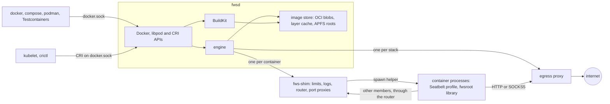

# fun-with-sandboxes

fws is a container engine for macOS. It runs Docker Compose stacks side by
side on one Mac, without root and without a virtual machine. It serves the
Docker Engine API, Podman's API and Kubernetes' Container Runtime
Interface, so the stock `docker` CLI, `docker compose`, `podman`,
Testcontainers and kind drive it unchanged.

Each container is a process tree on the Mac, confined by a generated
[Seatbelt](docs/SEATBELT.md) profile and rooted in an APFS copy-on-write
clone of its image. A container starts in milliseconds and costs only its
processes. Each Compose project, a *stack*, gets its own block of host
ports and its own directory tree, so two stacks never clash and never see
each other.

fws is for running a project's tests and services locally. It is not a
boundary against untrusted or multi-tenant code.

## How it fits together

One daemon, `fwsd`, serves the APIs and keeps images; each running
container is a supervisor process and the container's own processes,
which load a library that presents the container's root, users and
network. [ARCHITECTURE](docs/ARCHITECTURE.md) describes each part.



## Quick start

On a Mac with Apple silicon, Go and the Xcode Command Line Tools
(`xcode-select --install`):

```bash
go install github.com/e6qu/fun-with-sandboxes/cmd/...@latest
```

```bash
fwsd
```

In another terminal:

```bash
export DOCKER_HOST=unix://$HOME/.fws/docker.sock
```

```bash
docker pull ghcr.io/e6qu/fws-python:3.14 && docker tag ghcr.io/e6qu/fws-python:3.14 fws/python:3.14
```

```bash
docker run --rm fws/python:3.14 python3 -c 'print("hello from a container")'
```

Containers run macOS programs, so images are `darwin/arm64`; Linux images
from Docker Hub do not run. fws comes with a catalog of darwin images:
databases, brokers, services, language toolchains, AWS Lambda runtimes,
Playwright, Docker in Docker, Kubernetes and kind, and `fws/base` to build
`FROM`.

## What drives it

CI runs each of these against the engine on macOS:

- the Docker CLI, Docker Compose (with `watch`), buildx and BuildKit;
- Testcontainers for Go, Java, Python, Node.js, Bun and Rust;
- Podman's remote client, `podman-compose`, pods and `podman kube play`;
- the Dev Containers CLI and VS Code's Dev Containers extension;
- Playwright, with Chromium and Firefox;
- graphical applications, Electron's and VS Code among them;
- `crictl`, the kubelet, kind and k3s.

## Documentation

| Document | What it covers |
|---|---|
| [USAGE](docs/USAGE.md) | installing and running the engine, each client, use cases, troubleshooting |
| [IMAGES](docs/IMAGES.md) | the image catalog and each image's reference |
| [IMAGE-AUTHORING](docs/IMAGE-AUTHORING.md) | writing Dockerfiles `FROM` the catalog; adding, changing and updating catalog images |
| [LIMITATIONS](LIMITATIONS.md) | where fws differs from Docker, and why |
| [ARCHITECTURE](docs/ARCHITECTURE.md) | the map: processes, components, flows, boundaries |
| [DESIGN](docs/DESIGN.md) | how each mechanism works |
| [SEATBELT](docs/SEATBELT.md) | the macOS sandbox and each container's profile |
| [CONTRIBUTING](CONTRIBUTING.md) | developing fws: setup, tests, CI, rules |
| [PLAN](PLAN.md) | purpose, constraints, non-goals, status |
| [HISTORY](docs/HISTORY.md) | how the project got here |
