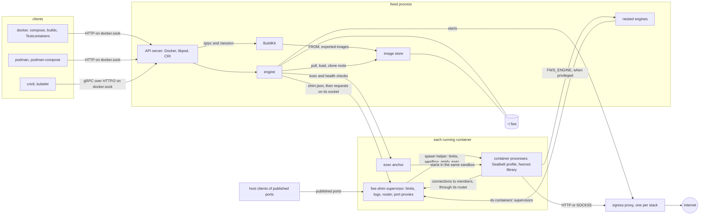
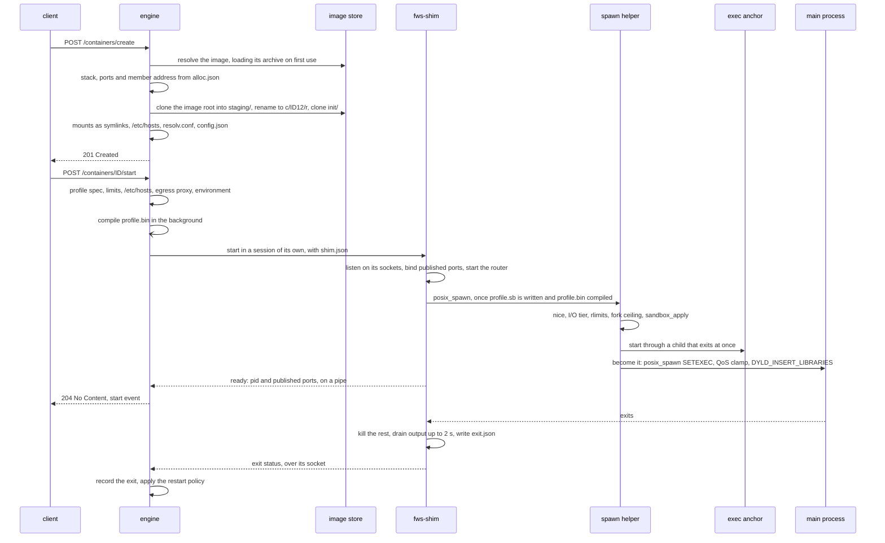
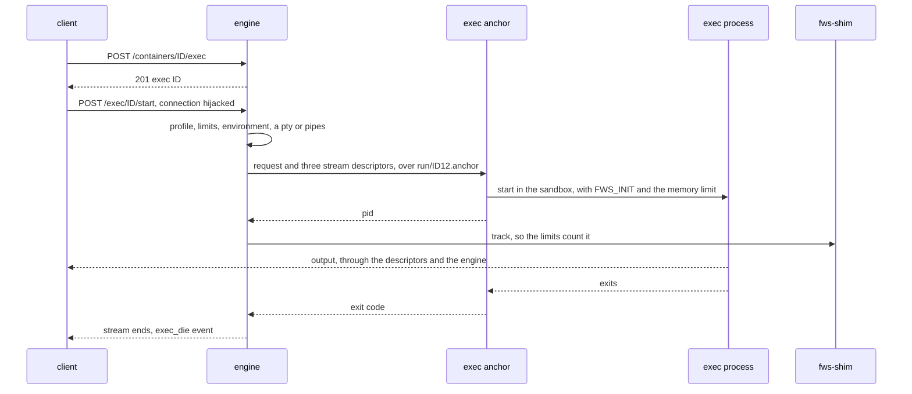
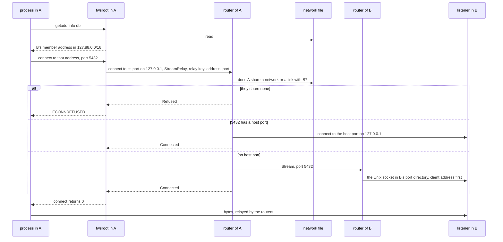
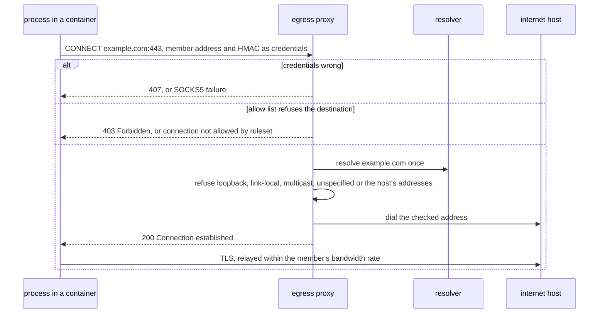
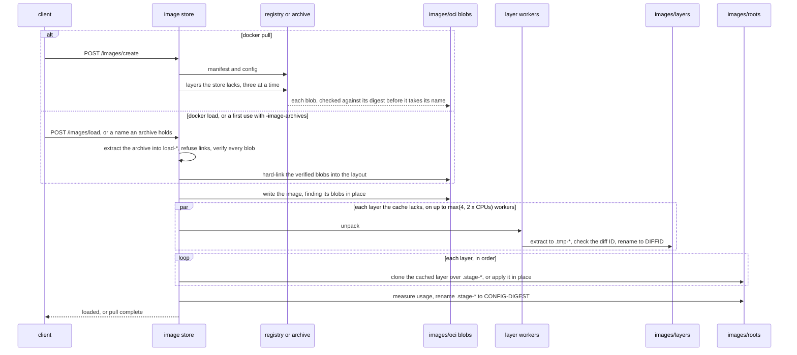
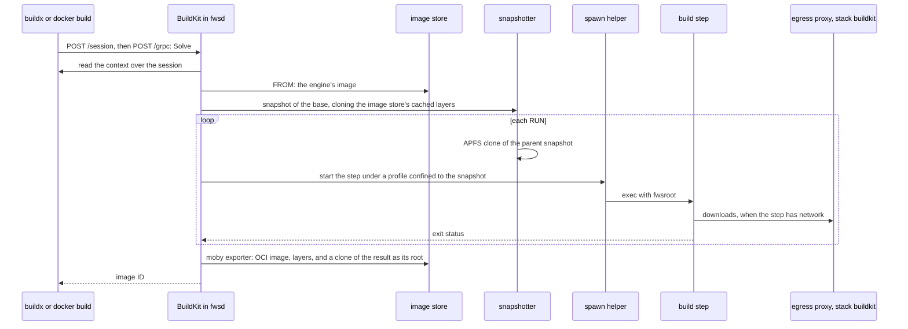
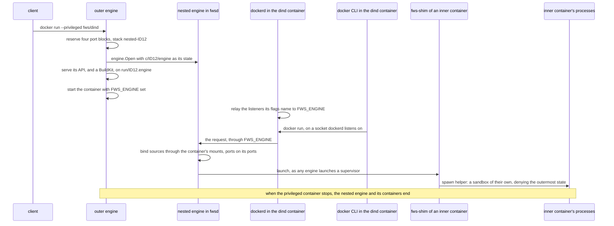
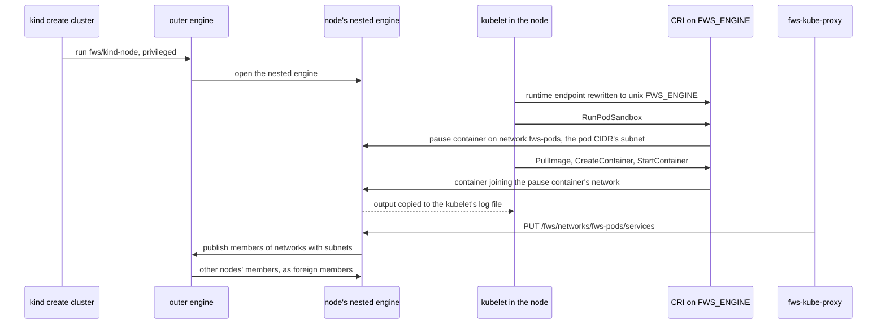

# Architecture

The map of fws: its processes and packages, what each owns, what passes
between them, and how a request travels through them. Each section links
to [DESIGN](DESIGN.md), which holds the mechanisms in detail, and to
[SEATBELT](SEATBELT.md) for the sandbox profile. [LIMITATIONS](../LIMITATIONS.md)
lists where the result differs from Docker.

1. [Overview](#overview)
2. [Components](#components): [fwsd](#fwsd), [the API server](#the-api-server),
   [the engine](#the-engine), [the image store](#the-image-store),
   [builders](#builders), [the CRI](#the-cri),
   [nested engines](#nested-engines), [the supervisor](#the-supervisor),
   [the runtime and the spawn helper](#the-runtime-and-the-spawn-helper),
   [Seatbelt profiles](#seatbelt-profiles),
   [the container library](#the-container-library),
   [the router](#the-router), [the egress proxy](#the-egress-proxy),
   [port proxies](#port-proxies), [the catalog](#the-catalog),
   [packages](#packages), [state on disk](#state-on-disk)
3. [Flows](#flows): [create and start](#container-create-and-start),
   [exec](#exec), [a connection between members](#a-tcp-connection-between-stack-members),
   [egress](#egress-to-the-internet),
   [pull, load and unpack](#image-pull-load-and-unpack),
   [docker build](#docker-build-through-buildkit),
   [a nested engine](#a-privileged-containers-nested-engine),
   [Kubernetes](#kubernetes-through-the-cri)
4. [Security boundaries](#security-boundaries)
5. [Performance](#performance)
6. [Failure handling and restart](#failure-handling-and-restart)

## Overview

fws runs on one Mac as the invoking user, with no virtual machine and no
privileged helper. One daemon, `fwsd`, serves the Docker Engine API,
Podman's libpod API and Kubernetes' CRI on one Unix socket. Each running
container is a tree of ordinary host processes: a supervisor process
(`fws-shim`) starts the container's main process through a small C spawn
helper, which applies the container's Seatbelt profile and loads the
container library, `fwsroot`, into every process. The kernel enforces the
profile; the library presents the container's root at `/`, its users, its
network and its processes. Each Compose project, a *stack*, holds a block
of host ports and a directory tree of its own.



The processes, which binary runs each, and how many there are:

| Process | Binary | How many | Started by | Outlives `fwsd` |
|---|---|---|---|---|
| Engine, API server, BuildKit, CRI, nested engines | `fwsd` | one | the user | — |
| Supervisor, with the container's router and port proxies | `fws-shim` (role `shim`) | one per running container | the engine | yes |
| Exec anchor | `fws-shim` (runtime's anchor role) | one per running container | the spawn helper, inside the sandbox | yes |
| Spawn helper | `lib/` helper built from `spawn.c` | one per process start, then it becomes the process | the supervisor | — |
| Egress proxy | `fws-shim` (role `egress`) | one per stack with internet access, one for builds | the engine | yes |
| Container processes | the image's programs, with `fwsroot` loaded | any | the spawn helper, the anchor, or each other | yes |
| `docker-init`, `fws-memexec` | `fws-shim` under those names | as needed | the container | — |

`fwsd` holds only the engine's in-memory state and its open sockets: every
supervisor, anchor and egress proxy is a process of its own, so an engine
started with `-live-restore` can stop and come back without stopping a
container ([failure handling](#failure-handling-and-restart)).

## Components

### fwsd

`cmd/fwsd/main.go`. Parses the flags ([USAGE](USAGE.md)), refuses to run
as root, finds `fws-shim` beside its own binary and registers it as the
binary for helper roles (`roles.Use`), opens the engine
(`engine.Open`), starts BuildKit, and serves the API on the socket. The
socket is bound in a private directory, made `0600` and only then renamed
into place (`listenPrivate`). One HTTP server speaks HTTP/1.1 and
unencrypted HTTP/2 on it. In the background it compiles the container
library and spawn helper with clang into `lib/`, so the first container
does not wait for it. On `SIGINT` or `SIGTERM` it shuts the server down and
closes the engine, which stops every container unless `-live-restore` is
set. `cmd/fwsd` also supplies the engine with `Serve`, the function that
serves a nested engine's API, with a BuildKit of its own, on a socket.

### The API server

`internal/api` (`server.go`, `images.go`, `archive.go`, `stream.go`,
`diskusage.go`, `libpod*.go`). One `api.Server` is the socket's HTTP
handler:

- A request over HTTP/2 with a gRPC content type goes to the CRI
  (`cri.Serves`).
- `POST /grpc` and `POST /session` go to BuildKit.
- Everything else is Docker's API, with or without a `/v1.xx` prefix, or
  Podman's under `/libpod`. Podman's endpoints that speak Docker's
  protocol pass to Docker's handlers; the rest translate Podman's shapes,
  and pods live in `pods.json`.

The handlers decode requests into `github.com/moby/moby/api` types, call
the engine, and encode its answers; attach, exec, logs, events and builds
hijack or stream the connection. Errors carry the engine's kind
(`engine.KindOf`) to Docker's status codes. The endpoint list is
[DESIGN §8](DESIGN.md#8-docker-engine-api-surface).

### The engine

`internal/engine`. `engine.Engine` (`engine.go`) is containers, volumes,
networks, execs, services, events, health checks, the classic builder and
the machine guards. Its main files:

| File | Holds |
|---|---|
| `engine.go` | `Open`, `Close`, the engine's maps and locks |
| `container.go` | create, start, stop, remove, `watch`, the restart policy, the shim's sockets |
| `exec.go`, `health.go` | execs and health checks, through the anchor |
| `networks.go`, `members.go`, `links.go`, `hosts.go` | networks, member addresses, the stack's network file, `/etc/hosts` |
| `egress.go` | each stack's egress proxy |
| `publish.go` | the published-port plan the shim binds |
| `nested.go`, `peers.go`, `services.go`, `nodeudp.go` | nested engines, cross-node pods, virtual services |
| `security.go`, `resources.go`, `cpuset.go`, `quota*.go`, `iopolicy.go` | profile grants and limits, refused options |
| `guard*.go` | the machine guards |
| `build.go`, `buildcache.go` | the classic builder |
| `imageops.go`, `registry.go`, `remote.go` | pulls, pushes, commits, `docker login`, remote build contexts |

It takes port blocks and stack directories from `internal/alloc`
(`alloc.json`), writes each stack's network file through
`internal/members`, renders each container's profile with
`internal/seatbelt`, and launches supervisors with `internal/shim`.

**Locking.** `Engine.mu` (a `timedMutex`, which logs long waits and holds
under `-debug`) guards the maps of containers, volumes, networks and
execs. Each `Container` has its own `mu` for its record and run, and
`nameMu` for its name alone, so publishing an event never waits on
either. `egressMu`, `nestedMu` and `pidnsMu` order egress proxies, nested
engines and PID namespace files; `buildMu` is held shared by classic
builds and exclusively by a prune of their cache. Work proportional to an
image's file count, cloning and deleting roots, runs outside every lock in
`staging/` and `trash/`, and only the `rename` into or out of place runs
under it. The outer engine takes no nested engine's lock while holding its
own.

### The image store

`internal/image`. `image.Store` (`store.go`) keeps every image as an OCI
image in an image layout (`images/oci`), with the index of records in
`images/images.json`, a cache of unpacked layers in `images/layers`
(`layers.go`), and each image's root in `images/roots/<config digest>`.

- **In:** registry pulls (`Pull`, three layers at a time), `docker load`
  and `-image-archives` archives (`Load`, `archives.go`), committed and
  built images with a root already made (`Add` with a root).
- **Out:** roots that containers and the classic builder clone
  (`Clone`, `clone_darwin.go`), images for push and save (`V1Image`,
  `push.go`), cached layers that BuildKit's snapshots clone
  (`CloneCachedLayer`).
- **Layers:** `layer.go` extracts a tar stream safely (`ApplyLayer`,
  `ExtractLayer`, `Extract`); `merge.go` lays a cached layer over a root
  (`MergeLayer`); `changes.go` and `tar.go` diff a root against its
  `init` clone and write layers back.

**Locking.** `Store.mu` guards the index. `Store.blobs` is held shared
while an image's blobs are written and exclusively while unreferenced
blobs are collected, so a collection never takes a blob an add is about to
record. A layer is unpacked into a temporary directory and takes its name
by `rename`; two loads of the same layer race only for the name, and the
loser uses the winner's. Each archive of `-image-archives` loads once
(`sync.Once`), whoever asks first. The [pull, load and unpack
flow](#image-pull-load-and-unpack) shows the path;
[DESIGN §4](DESIGN.md#4-image-and-root-filesystem) has the rules.

### Builders

Two builders write into the image store:

- **BuildKit** (`internal/buildkit`), embedded in `fwsd`, serves
  `POST /grpc` and `POST /session` for buildx, `docker build` and
  `docker compose build`. Its darwin worker (`service.go`) brings a
  directory snapshotter of APFS clones (`snapshotter.go`), an applier that
  clones layers the image store has cached (`diff.go`), an executor that
  starts each step through the runtime under a Seatbelt profile
  (`executor.go`), the engine's images as its image store (`images.go`),
  and the `moby` exporter that stores results in the engine
  (`exporter.go`). Its state is `buildkit/`. The BuildKit packages are
  vendored in `third_party/buildkit` with patches
  ([DESIGN, BuildKit](DESIGN.md#buildkit)).
- **The classic builder** (`internal/engine/build.go`,
  `internal/dockerfile`) serves `POST /build` for `DOCKER_BUILDKIT=0`,
  with its step cache in `buildcache/`
  ([DESIGN, the classic builder](DESIGN.md#the-classic-builder)).

Both run steps with internet access through an egress proxy of a stack the
build owns: `buildkit` for BuildKit, a stack per classic build.

### The CRI

`internal/cri` serves the Container Runtime Interface's runtime and image
services over the engine, as cri-dockerd serves them over Docker's: a pod
sandbox is a pause container (`fws/pause:3.10.2`) on the network
`fws-pods`, and each of the pod's containers joins its network as
`--network container:` does. It keeps each CRI object's identity in
labels on the engine's containers (`fws.cri.*`), copies container output
to the kubelet's log files in CRI's format (`logs.go`), and serves exec,
attach and port-forward streams on a loopback port (`streaming.go`).
`internal/containerd` reads a kind node's containerd configuration for
registry mirrors. `cmd/fws-kube-proxy` runs in a node and keeps the
engine's virtual services (`internal/engine/services.go`) in step with the
cluster's Services ([DESIGN, Kubernetes](DESIGN.md#kubernetes)).

### Nested engines

`internal/engine/nested.go`, `peers.go`. A privileged container gets an
`engine.Engine` of its own inside `fwsd`, as a `docker:dind` container
runs `dockerd`: its state under the container's directory (`engine/`), its
run directory under the outer one (`run/<id12>/`), a range of four of the
outer engine's port blocks cut into smaller stacks, and its API, with a
BuildKit of its own, served by `fwsd` on `run/<id12>.engine`, which the
container's processes find in `FWS_ENGINE`. `engine.Nested` is everything
the nested engine borrows from the outer one: the container library, the
outermost state root (which no container reads), path resolution through
the container's mounts, port placement on the container's ports, dialling
and resolving on the container's networks, and the peer members of other
nodes. macOS refuses a second Seatbelt profile to a sandboxed process, so
the nested engine's containers are not the privileged container's
children: they are host processes under supervisors of their own, each in
a sandbox of its own. A nested engine and its containers end with the
privileged container. The [nested engine flow](#a-privileged-containers-nested-engine)
shows the path.

### The supervisor

`internal/shim` (`server_darwin.go`, `enforce_darwin.go`, `protocol.go`,
`client.go`), run as `fws-shim` with the role `shim`. The engine writes a
`shim.Config` to the container's `shim.json` and starts the supervisor in
a session of its own (`shim.Launch`); the supervisor answers on a
descriptor that it is ready, with its pid and the published ports it
bound. It then owns, for the container's run:

- the main process, started through the runtime, and its exit status,
  written to `exit.json`;
- its output, into the json-file log `log.jsonl` (`internal/logfile`), and
  its pty;
- the container's [router](#the-router) and [port proxies](#port-proxies);
- the limits: it follows the container's processes through kqueue
  `NOTE_FORK` events and the `SANDBOX_ROOT` tag (`internal/procs`), samples
  them every 100 ms when a limit is set, and kills, stops or refuses at
  the memory, CPU and pids limits; it answers the library's process count
  on the `.pids` socket and, for a shared PID namespace, its process table
  on the `.procs` socket (`internal/pidns`);
- network counters, from macOS's network statistics socket
  (`internal/netstat`).

The engine talks to it over `run/<id12>.sock` with one JSON request per
connection (`shim.Request`: `wait`, `state`, `signal`, `resize`, `pause`,
`unpause`, `update`, `track`, `stdin`, `logs`). The supervisor's own log
is `shim.log`. [DESIGN §3a](DESIGN.md#supervising-a-container) has the
limits in detail.

### The runtime and the spawn helper

`internal/runtime` (`start_darwin.go`, `compiled_darwin.go`,
`anchor_darwin.go`, `memexec_darwin.go`, `init.go`) and
`internal/pathmap/src/spawn.c`. `runtime.Start` takes a `runtime.Spec`
(root, argv, environment, profile, limits, library, streams) and starts
the process one of two ways:

- **Through the spawn helper**, for a container's main process and every
  build step: it resolves the program inside the root, writes the
  profile's text (`profile.sb`), finds or compiles its bytecode
  (`profile.bin`, keyed by the text's SHA-256 and `kern.osversion`), and
  `posix_spawn`s the helper with responsibility disclaimed. The helper
  sets the nice value, I/O tier, rlimits and fork ceiling, applies the
  bytecode with `sandbox_apply`, starts the exec anchor, and becomes the
  program with `POSIX_SPAWN_SETEXEC`, a QoS clamp and the library in
  `DYLD_INSERT_LIBRARIES`.
- **Through the exec anchor**, for `docker exec` and health checks: it
  sends the anchor the request and the three stream descriptors over the
  anchor's socket; the anchor, already inside the sandbox, starts the
  program, reports its pid, and later its exit code.

`runtime.Precompile` starts the compile while the supervisor starts, and
holds a lock file so the start waits for it rather than compiling again.
`init.go` is `docker-init`; `memexec_darwin.go` is `fws-memexec`, which
starts a Go program's children under the memory limit.
[DESIGN, starting a process](DESIGN.md#starting-a-process) has the detail.

### Seatbelt profiles

`internal/seatbelt/profile.go` renders a container's profile text from a
`seatbelt.Spec` the engine builds (`internal/engine/security.go`): its
root, volumes and their modes, port directory, ports, router and egress
ports, the stack's block, IPC prefix, the shim's sockets, and the flags a
container was created with. `internal/libsystem` compiles it
(`sandbox_compile_string`). The kernel enforces it from the spawn helper
on, for the process and every descendant. [SEATBELT](SEATBELT.md)
describes each section of the profile.

### The container library

`internal/pathmap/src/fwsroot.c`, built with `internal/pathmap/pathmap.go`
into `lib/`. Loaded into every container process, it interposes libSystem's
path, identity, user database, hostname, socket, DNS and process calls.
It reads its configuration from the environment the engine sets
(`SANDBOX_ROOT`, `FWS_MOUNTS`, `FWS_PORTS`, `FWS_PORTDIR`, `FWS_ROUTER`,
`FWS_NETWORK`, `FWS_ADDRESS`, `FWS_PIDS`, `FWS_PROCS`, `FWS_INIT` and
others), hides those variables from the program, and hands them on to
every program it starts. It talks to the container's router, to the
supervisor's `.pids` and `.procs` sockets, and reads the stack's network
file; it talks to nothing else of the engine. It presents; it does not
enforce: Seatbelt still decides every access by the engine's user
([security boundaries](#security-boundaries)).
[DESIGN, the container library](DESIGN.md#the-container-library) and
[DESIGN §6](DESIGN.md#6-networking-without-root-or-a-network-stack) have
the detail.

### The router

`internal/router`, run inside each container's supervisor on a port of
the stack's block. It is the only loopback port besides the container's
own and its egress proxy that the container's profile lets it connect to.
A request is a byte naming its kind, then what the kind names:

| Kind | Does |
|---|---|
| `Stream` | joins the connection to a listener of the container's own on a port without a host port: the Unix socket in its port directory, after the client's address |
| `StreamRelay` | with the relay key from the port directory: carries the connection to a member that shares a network with the container, at the member's host port or through the member's router |
| `Flow`, `FlowRelay` | the UDP equivalents: a flow port for a port without a host port, or a relay port to a member's UDP port |
| `Echo` | an ICMP echo to a host outside the machine, for a container with internet access |
| `Resolve`, `DNSStream` | DNS: the stack's names, and others through the container's `resolv.conf` servers when it has internet access |

The router reads the stack's network file to decide whether two members
share a network (`members.Sees`), so network membership is enforced by a
process outside the sandbox, not by the library. It holds the container's
bandwidth limits on the streams it carries (`internal/bandwidth`).

### The egress proxy

`internal/egress`, one `fws-shim` process (role `egress`) per stack with
internet access, on a port of the stack's block, started by
`Engine.ensureEgress`. It serves HTTP proxying and, on the same port,
SOCKS5 `CONNECT`. A client names itself by its member address and an
HMAC-SHA256 of it under the stack's key (`run/egress-<stack>.key`). The
proxy resolves each destination once, refuses any address that reaches the
host, and dials the address it checked; it applies the allow lists
(`network.allow`) and bandwidth rates (`network.rates`) the engine writes
beside the network file. The engine records the proxy in
`run/egress-<stack>.json` and its log in `run/egress-<stack>.log`, so the
next engine reuses a proxy still serving the same port, network file and
key.

### Port proxies

`internal/portproxy`, inside the supervisor, outside the sandbox. For each
`ports:` entry it binds the real host listener (TCP, or UDP as
`docker-proxy` does) and forwards to the container's host port, or to the
Unix socket in its port directory for a port without one. A taken port
fails the start with Docker's "port is already allocated". The
`fws.ingress.allow` label filters sources here.

### The catalog

The darwin images containers run come from the catalog, built outside the
engine:

- `images/<name>/`: each image's spec (`image.json`), entry program and
  Nix inputs; `images/catalog/*.nix` pin releases nixpkgs lacks.
- `scripts/build-images.sh` builds the Nix closures and runs
  `cmd/fws-mkimage`, which relocates each closure to load by relative
  paths, re-signs it, and writes an OCI image archive with a layer per
  store path.
- `internal/catalog` lists the images and tags, for `fws catalog`
  (`cmd/fws`) and CI's publish check; `scripts/publish-images.sh` pushes
  them to `ghcr.io/e6qu/fws-*`.

The engine loads those archives with `docker load`, `fwsd -image-archives`
or a pull. [IMAGE-AUTHORING](IMAGE-AUTHORING.md#how-a-catalog-image-is-built)
has the build, with a diagram of its stages, and [IMAGES](IMAGES.md) the
images.

### Packages

```
cmd/fws/              # the command line: fws catalog lists the image catalog
cmd/fwsd/             # the daemon: Docker Engine, libpod and CRI APIs over a unix socket
cmd/fws-shim/         # the helper binary: supervisors, exec anchors, egress proxies,
                      #   docker-init, fws-memexec
cmd/fws-mkimage/      # Nix closure -> darwin image archive
cmd/fws-kube-proxy/   # kube-proxy for a node whose runtime is the engine
internal/alloc/       # per-stack port blocks and directories
internal/api/         # the Docker Engine API and Podman's libpod
internal/bandwidth/   # token buckets for the bandwidth labels, in routers and egress proxies
internal/buildkit/    # embedded BuildKit with a darwin worker
internal/catalog/     # the image catalog: names, tags, kinds, where each is published
internal/containerd/  # a kind node's containerd configuration: registry mirrors and hosts
internal/cri/         # the Kubernetes Container Runtime Interface
internal/dockerfile/  # Dockerfile parsing and variable expansion
internal/egress/      # the per-stack HTTP and SOCKS5 proxy to the internet
internal/engine/      # containers, volumes, networks, services, exec, health, events, guards
internal/execpath/    # finding a container's executables, as execve and a shell do
internal/identity/    # users and groups from the container's /etc/passwd
internal/image/       # image store, layer extraction, clonefile roots
internal/libsystem/   # libSystem calls syscall does not offer (posix_spawn, I/O policy,
                      #   sandbox_compile_string)
internal/logfile/     # json-file logs
internal/members/     # a stack's network file: member addresses and names
internal/netstat/     # per-socket network counters for docker stats
internal/pathmap/     # fwsroot, the container library, the spawn helper, and their build
internal/pidns/       # PID namespaces containers share, through their shims
internal/portproxy/   # published host ports, TCP and UDP
internal/procs/       # the host process table: the shim's member tracking, top and stats
internal/roles/       # the helper processes the engine's binary runs
internal/rootfs/      # chroot-style path resolution inside a root
internal/router/      # traffic to container ports without host ports, relays, DNS, ICMP echo
internal/runtime/     # starting container processes through the spawn helper; the
                      #   compiled-profile cache; the exec anchor; docker-init
internal/sandboxenv/  # the container side of the SANDBOX_* contract
internal/seatbelt/    # Seatbelt profile rendering
internal/shim/        # a container's supervisor: limits, output, live restore
third_party/buildkit/ # the BuildKit packages it uses, patched (sync-buildkit.sh)
images/               # entrypoints and Nix specs for the darwin catalog
tests/e2e/            # Docker CLI, Compose and Testcontainers end-to-end suite (own module)
```

### State on disk

Everything lives under `-root`, `~/.fws` by default, resolved through
symlinks at start-up because Seatbelt matches resolved paths.
[DESIGN, Layout](DESIGN.md#layout) lists every file; who writes and who
reads each part:

| Path | Written by | Read by |
|---|---|---|
| `docker.sock` | `fwsd` | clients |
| `alloc.json`, `networks.json`, `volumes.json`, `pods.json` | the engine, the API server (`pods.json`) | the engine at start-up |
| `lib/` | the engine, with clang | the spawn helper, every container process |
| `run/` | the engine, supervisors, anchors, egress proxies | the engine, the container library (its own sockets only) |
| `images/` | the image store | the image store, BuildKit's applier |
| `stacks/<stack>/network` and `.allow`, `.rates` | the engine | the container library, routers, egress proxies |
| `stacks/<stack>/c/<id12>/` | the engine, the container's supervisor | the engine, the container (its `r/` root only) |
| `volumes/` | the engine, containers | containers that mount them |
| `staging/`, `trash/` | the engine | — (cleared at start-up) |
| `buildcache/`, `buildkit/` | the two builders | the two builders |

A container's profile lets it read its own root, volumes, port directory
and network file, and nothing else of the state.

## Flows

### Container create and start

`Engine.Create` and `Container.start` in `internal/engine/container.go`,
`shim.Launch` and `server_darwin.go` in `internal/shim`,
`runtime.Start` in `internal/runtime/start_darwin.go`, and
`internal/pathmap/src/spawn.c`. [DESIGN §9](DESIGN.md#9-runtime-launch-sequence)
lists the steps.



A privileged container's nested engine opens before the supervisor
starts ([below](#a-privileged-containers-nested-engine)).

### Exec

`Engine.ExecStart` in `internal/engine/exec.go`, `runtime.Start` with an
anchor, and `serveExec` in `internal/runtime/anchor_darwin.go`. Health
checks take the same path (`health.go`).



The anchor is inside the container's sandbox, so the exec is too: Seatbelt
lets it signal and inspect the container's processes, as `docker exec`
does in the container's namespaces.

### A TCP connection between stack members

`routed` and `route` in `fwsroot.c`, `Router.join` and `Router.foreign`
in `internal/router/router.go`. Container A connects to `db:5432`, a port
of member B:



Seatbelt lets A connect to no member's port or router directly, so every
member connection takes this path. Another stack's member on a shared
network is reached the same way, listed as foreign in A's network file.
[DESIGN §6](DESIGN.md#6-networking-without-root-or-a-network-stack) has the
diagram of every destination a `connect` can name.

### Egress to the internet

`internal/egress/egress.go`, `socks.go`, `allow.go`. The engine gives each
container with internet access `HTTP_PROXY`, `HTTPS_PROXY`, `ALL_PROXY`
and `NO_PROXY` naming its stack's proxy, with the container's credentials:



A container connects to nothing outside loopback itself: its profile
allows only the proxy's port. DNS queries a program sends itself go to its
router, which forwards them upstream only for a container with internet
access.

### Image pull, load and unpack

`Pull`, `Load`, `add`, `unpack` and `cacheLayers` in
`internal/image/store.go`; `cacheLayer` and `layLayer` in `layers.go`;
`verifyBlobs` in `verify.go`; `MergeLayer` in `merge.go`.



The steps in order:

1. **Blobs.** A pull downloads only the blobs the layout lacks, three at a
   time, as dockerd does. A load extracts the archive into a directory
   `load-*` beside the layout, refuses an index, layout or blob that is a
   link, verifies every blob against its digest, and hard-links the
   verified blobs into `images/oci/blobs` rather than copying them, so
   writing the image finds them in place.
2. **Layer cache.** The layers the cache lacks unpack at once, on
   `min(layers, max(4, 2 x CPUs))` workers: unpacking waits on the file
   system more than on the processor. Each unpacks into a directory of its
   own and is checked against the config's `rootfs.diff_ids`; a layer that
   fails here is unpacked again as the root is laid, which reports why.
3. **Root.** The layers are laid over an empty tree in order, each
   directory the tree lacks one `clonefile` of the layer's subtree; a
   layer with a hard link into a lower layer applies in place.
4. **Record.** The store measures the root's disk usage, renames the stage
   into `images/roots/<config digest>` and records the image.

A load that takes a second or more logs
`image archive X: extracted …, blobs verified …`, and an unpack that takes
a second or more logs
`image <id> unpacked: blobs …, N of M layers unpacked …, merged …, usage …`.
[DESIGN, Layers and roots](DESIGN.md#layers-and-roots) has the rules.

### docker build through BuildKit

`internal/buildkit`: `service.go`, `images.go`, `diff.go`, `executor.go`,
`snapshotter.go`, `exporter.go`.



The classic builder (`POST /build`) follows the same shape inside the
engine, with a root clone per stage and a layer per step
([DESIGN, the classic builder](DESIGN.md#the-classic-builder)).

### A privileged container's nested engine

`openNested` in `internal/engine/nested.go`, `serveNested` in
`cmd/fwsd/main.go`.



A kind or k3s node is the same nested engine with a kubelet as its client
instead of `dockerd`.

### Kubernetes through the CRI

`internal/cri`, `images/kind-node/entry`, `cmd/fws-kube-proxy`,
`internal/engine/services.go` and `peers.go`.



`crictl` and a kubelet on the host talk to the CRI on `docker.sock` the
same way, with the outer engine as their runtime.

## Security boundaries

fws keeps a project's containers from one another and from the user's
data, against mistakes rather than attackers; it is not a boundary against
hostile code ([DESIGN, what it is not](DESIGN.md#what-it-is-not)). Three
kinds of mechanism hold a container, and only the first two enforce:

| Mechanism | Where it runs | What it holds |
|---|---|---|
| **Seatbelt**, the kernel | every container process, from the spawn helper on | file reads and writes outside the root, volumes and system tree; binds and connections outside the container's ports, router and egress proxy; signals and process information outside the sandbox; Mach services, IPC names, IOKit, preferences |
| **Processes outside the sandbox** | the supervisor, router, egress proxy, port proxies, engine | memory, CPU and pids limits; network membership (the router's check); internet access, allow lists and bandwidth; ingress allow lists; the options the engine refuses |
| **The container library**, inside the process | `fwsroot` in every container process | presents the root at `/`, users, owners and modes, hostname, ports, interfaces, routes, name resolution and the process tree; a program that does not load it, or bypasses it with raw system calls, sees the host's view, still confined by the first two |

What a container could reach without the library is what Seatbelt allows:
its root, volumes, the system tree and its own ports. The engine's state,
`$HOME` and other stacks' files and ports stay denied either way.
[SEATBELT](SEATBELT.md) lists the profile's rules and
[DESIGN, accepted exceptions](DESIGN.md#accepted-exceptions) what a
container can read of the host; [LIMITATIONS](../LIMITATIONS.md#isolation)
lists what is presented without being enforced.

## Performance

- **Start.** A process start costs about 3.4 ms natively to reach `main`
  and about 7 ms with any library inserted, plus about 4 ms for fwsroot's
  interposing ([DESIGN §9](DESIGN.md#9-runtime-launch-sequence),
  `BenchmarkStartCost`). Compiling a profile takes libsandbox about
  15 ms and applying its bytecode about 35 µs, so the compiled profile is
  kept and its compile overlaps the supervisor's start. The engine logs
  each create and start step's time under `-debug`.
- **Interposed calls.** `stat` and `open` of a file the container holds
  run within about a microsecond of native (`BenchmarkCalls`, run by CI on
  macOS). The library reads its extended attributes only for files marked
  `UF_NODUMP`.
- **Roots.** A container's root is an APFS clone: constant time per file,
  near zero bytes. Cloning and deleting roots run outside the engine's
  lock.
- **Loads.** Blobs of a loaded archive are hard-linked into the layout
  rather than copied; uncached layers unpack in parallel; extraction
  remembers the parent directories it has checked, rather than checking
  each entry's parents again, and sets a file's mode and recorded owner
  through its open descriptor rather than its path. A pull downloads three
  layers at a time and only those the store lacks. With `-image-archives`
  an archive loads the first time one of its names is asked for. The slow
  load and unpack log lines above say where a load's time went.
- **Machine.** Every container process runs at most at the QoS
  `-qos-clamp` names (`utility` by default), so containers yield to the
  user's interactive work; the machine guards pause the heaviest container
  under memory pressure or a full disk.

## Failure handling and restart

- **Live restore.** Supervisors, anchors and egress proxies are processes
  of their own. With `-live-restore`, `fwsd` stops without stopping them;
  the next engine reads each container's `config.json`, connects to its
  supervisor's socket, follows its run again (`attachTaskLocked` with
  `reconnect`), reopens privileged containers' nested engines and reuses
  egress proxies whose record still matches. Without it, the engine stops
  its containers as it stops, and kills any a crashed engine left running
  as it starts.
- **Lost supervisors.** A container recorded as running whose supervisor
  is gone takes its exit from `exit.json`; without one, the engine kills
  every process carrying the container's `SANDBOX_ROOT` tag and records
  exit code 255 (`lostExit`).
- **Restart policies.** `always` and `unless-stopped` containers start
  again when the engine opens; a container that exits follows Docker's
  back-off.
- **Crash leftovers.** At start-up the engine deletes, in the background,
  what `staging/` and `trash/` hold; the image store moves to its trash
  unfinished stages, builds, loads, downloads and layers (`sweep.go`).
  Every record is written to a temporary file and renamed, and a cached
  layer's record before its directory takes its name.
- **Ending a container.** When the main process exits, the supervisor
  kills the rest of the container, drains output for up to 2 s, then
  records the exit, so an escaped descendant cannot hold the container
  running.
- **Fallbacks.** Where macOS refuses compiled bytecode, the spawn helper
  compiles the text with `sandbox_init`. A layer that fails to unpack into
  the cache is applied again as the root is laid, which reports the error.
  A root on a size-quota disk image is attached again when the engine
  loads its container after the Mac restarts.
