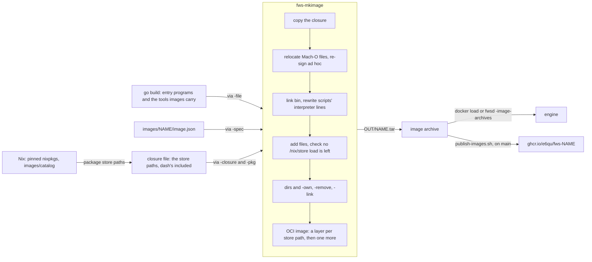

# Image authoring

How to make fws images: the rules an image follows, how to write a
Dockerfile `FROM` the catalog, and how to add, change, update, build, test
and publish a catalog image. [IMAGES](IMAGES.md) is the catalog and each
image's reference.

The key words "MUST", "MUST NOT", "REQUIRED", "SHALL", "SHALL NOT", "SHOULD", "SHOULD NOT", "RECOMMENDED", "MAY", and "OPTIONAL" in this document are to be interpreted as described in [RFC 2119](https://www.rfc-editor.org/info/rfc2119).

- [The container contract](#the-container-contract)
- [Write a Dockerfile FROM fws images](#write-a-dockerfile-from-fws-images)
- [Catalog images](#catalog-images)
- [Add an image](#add-an-image)
- [Change an image](#change-an-image)
- [Update an image to a new upstream release](#update-an-image-to-a-new-upstream-release)
- [Adapt an upstream image's behaviour](#adapt-an-upstream-images-behaviour)
- [Build, load and publish](#build-load-and-publish)
- [Test an image](#test-an-image)
- [Troubleshoot](#troubleshoot)
- [How a catalog image is built](#how-a-catalog-image-is-built): [the build script](#the-build-script), [pinned releases](#nix-expressions-and-pinned-releases), [fws-mkimage](#fws-mkimage), [the spec](#the-spec-imagesnameimagejson), [entry programs](#entry-programs), [the catalog list](#the-catalog-list-and-the-docs-table)

## The container contract

An image's programs run as processes on the Mac, under Seatbelt, in a
root directory of their own. macOS gives an unprivileged process no
private `/` and no private network stack, so a container cannot own
`/var/lib/postgresql/data` or port 5432. The container library, which the
engine loads into every container process, presents both: it maps the
container's paths into its root and its exposed and published ports onto
host ports on loopback. The engine also tells the container where its
things are:

| Variable | Meaning |
|---|---|
| `SANDBOX_ROOT` | the container's root directory on the host; image paths live under it |
| `SANDBOX_PORT_<n>` | the loopback host port of container port `<n>`, for a program that loads no library |
| `SANDBOX_<SERVICE>_PORT_<n>` | the host port of stack peer `<service>`'s port `<n>` |
| `SANDBOX_<SERVICE>_HOST` | the host to reach that peer on (`127.0.0.1`); through the container library a peer is reachable by name too |
| `SANDBOX_HOST` | `127.0.0.1`, the host a container's published ports are on |
| `SANDBOX_STACK` | the stack (Compose project) name |
| `SANDBOX_IPC_PREFIX` | the prefix POSIX shared memory and semaphore names start with under private IPC, which the container library adds |

A container's processes see `PATH` and `HOME` as the container's own.
Containers with a network also get `HTTP_PROXY`, `HTTPS_PROXY`,
`ALL_PROXY` (SOCKS5, for any TCP) and `NO_PROXY` pointing at their stack's
egress proxy, with credentials that name the container to it;
`network_mode: none` and `internal: true` networks get none, as in Docker.
Volumes and bind mounts appear at their destination inside the root. As
Docker does, the engine writes the container's `/etc/hosts` as it starts,
with `localhost`, its `--add-host` entries, its hostname at its member
address and its legacy links, and its `/etc/hostname`; the container
library resolves the names it lists before any other.

What an image MUST and MUST NOT do follows from the contract:

- **Everything it runs is in the image.** The Seatbelt profile lets a
  container read the macOS system tree and run the system shells, nothing
  else of the host's, so an image MUST carry every program and library its
  programs load, and they MUST load them by relative paths
  (`@loader_path`, `@executable_path`), never from `/nix/store` or
  `/opt/homebrew`, which a container cannot read.
- **The host's trees stay the host's.** `/System`, `/usr/lib`, `/dev`,
  `/private/var/db`, `/var/db` and `/Library/Apple` are the host's in every
  container: the dynamic loader and libSystem read them there
  (`host_trees` in `internal/pathmap/src/fwsroot.c`). An image MUST NOT
  put anything under them, as no container would see it; `fws-mkimage`
  refuses a file, directory or link there. An image SHOULD use
  `/usr/local` instead, as `fws/node` and `fws/playwright` do for
  `npm install -g`.
- **A shell of its own.** macOS's loader drops the container library from
  Apple's own shells, and with it from `system()` and `popen()`, so an
  image SHOULD carry its own `/bin/sh`. Every catalog image but
  `fws/ryuk` and `fws/toolbox` carries one (`dash`, unless it links its
  own), and every one but `fws/toolbox` carries `/bin/nc`, which answers the
  in-container port check Testcontainers runs where a Linux image would
  read `/proc/net/tcp`.
- **Container paths for sockets.** macOS caps a Unix socket's path at 104
  bytes, which a host path under a stack's root often passes. A program
  SHOULD be given a socket's container path, not its host path: the
  library binds and connects a long one through its directory.
- **Ports at their container numbers.** A server listens on its container
  port, as in Docker; the library puts it on the host port. A program
  that cannot load the library (a static binary, one whose code signature
  forbids injected libraries, an Apple-signed one) MUST be given its
  ports and paths from the `SANDBOX_*` variables by its entrypoint.

[LIMITATIONS](../LIMITATIONS.md#isolation) lists what the library
presents without the kernel enforcing it.

## Write a Dockerfile FROM fws images

`docker build`, `docker buildx build` and `docker compose build` run on an
embedded BuildKit with a darwin worker; `DOCKER_BUILDKIT=0` picks the
classic builder. A Dockerfile MUST be based on a darwin image: `fws/base:1`
in place of Alpine or Debian, or a language image for an app in that
language:

```dockerfile
FROM fws/python:3.14
COPY requirements.txt /app/
RUN python3 -m ensurepip && python3 -m pip install -r requirements.txt
COPY . /app
CMD ["python3", "main.py"]
```

Every instruction builds. A `RUN` step runs what its image holds, under
the same Seatbelt confinement as a container, with the internet through a
build-only egress proxy (none with `--network none`), so pip, npm, bun,
`curl` and `git` download as they do on Linux.

`fws/node` and `fws/rust` carry a C and C++ toolchain, as the official
images' build-essential does: nixpkgs' clang, ld64 and the macOS SDK
behind nixpkgs' wrappers, `make`, and cctools' `libtool`, `lipo` and
`otool`, with `gcc` and `g++` naming clang as on macOS. A node-gyp addon,
a crate's build script and rustc's link use it as on Linux:

```dockerfile
FROM fws/rust:1.100 AS build
WORKDIR /src
COPY . .
RUN cargo build --release
FROM fws/base:1
COPY --from=build /src/target/release/app /usr/local/bin/app
CMD ["app"]
```

A program the images lack is added by downloading its macOS arm64 build,
or by copying one in:

```dockerfile
FROM fws/base:1
RUN curl -fsSL -o /tmp/tool.tar.gz https://example.com/tool-darwin-arm64.tar.gz \
 && tar -xzf /tmp/tool.tar.gz -C /usr/local/bin tool && rm /tmp/tool.tar.gz
```

Besides [the container contract](#the-container-contract)'s rules:

- A Dockerfile MUST NOT install with a system package manager: there is
  none, and `apt-get`, `apk` and `yum` install Linux binaries and fail.
- A program MUST be a macOS binary for the engine's architecture; a
  `FROM --platform` other than `darwin/arm64` is refused.
- A program whose load commands a build step rewrites with
  `install_name_tool` MUST be re-signed (`codesign --force --sign -`)
  before it runs, which no image carries the tools for: rewrite and sign
  it on the host and `COPY` it in.
- A program signed with the hardened runtime is re-signed ad hoc when a
  container executes it, so it loads the container library, except on a
  read-only mount.
- There is no Xcode: what runs `xcodebuild` or `xcrun` fails. A Python
  wheel built from source needs a compiler `fws/python` does not put on
  `PATH`; a Dockerfile there SHOULD take packages that ship macOS arm64
  builds, or copy in an extension built on the host.
- `USER` and `chown` are presented, not enforced: every process runs as
  the engine's user.
- Multi-platform builds and `# syntax=` frontends other than Docker's own
  are refused; the classic builder refuses `RUN --mount`, `--network` and
  `--security`, and heredocs (`RUN <<EOF`). [LIMITATIONS](../LIMITATIONS.md#images-and-builds) lists the rest.
- A script's `#!/usr/bin/env` line runs the program the container's
  `PATH` names.

## Catalog images

The catalog's images are built from Nix packages by
`scripts/build-images.sh` on macOS. Each is made from these files; an
image that changes MUST change every one of them that describes it, in the
same pull request:

| File | What it holds |
|---|---|
| `images/<name>/image.json` | the image's spec: its default tag, extra files and directories, and its OCI config (`Entrypoint`, `Cmd`, `Env`, ports, volumes, health check) |
| `images/<name>/entry/main.go` | the entry program, a Go stand-in for the official image's entrypoint script, where the image has one |
| `images/*.nix`, `images/<name>/*.nix`, `images/catalog/*.nix` | Nix expressions that build packages at releases nixpkgs does not carry |
| `scripts/build-images.sh` | the build of every image: which packages, which files, which users, which flags to `fws-mkimage` |
| `cmd/fws-mkimage` | turns a Nix closure and the spec into a darwin OCI archive |
| `internal/catalog/catalog.go` | the list of images and tags, which `fws catalog` prints and CI checks are published |
| [`docs/IMAGES.md`](IMAGES.md) | the catalog table, which `internal/catalog`'s test compares with `catalog.go`, and each image's reference section |
| `tests/e2e/*_test.go` | the end-to-end test that drives the image through the client its users use |
| `.github/workflows/ci.yml` | the `prebuilt` groups of packages built from source |

[How a catalog image is built](#how-a-catalog-image-is-built) describes each
piece in detail.

## Add an image

A new image MUST add, in one pull request:

1. its spec, `images/<name>/image.json`, and its entry program under
   `images/<name>/entry` where the official image's entrypoint does more
   than run the program;
2. its build to `scripts/build-images.sh`, and its packages to a
   `--prebuilt` group where no binary cache holds them;
3. any Nix expression its packages need, under `images/catalog` (a package
   at a release nixpkgs lacks) or `images/<name>`;
4. its entry to `internal/catalog/catalog.go`;
5. its row to the table in [IMAGES](IMAGES.md#the-catalog) and its
   section to [IMAGES](IMAGES.md#image-reference) (`go test
   ./internal/catalog` checks the table);
6. an end-to-end test in `tests/e2e` that drives it through the client its
   users would use, a Testcontainers module where one exists.

### A worked example: `fws/caddy`

This example adds an image of the Caddy web server, which the catalog
does not have, from nixpkgs' `caddy` package. Caddy reads its
configuration from a file and needs no entry script.

1. **Find the package and what the official image does.** Check that
   nixpkgs builds it for `aarch64-darwin` at the newest release:

   ```bash
   nix --extra-experimental-features 'nix-command flakes' build --no-link --print-out-paths \
     github:NixOS/nixpkgs/31cff629c6323a1a6ab22977bc497cedae34a548#caddy
   ```

   Read the official image's Dockerfile for its user, `Env`, `Cmd`,
   `WorkingDir`, ports and volumes, and its entrypoint script, if any:
   those are what the fws image reproduces.

2. **Write the spec**, `images/caddy/image.json`:

   ```json
   {
     "tag": "fws/caddy:2",
     "files": {},
     "dirs": ["/tmp", "/config", "/data", "/srv"],
     "config": {
       "Env": ["PATH=/bin", "TZ=UTC", "XDG_CONFIG_HOME=/config", "XDG_DATA_HOME=/data"],
       "Cmd": ["caddy", "run", "--config", "/etc/caddy/Caddyfile", "--adapter", "caddyfile"],
       "WorkingDir": "/srv",
       "ExposedPorts": {"80/tcp": {}, "443/tcp": {}, "2019/tcp": {}},
       "Volumes": {"/config": {}, "/data": {}},
       "Labels": {"org.opencontainers.image.source": "https://github.com/e6qu/fun-with-sandboxes"}
     }
   }
   ```

   and its configuration, `images/caddy/Caddyfile`:

   ```text
   :80 {
   	respond "Hello from fws/caddy"
   }
   ```

3. **Add the build** to `scripts/build-images.sh`, before the loop that
   removes stale archives:

   ```bash
   # Caddy as its official image runs it, with a Caddyfile of its own.
   caddy=$(pkg_with caddy caddy)
   closure "$caddy" > "$build/caddy.closure"
   accounts caddy
   mkimage "${acct[@]}" -spec images/caddy/image.json -closure "$build/caddy.closure" -pkg "$caddy" \
     -file "/etc/caddy/Caddyfile=images/caddy/Caddyfile" -out "$out/caddy.tar"
   ```

   `accounts caddy` with no user gives the image `root` and `nobody`
   alone; an official image that runs as a user of its own names it, as
   `accounts valkey valkey 999 999 /data` does.

4. **List it** in `internal/catalog/catalog.go`:

   ```go
   {"caddy", []string{"2"}, Service, "Caddy"},
   ```

5. **Document it**: a row in [IMAGES](IMAGES.md#the-catalog)'s table, whose
   first cell names `` `fws/caddy:2` ``, and a section under
   [IMAGES](IMAGES.md#image-reference) with what the spec sets and what
   differs from the official image. Then:

   ```bash
   go test ./internal/catalog
   ```

6. **Test it end to end**, in a new or fitting file under `tests/e2e`,
   which builds only with `-tags e2e` on darwin:

   ```go
   // Caddy serves its Caddyfile's site on the container's port 80.
   func TestCaddy(t *testing.T) {
   	ctx := context.Background()
   	c, err := testcontainers.Run(ctx, "fws/caddy:2", testcontainers.WithExposedPorts("80/tcp"),
   		testcontainers.WithWaitStrategy(wait.ForHTTP("/").WithPort("80/tcp")))
   	testcontainers.CleanupContainer(t, c)
   	if err != nil {
   		t.Fatal(err)
   	}
   	endpoint, err := c.PortEndpoint(ctx, "80/tcp", "http")
   	if err != nil {
   		t.Fatal(err)
   	}
   	if body := httpGet(t, endpoint+"/"); !strings.Contains(body, "Hello from fws/caddy") {
   		t.Fatalf("the site reads %q", body)
   	}
   }
   ```

   A test MUST wait on the event it needs (a health status, a wait
   strategy, a connection), never on a fixed sleep
   ([CONTRIBUTING](../CONTRIBUTING.md#ground-rules)).

7. **Build and run it** on macOS:

   ```bash
   scripts/build-images.sh images-out
   ```

   ```bash
   cd tests/e2e && FWS_E2E_IMAGES=../../images-out go test -tags e2e -v -count=1 -run '^TestCaddy$' ./...
   ```

   `scripts/build-images.sh` builds the whole catalog, keeping each
   archive whose inputs are unchanged, so a second run rebuilds only the
   new image.

### When the image needs an entry program

An official image whose script prepares a data directory, reads
variables or drops privileges needs an entry program. Its shape, as
`images/memcached/entry` and `images/redis/entry` have it:

```go
// Command entry runs Example inside a fwsd container as the official
// image's entrypoint does: an option as the first argument runs
// example-server with it, which runs as the example user and listens on
// the container's port 9999, which the container library puts on its host
// port.
package main

import (
	"log"
	"net"
	"os"
	"os/exec"
	"strings"
	"syscall"
	"time"

	"github.com/e6qu/fun-with-sandboxes/internal/sandboxenv"
)

func main() {
	log.SetFlags(0)
	log.SetPrefix("entry: ")
	args := os.Args[1:]
	if len(args) > 0 && args[0] == "health" {
		c, err := net.DialTimeout("tcp", "127.0.0.1:9999", 2*time.Second)
		if err != nil {
			log.Print(err)
			os.Exit(1)
		}
		c.Close()
		return
	}
	if len(args) == 0 || strings.HasPrefix(args[0], "-") {
		args = append([]string{"example-server"}, args...)
	}
	if args[0] == "example-server" {
		data := sandboxenv.Path("/data")
		if err := os.MkdirAll(data, 0o755); err != nil {
			log.Fatal(err)
		}
		if err := sandboxenv.Become("example", data); err != nil {
			log.Fatal(err)
		}
	}
	bin, err := exec.LookPath(args[0])
	if err != nil {
		log.Fatal(err)
	}
	log.Fatal(syscall.Exec(bin, args, os.Environ()))
}
```

Build it with the others at the top of `scripts/build-images.sh`
(`go build -o "$build/example-entry" ./images/example/entry`), add it with
`-file "/entry=$build/example-entry"`, and set the spec's `Entrypoint` to
`["/entry"]` and its `Healthcheck` to `["CMD", "/entry", "health"]`.

## Change an image

- **Its configuration** (`Env`, ports, health check): edit
  `images/<name>/image.json`, and the image's section in
  [IMAGES](IMAGES.md#image-reference).
- **What it carries**: add a package to its `closure` and `-pkg` (or
  `-file`) arguments in `scripts/build-images.sh`. A package's `bin/`
  goes on `/bin`; a program the official image keeps elsewhere gets a
  `-link`, as `-link /usr/local/bin/etcd=../../../bin/etcd` does.
- **Its users**: the `accounts` line, at the official image's ids.
- **Its entrypoint**: the entry program, and its unit tests.
- **Its tags**: the spec's `tag` or the build's `-tag`, the
  `catalog.go` entry, the table in [IMAGES](IMAGES.md#the-catalog), and
  every test, Compose file and document that names the old tag
  (`grep -rn 'fws/<name>:' .`).

Then rebuild, run the image's end-to-end tests, and update every document
that describes what changed ([CONTRIBUTING](../CONTRIBUTING.md#change-things)).

## Update an image to a new upstream release

An update MUST take the newest upstream release. Where the pinned
`nixpkgs-26.05-darwin` lags, the release MUST be built here rather than
wait for nixpkgs:

1. **nixpkgs-26.05 has it.** Move the `nixpkgs=` pin in
   `scripts/build-images.sh` to a newer commit of
   `nixpkgs-26.05-darwin`. That branch advances once Hydra has built and
   cached its darwin packages, so its packages come from the cache; a
   `nixos-26.05` commit can name darwin builds no cache holds yet. A pin
   moves every `pkg_with` package at once: the whole catalog is rebuilt and
   MUST pass the end-to-end suite.
2. **nixpkgs-unstable has it.** Take its package in
   `images/catalog/default.nix` (`inherit (u) <pkg>;`), moving the
   `unstable=` pin in `scripts/build-images.sh` if the pinned commit is
   older than the release, and build the image with `cat_with`.
3. **Neither has it.** Copy nixpkgs-unstable's recipe into
   `images/catalog/<pkg>.nix` (with its patches), set `version` and the
   source to the release, and add it to `images/catalog/default.nix` as
   `u.callPackage ./<pkg>.nix { }`. Where the recipe cannot be built at
   the release, take the vendor's own macOS build, as `vault-bin.nix`,
   `bun.nix` and ClickHouse's derivation do; such a build that its vendor
   signs MUST keep its signature (`dontFixup = true`), since re-signing
   it fails.
4. **The images with their own expressions**: MySQL and MariaDB in
   `images/servers.nix` (`release pkg version url hash`); Kubernetes,
   the kubelet, go-runner and pause in `images/kubernetes`, together with
   the kind node's tag and crictl's module version; etcd in
   `images/etcd/etcd.nix`; Rust in `images/rust/rust.nix`, with the
   `RUST_VERSION` in its spec; ClickHouse's and OpenSearch's image files in
   `images/clickhouse/docker.nix` and `images/opensearch/docker.nix`;
   Playwright's `pw_version` and `BROWSERS` in `scripts/build-images.sh`,
   which MUST name the revisions that release's `browsers.json` names.

Each new source needs its hash. Put a placeholder in the `hash` (or
`vendorHash`, `cargoHash`) and build: Nix fails with the hash it got,
which goes in its place. GitHub's source archives hash as `git archive`
of the tag lays the tree out. Build one package alone with the same
arguments the script gives it:

```bash
nix --extra-experimental-features 'nix-command flakes' build --impure --no-link --print-out-paths \
  -f images/catalog --argstr unstable github:NixOS/nixpkgs/9996594bd38077de6a018ec17453ba3d99182787 valkey
```

```bash
scripts/build-images.sh --prebuilt tools
```

A new major or minor release that the catalog's tag names (`fws/valkey:9`
to `:10`) changes the tag too, as [Change an image](#change-an-image)
says. Version updates are upkeep, and MUST NOT go ahead of the roadmap
([PLAN](../PLAN.md#upkeep)).

## Adapt an upstream image's behaviour

The catalog's images are configured as the official images are, through
the same variables, files and arguments, so Compose files, Testcontainers
modules and documentation written for them work unchanged. Where macOS
lacks what the official image relies on, the fws image does the nearest
thing and its [IMAGES](IMAGES.md#image-reference) section says what
differs. The conventions:

- **The entrypoint.** The entry program does what the official script
  does: an option as the first argument runs the server with it (`redis`,
  `memcached`, `mongo`, `consul`, `vault`); a `.conf` file does too where
  the official image takes one (`redis`, `valkey`); any other command runs
  as given, with no setup. It sits at the official script's path where a
  client or a Testcontainers module names that path
  (`/usr/local/bin/docker-entrypoint.sh`, `/entrypoint.sh`,
  `/startup/docker-entrypoint.sh`, `/lambda-entrypoint`).
- **Health.** A server's entry program answers `health` with a probe of
  its own protocol on `127.0.0.1` at the container port (PostgreSQL's
  `pg_isready`, a MySQL greeting, an AMQP `Connection.Start`, a Redis
  `PING`, an HTTP request), and the spec runs it every second.
- **Users.** `accounts` gives the image the official image's users at the
  official ids; the entry program drops to the user with
  `sandboxenv.Become`, giving it the data directories. Identity is
  presented, not enforced: every process runs as the engine's user
  ([LIMITATIONS](../LIMITATIONS.md#isolation)).
- **First-start setup.** Initialisation (`initdb`, a root password, a
  database, init scripts) goes through a temporary server that listens on
  its socket or loopback alone, as the official scripts run it, and is
  skipped when the data directory already holds a database.
- **Paths the program compiled in.** A Nix-built program names its own
  files by store path, which the image holds under `/nix/store` in its
  root. Where a program finds them relative to its binary, the entry
  program runs it by its real path, not the `/bin` link
  (`filepath.EvalSymlinks`), as PostgreSQL's does; where it needs them on
  its command line, the entry program names them (MySQL's `--basedir`,
  `--lc-messages-dir`, `--plugin-dir`; nginx's `mime.types`). A Nix
  wrapper script that names programs by store path is bypassed for the
  binary beside it, as Gitea's `.gitea-wrapped`.
- **Scripts.** A script added with `-file` keeps its `#!` line, which
  runs the image's interpreter where the root holds it and the host's
  otherwise: an image whose scripts run `#!/bin/bash` MUST carry bash, and
  one whose scripts run `#!/usr/bin/env` SHOULD link
  `/usr/bin/env=../../bin/env` to coreutils' `env`, as `fws/base`,
  `fws/node`, `fws/clickhouse` and the others whose scripts need it do.
- **Sockets.** Give the server a socket's container path
  (`--socket=/var/run/mysqld/mysqld.sock`, PostgreSQL's
  `unix_socket_directories`), not its host path
  ([the container contract](#the-container-contract)).
- **Logs** go to standard output or standard error, as Docker collects
  them: nginx with `-e stderr`, RabbitMQ with `RABBITMQ_LOGS=-`,
  SeaweedFS with `-logtostderr=true`, Kafka through a console appender.
- **What macOS lacks.**
  - **System V semaphores**: macOS allows 87 machine-wide by default, so
    a server that allocates them per connection keeps its limits small, as
    `fws/postgres` does (`max_connections=10`).
  - **File capabilities, cgroups, iptables, `/proc`**: the step that
    sets them up is left out (Vault's `IPC_LOCK` capability, dind's
    iptables, the kubelet's cgroups), and a check that reads `/proc` gets
    another way to answer (`/bin/nc -z` for a port).
  - **Nested sandboxes**: macOS refuses a second Seatbelt profile to a
    sandboxed process, so a program's own sandbox MUST be turned off:
    Chromium-based programs MUST run with `--no-sandbox`, and Firefox runs
    with `MOZ_DISABLE_*_SANDBOX=1`.
  - **Linux daemons a script talks to** (systemd, containerd, rootlesskit)
    are replaced by small stand-ins, as `fws/kind-node`'s `ctr`,
    `containerd` and `journalctl` are.
- **Arguments.** What follows the server's name in the command goes to the
  server, as the official entrypoints pass it on (`nginx -T`,
  `rabbitmq-server ...`).
- **Honour or refuse.** An option the image cannot honour SHOULD make the
  entry program fail with a message rather than be dropped, as `fws/nginx`
  and `fws/rabbitmq` do for a command other than their server, `fws/k3s`
  for a `k3s server` flag it cannot give, and `fws/dind`'s `dockerd` for a
  flag the nested engine does not take. Where an image takes an option and
  ignores it, its [IMAGES](IMAGES.md#image-reference) section MUST say so.

## Build, load and publish

- **Build** the catalog with `scripts/build-images.sh DIR` on macOS with
  Nix. It writes a `docker save` archive per image (an OCI image layout
  with Docker's `manifest.json` beside it) and keeps each archive whose
  inputs are unchanged. A first build compiles what no binary cache holds
  for darwin (the `--prebuilt` groups), which takes hours on one machine:

  ```bash
  scripts/build-images.sh images-out
  ```

- **Load** an archive with `docker load -i DIR/<name>.tar`, or start the
  engine with `fwsd -image-archives DIR`, which loads an archive the first
  time one of its images is asked for.
- **Publish** with `scripts/publish-images.sh DIR PREFIX`. It pushes each
  archive's OCI layout, byte for byte, as `PREFIX/fws-<name>:<tag>`
  (`fws/postgres:16` becomes `PREFIX/fws-postgres:16`,
  `fws/lambda/python:3.14` becomes `PREFIX/fws-lambda/python:3.14`), so an
  image's digest is the same in the archive, the registry and every engine
  that pulls it. It refuses an archive whose tag does not start `fws/`.
  It uses crane, which it installs; log in first:

  ```bash
  crane auth login ghcr.io -u you --password-stdin
  ```

  ```bash
  scripts/publish-images.sh ./images-out ghcr.io/you
  ```

CI publishes each pull request's catalog to a local registry and checks
every tag `fws catalog -published` lists is there as a darwin image; on
`main`, once the end-to-end suite passes, the `publish` job pushes to
`ghcr.io/e6qu` ([CONTRIBUTING](../CONTRIBUTING.md#ci)).
`scripts/catalog-store.sh pack` and `unpack` keep the catalog with each
layer once for CI's cache.

## Test an image

The end-to-end suite in `tests/e2e`, a Go module of its own, runs on
macOS against the archives in `FWS_E2E_IMAGES`. It starts an engine of its
own ([CONTRIBUTING](../CONTRIBUTING.md#test)). Each file starts with
`//go:build e2e && darwin`. The tests of the catalog's images:

| Images | Tests |
|---|---|
| `fws/nginx` | `TestNginx`, `TestNginxModule` (`catalog_test.go`) |
| `fws/mariadb`, `fws/postgres`, `fws/rabbitmq`, `fws/gitea`, `fws/dynamodb-local` | `TestMariaDB`, `TestPostgres18`, `TestRabbitMQ`, `TestGitea`, `TestDynamoDBLocal`, `TestDynamoDBModule`, `TestCatalogClientsOnDefaultPorts` (`catalog_test.go`) |
| `fws/python`, `fws/node`, `fws/bun`, `fws/rust`, `fws/busybox`, `fws/base` | `TestLanguageImages`, `TestShellImages`, `TestNodeToolchain`, `TestBunToolchain`, `TestRustToolchain` (`catalog_test.go`) |
| `fws/playwright` | `TestPlaywright`, `TestPlaywrightTest` (`catalog_test.go`), `TestDevcontainerPlaywright` |
| `fws/mysql`, `fws/valkey`, `fws/memcached`, `fws/nats`, `fws/seaweedfs`, and Testcontainers' modules (`fws/redis` among them) | `TestMySQL`, `TestValkey`, `TestMemcached`, `TestNATS`, `TestSeaweedFS`, `TestTestcontainersModules` (`services_test.go`) |
| `fws/etcd`, `fws/consul`, `fws/vault`, `fws/mongo` | `stores_test.go` |
| `fws/clickhouse`, `fws/influxdb`, `fws/opensearch`, `fws/toxiproxy` | `analytics_test.go` |
| `fws/meilisearch`, `fws/qdrant`, `fws/neo4j` | `search_test.go` |
| `fws/kafka`, `fws/mailpit` | `brokers_test.go` |
| `fws/lambda/*` | `lambda_test.go` |
| `fws/dind` | `dind_test.go` |
| the Kubernetes images, `fws/pause` | `TestKubernetesControlPlane` (`kubernetes_test.go`) |
| `fws/kind-node`, `fws/k3s` | `kind_test.go`, `k3s_test.go` |
| `fws/ryuk`, `fws/toolbox` | throughout: Testcontainers' reaper, and the suite's app and probe |

To add a test:

- Drive the image through the client its users use: a Testcontainers
  module (`tcpostgres.Run`, `tcvault.Run`), a database driver, an SDK, or
  the Docker CLI (`mustDocker(t, "run", ...)`). A new client library goes
  in `tests/e2e/go.mod`.
- Wait on events, never on a sleep: `waitedRun` and `waitHealthy` wait for
  the image's health check, Testcontainers' wait strategies for a port, a
  log line or an HTTP answer.
- Check what the official image promises: the variables it reads, the
  init scripts it runs, the data surviving a `docker restart`, refusals
  (a database without a password option), and the image's own client in
  the container (`docker exec <c> psql`).
- Clean up with `t.Cleanup` or `testcontainers.CleanupContainer`, and print
  the container's logs on a failure (`containerLogs`, `logsOnFailure`) and
  the Seatbelt denials of a process (`sandboxDenials`).
- Run it alone:

  ```bash
  cd tests/e2e && FWS_E2E_IMAGES=../../images-out go test -tags e2e -v -count=1 -run '^TestValkey$' ./...
  ```

CI splits the suite into four shards by `tests/e2e/durations.txt`; a test
it does not list counts as 30 seconds. Add the new test's time from a
run's `--- PASS` line when it is far from that.

## Troubleshoot

- **The build refuses a path**: `fws-mkimage` names it. A host tree
  (`/usr/lib is the host's in every container`) moves to `/usr/local`; an
  absolute `-link` target (`want image-path=relative-target`) becomes
  relative; an absolute link in a `-file` directory, or a store link that
  leaves the store, is fixed in what is copied.
- **`<file> loads /nix/store/..., which the image's closure does not
  hold`**: a Mach-O file, from the closure or a `-file`, loads a library
  outside the closure: add the library's package to the `closure`
  arguments.
- **`still references /nix/store/... after relocation`**: a Mach-O file
  loads a library by a path `install_name_tool` could not rewrite.
- **`exec: "<name>": executable file not found in $PATH`**: the spec's
  `PATH` does not name the directory, or no `-pkg` or `-link` put the
  program there. Check with `docker run --rm --entrypoint /bin/sh IMAGE
  -c 'ls -l /bin'`.
- **A script fails to start**: its `#!` interpreter is a store path the
  image does not carry on `/bin`, which `fws-mkimage` leaves as it is: add
  the interpreter's package with `-pkg`.
- **A health check never passes**: run the probe by hand,
  `docker exec <container> /entry health`, and read
  `docker inspect --format '{{json .State.Health}}' <container>`. The probe
  connects to `127.0.0.1` at the container port; a server bound to another
  address or port fails it.
- **A socket path is too long** (a bind or connect that fails, or a
  server's own check of the path's length): the program was given a host
  path; give it the container's.
- **Seatbelt denied something.** Seatbelt logs every denial;
  [SEATBELT](SEATBELT.md#finding-what-a-container-was-denied) shows how to
  read the log and the container's profile. A denial of the window server, Launch Services
  or the pasteboard means the program needs the user's session
  (`--security-opt seatbelt=gui`, run as the engine's user, as Firefox in
  `fws/playwright` does). A denial of a path outside the root means the
  program reached a host path: it loads no library, or was given a host
  path.
- **A program loses its way between container and host paths.** Run it
  with `-e FWS_TRACE=1` ([USAGE](USAGE.md#tracing-paths)).
- **A process crashes.** macOS writes a crash report for it to
  `~/Library/Logs/DiagnosticReports/*.ips`: a JSON header line, then a
  JSON body whose `procPath`, `exception`, `termination` and `asi` say what
  died and why, and whose `faultingThread` names the thread whose frames
  show where. CI prints the same summary, and every distinct Seatbelt
  denial of the last 20 minutes, whenever an end-to-end shard fails.
- **The program wants its own sandbox**: a Chromium-based program MUST run
  with `--no-sandbox`, and Firefox with its `MOZ_DISABLE_*_SANDBOX`
  variables; macOS refuses a second Seatbelt profile.
- **A server runs out of semaphores** as it starts: lower its process or
  connection limits, as `fws/postgres` does.

## How a catalog image is built

The reference for each piece of a catalog image's build. The pieces and
what each hands the next, from Nix to the engine and the registry:



### The build script

`scripts/build-images.sh` runs from the repository's root and does, in
order:

1. **Builds the Go programs** the images carry: `fws-mkimage`,
   `fws-kube-proxy`, each `images/<name>/entry`, `images/toolbox`,
   `images/nc`, `images/busybox`, `images/tar`, `images/kafka/ub` and
   `images/dind/dockerd`, each with `go build -o "$build/<name>"`: an
   entry program as `<name>-entry` (Lambda's as `lambda-entrypoint`), and
   `images/kind-node/entry` later, just before `fws/kind-node`.
2. **Builds every `images/catalog` package at once**, with
   `--keep-going`, so a failure names each package that fails.
3. **Builds the shared parts**: `dash` (every image's `/bin/sh`),
   `iana-etc` (`/etc/services` and `/etc/protocols`), `cacert` (Mozilla's
   CA bundle), the command sets `busybox_pkgs` and `base_pkgs`, and the C
   toolchain `toolchain_args` (nixpkgs' clang with ld64 and the macOS SDK,
   cctools, GNU make, `gcc`/`g++` links to clang, `SDKROOT`).
4. **Builds each image** with the same few lines:

   ```bash
   valkey=$(cat_with valkey valkey-server)
   closure "$valkey" > "$build/valkey.closure"
   accounts valkey valkey 999 999 /data
   mkimage "${acct[@]}" -spec images/valkey/image.json -closure "$build/valkey.closure" -pkg "$valkey" \
     -file "/entry=$build/valkey-entry" -out "$out/valkey.tar"
   ```

   - `pkg_with ATTR BIN` builds nixpkgs' (the pinned
     `nixpkgs-26.05-darwin`) package `ATTR` and prints the output that
     holds `bin/BIN`; `cat_with` does the same for `images/catalog`'s
     packages, `server_with` for `images/servers.nix`'s, and
     `output_with BIN INSTALLABLE...` for any Nix expression, such as
     `-f images/etcd/etcd.nix --argstr nixpkgs "$nixpkgs"`.
     Unfree packages build (`NIXPKGS_ALLOW_UNFREE=1`).
   - `closure PATH...` prints the store paths those packages reference,
     `dash`'s included: the image's whole dependency tree, and nothing
     else. `deps_of PATH...` sets `deps` to a closure without the paths
     themselves, for images that add one binary with `-file` rather than
     the whole package.
   - `accounts NAME [USER UID GID HOME]...` writes the image's
     `/etc/passwd` and `/etc/group`: `root` (0), `nobody` (65534) and the
     users the official image has, at the official image's ids, each with
     `/bin/sh` as its shell (`nobody`'s is `/bin/false`). It sets `acct` to the `-file` arguments that
     add them and an `-own HOME=UID:GID` for each user's home, but
     `/nonexistent`.
   - `mkimage ARGS...` runs `fws-mkimage -reuse` with what every image
     carries, `-pkg "$dash" -link /bin/sh=dash`, `/bin/nc`,
     `/etc/services` and `/etc/protocols`, and then `ARGS`. The image's own
     arguments come last, so they win: `fws/kind-node`'s
     `-link /bin/sh=bash` replaces the dash default. `fws/toolbox` and
     `fws/ryuk` call `fws-mkimage` directly: neither has a shell or
     `/etc/passwd`, and only `fws/ryuk` has `/bin/nc`.
5. **Removes stale archives**: any `DIR/*.tar` whose `.inputs` record this
   run neither wrote nor kept, which is how an image the catalog drops
   leaves `DIR`.

Two modes serve CI:

- `scripts/build-images.sh --inputs` prints every file the build reads:
  the script, `go.mod`, `go.sum`, `git ls-files images` and the Go sources
  of every package the image programs compile. CI keys the archives'
  cache on their content, so a new file an image reads MUST be under
  `images/` or a Go package an image program imports.
- `scripts/build-images.sh --prebuilt GROUP` builds a group of the
  packages no binary cache holds for darwin, and `--prebuilt-derivations
  GROUP` prints their derivations, which CI keys each group's cache on.
  The groups are:

  | Group | Packages |
  |---|---|
  | `mysql`, `mariadb` | `images/servers.nix`'s servers |
  | `qdrant`, `meilisearch`, `influxdb` | `images/catalog`'s `qdrant`, `meilisearch`, `influxdb2-server` |
  | `gitea` | `images/catalog`'s `gitea`, `gitea.data` and `mailpit` |
  | `tools` | `images/catalog`'s `podman`, `seaweedfs`, `toxiproxy`, `docker-client`, `docker-buildx`, `docker-compose`, `valkey`, `rabbitmq-server` |
  | `kubernetes` | `images/kubernetes`'s `kubernetes.nix`, `kubelet.nix`, `go-runner.nix`, `pause.nix`, and `images/etcd/etcd.nix` |
  | `consul` | nixpkgs' `consul`, which Hydra does not build under its licence |

  A package that compiles from source for hours MUST be in a group: its
  name in `build-images.sh`'s `case`, and a new group also in the
  `prebuilt` job's `matrix.group` in `.github/workflows/ci.yml`
  ([CONTRIBUTING](../CONTRIBUTING.md#ci)).

### Nix expressions and pinned releases

Every package is pinned, so a rebuild makes the same images:

| Where | What it pins |
|---|---|
| `scripts/build-images.sh`: `nixpkgs=` | `nixpkgs-26.05-darwin` at a commit, overridable with `NIXPKGS`; the default for every `pkg_with` package (PostgreSQL, Python, Node.js, memcached, Consul, DynamoDB Local, the Lambda emulator, the InfluxDB CLI, the shared parts) |
| `scripts/build-images.sh`: `unstable=` | `nixpkgs-unstable` at a commit, overridable with `NIXPKGS_UNSTABLE`, whose packages and recipes `images/catalog` uses |
| `images/catalog/default.nix` | the catalog's packages at releases `nixpkgs-26.05` lags: nixpkgs-unstable's package where it has the release (`redis`, `nats-server`, `neo4j`, `mongodb-ce`, `mongosh`, `nginxMainline`), an override of one (`docker_29` at 29.10.0, client only), a vendor build (ClickHouse's macOS binary), and a recipe of its own for the rest |
| `images/catalog/<pkg>.nix` | a recipe copied from nixpkgs-unstable and set to the release: `version`, `src` and its `hash`, and `vendorHash`, `cargoHash` or the like (Valkey, Vault's release zip, Bun, Meilisearch, Qdrant, RabbitMQ, SeaweedFS, Toxiproxy, InfluxDB, Gitea, Mailpit, Podman, buildx, Compose, Kafka through `kafka.nix`'s `kafkaVersion` and `hash`) |
| `images/servers.nix` | MySQL and MariaDB at their series' newest release (`release pkg version url hash`), built with their vendors' compilation comment |
| `images/kubernetes/*.nix` | Kubernetes (`version`, `KUBE_GIT_COMMIT`), the darwin-patched kubelet (`kubelet-darwin.patch`), go-runner and pause (`version`) |
| `images/etcd/etcd.nix` | etcd's `version`, source `hash` and the three `vendorHashes` |
| `images/rust/rust.nix` | Rust's `version`, its release `date` and each component's digest from the release's channel manifest |
| `images/clickhouse/docker.nix`, `images/opensearch/docker.nix` | the official images' own files (entrypoint scripts, configuration) at the release, and OpenSearch's minimal distribution and security plugin |
| `images/node/yarn.nix` | Yarn 1 without a Node.js of its own, for `fws/node:22` and `:24` |
| `scripts/build-images.sh` | Playwright (`pw_version` and each browser's revision and digest under `BROWSERS`), the Lambda Java runtime's jars and digests under `JARS`, Ryuk's commit (`ryuk_commit`), crictl's module version, and the Python, Node.js and Lambda releases the loops build |

### fws-mkimage

`cmd/fws-mkimage` turns a closure and a spec into an archive. Its flags:

| Flag | Meaning |
|---|---|
| `-spec FILE` | the image spec, `images/<name>/image.json` (REQUIRED) |
| `-out FILE` | the archive to write (REQUIRED); it takes its name only once whole, through a temporary file and a rename |
| `-closure FILE` | a file listing the Nix store paths to copy, one per line |
| `-pkg STORE_PATH` | link each entry of the package's `bin/` into `/bin` (repeatable); the path MUST be in the closure, and a later package's entry replaces an earlier one's of the same name |
| `-file IMAGE_PATH=HOST_PATH` | add a file or directory (repeatable); it overrides the spec's `files` entry, and an earlier `-file`, at the same image path |
| `-link IMAGE_PATH=TARGET` | add a symbolic link (repeatable), replacing what is at the path; the target MUST be relative, as in `/bin/sh=dash` or `/usr/bin/env=../../bin/env` |
| `-env KEY=VALUE` | set a variable in the config (repeatable), replacing the spec's of that name |
| `-own IMAGE_PATH=UID:GID` | make a directory, if missing, owned by that user and group in the layer, such as an account's home (repeatable) |
| `-remove IMAGE_PATH` | leave a path out of the image, such as a store path's file (repeatable); the path MUST exist |
| `-tag NAME:TAG` | the image's tag, overriding the spec's `tag` |
| `-arch ARCH` | the image's architecture, by default the build machine's; `arm64` gets variant `v8` |
| `-reuse` | keep the archive at `-out` where it was made from the same inputs, as `<out>.inputs` records them |

It works in this order:

1. **Copies the closure** under `/nix/store` in the image. A store
   symlink to an absolute store path becomes relative; one that leaves the
   store fails the build.
2. **Relocates Mach-O files.** Every absolute store reference a file loads
   through (`LC_LOAD_DYLIB`, its weak, re-export, lazy and upward forms, and
   `LC_RPATH`) is rewritten with `install_name_tool` to an
   `@loader_path`-relative one, and the file is re-signed ad hoc
   (`codesign --force --sign -`), as arm64 macOS refuses modified code
   otherwise. A required load of a store path the closure lacks fails the
   build; a weak load and an rpath may name a path that is not there, as
   dyld passes over both.
3. **Links each `-pkg`'s `bin/`** into `/bin`.
4. **Rewrites the closure's scripts' `#!` lines**, which the kernel
   resolves outside the container's root: an interpreter that is a shell
   (`sh`, `bash`, `zsh`, `dash`) becomes `#!/bin/<shell>`, with every store
   path in the script prefixed by `${SANDBOX_ROOT}`; an interpreter the
   image has on `/bin` becomes `#!/usr/bin/env -S <name>`, written to the
   image's last layer; any other is left as it is, and that script runs in
   no container.
5. **Adds the spec's `files` and each `-file`.** A directory is copied
   whole, following the source where it is a link; a relative link inside
   it is kept, an absolute one fails the build. Mach-O files among them
   are relocated as the closure's are, to the store paths the closure
   holds. Then every Mach-O file in the image is checked: one that still
   loads from `/nix/store` fails the build.
6. **Creates the spec's `dirs` and each `-own` directory**, then **removes
   each `-remove`**, then **adds each `-link`**. Files, directories and
   links in a host tree are refused: `file <path>: /usr/lib is the host's in
   every container, so the image's would never be seen`.
7. **Writes the OCI image**: a layer per store path, in sorted order, then
   a last layer with everything else. A store path's layer depends on that
   path alone, so images that share libraries share layers, in the store
   and in a registry; a `-remove` of a store path's file changes that
   path's layer. Every entry is root's but the `-own` directories, and
   every time stamp is the epoch, so the same inputs make the same
   digest. The config is the spec's `config` with `-env` over it,
   `os` `darwin`, and the manifest carries
   `org.opencontainers.image.source` and the epoch as its creation time.

`-reuse` keeps an archive whose inputs digest matches: the digest covers
`fws-mkimage`'s own binary, every flag but `-out` and `-reuse`, the spec's and the closure file's
content, and each added file's content (a store path by its name). A
rebuild of the catalog therefore rebuilds only the archives whose inputs
changed.

### The spec: `images/<name>/image.json`

```json
{
  "tag": "fws/valkey:9",
  "files": {},
  "dirs": ["/data", "/tmp"],
  "config": {
    "Env": ["PATH=/bin", "TZ=UTC"],
    "Entrypoint": ["/entry"],
    "Cmd": ["valkey-server"],
    "WorkingDir": "/data",
    "ExposedPorts": {"6379/tcp": {}},
    "Volumes": {"/data": {}},
    "Healthcheck": {"Test": ["CMD", "/entry", "health"], "Interval": 1000000000, "Timeout": 5000000000, "Retries": 30},
    "Labels": {"org.opencontainers.image.source": "https://github.com/e6qu/fun-with-sandboxes"}
  }
}
```

| Field | Meaning |
|---|---|
| `tag` | the image's name and tag, `fws/<name>:<tag>`; `-tag` overrides it where one spec builds several tags (Python, Node.js, PostgreSQL, the Lambda images) |
| `files` | a map of image path to host path, relative to the repository's root, added as `-file` adds them; the catalog's specs leave it empty and pass `-file` |
| `dirs` | empty directories to create, mode 755: data directories, `/tmp`, a user's home |
| `config` | the OCI image config, as `docker image inspect` shows `.Config`; the engine honours it as dockerd does |

The `config` fields the catalog uses:

| Field | Use |
|---|---|
| `Env` | `PATH` (most images use `PATH=/bin`; images built `FROM` use Debian's full `PATH`), `TZ=UTC`, CA bundle variables (`SSL_CERT_FILE`, `CURL_CA_BUNDLE`, `GIT_SSL_CAINFO`) where the image carries `/etc/ssl/certs/ca-certificates.crt`, and the official image's own variables |
| `Entrypoint`, `Cmd` | as the official image has them; the entry program at the official script's path where clients or Testcontainers modules name it, else `/entry` |
| `User` | the official image's user, where it sets one (`fws/kafka`, `fws/memcached`, `fws/opensearch`, `fws/pause`); most images start as root and their entry program drops to the user |
| `WorkingDir`, `ExposedPorts`, `Volumes`, `StopSignal` | as the official image has them |
| `Healthcheck` | `Test`, and `Interval`, `Timeout`, `StartPeriod` and `StartInterval` in nanoseconds, with `Retries`; `fws-mkimage` writes `StartInterval`, which go-containerregistry's config lacks, itself |
| `Labels` | `org.opencontainers.image.source`, on every image |

### Entry programs

Where the official image's entrypoint is a shell script, the fws image
runs a small Go program in its place, `images/<name>/entry/main.go`,
built by `scripts/build-images.sh` and added with
`-file "/entry=$build/<name>-entry"` or at the official script's path.
Go programs on macOS load libSystem, so an entry program loads the
container library like any other process. They use two small packages,
which depend on nothing else of the engine's but `internal/identity`,
which `sandboxenv` resolves users with (`fws/kind-node`'s entry, which
stands in for containerd's tools, also uses `internal/containerd`). An entry program is
rebuilt, with every image, whenever a package it imports changes, so what
entries need SHOULD stay in such small packages:

- `internal/sandboxenv`: `Root()` is `SANDBOX_ROOT`; `Path(p)` maps a
  container path to its host path in the root; `Port(n)` and `Peer(svc,
  n)` read the `SANDBOX_*` ports; `IPCName` adds the IPC prefix; and
  `Become(user, own...)` does what the official scripts do with `gosu`:
  under root it gives `user` the paths in `own` and everything under them,
  then switches to the user and sets `HOME` and `USER`; under any other
  user, the container's choice stands and it does nothing.
- `internal/execpath`: `Resolve(root, argv0, env)` finds an executable as
  `execve` and a shell's `PATH` search would in the container, through
  links and mounts (`FWS_MOUNTS`).

An entry program's own unit tests (`main_test.go`) run with the module's
on any machine; keep the logic worth testing (argument rewriting, file
formats) in plain functions.

### The catalog list and the docs table

`internal/catalog/catalog.go`'s `Images` lists each image with its tags,
its kind (`base`, `language`, `lambda`, `tool`, `database`, `storage`,
`messaging`, `service`, `kubernetes`) and a summary. `fws catalog` prints
it, and CI's `images` job publishes the built archives to a local
registry and checks that every tag `fws catalog -published` lists is
there as a darwin image. `TestMatchesImagesDoc` in
`internal/catalog/catalog_test.go` reads [IMAGES](IMAGES.md#the-catalog)'s table, from
the line starting `| Image |` to the first blank line, takes each
`` `fws/<name>:<tag>` `` in each row's first cell, and fails unless they
are exactly the catalog's tags:

```bash
go test ./internal/catalog
```
