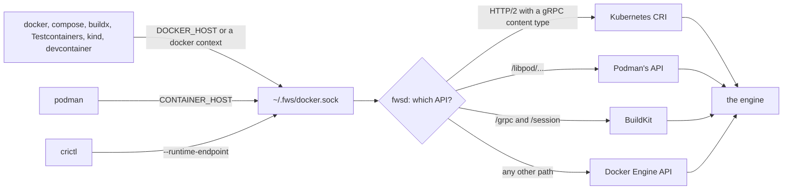
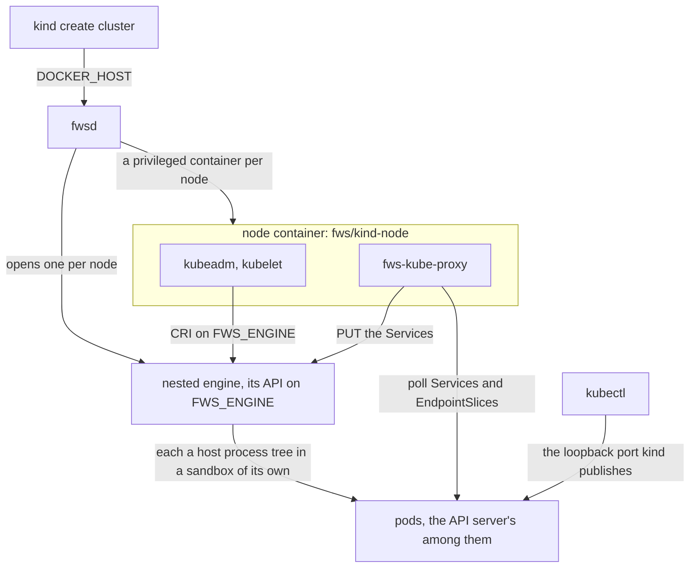

# Using fws

How to install and run the engine, how each client drives it, worked use
cases, and troubleshooting. The images are in [IMAGES](IMAGES.md), and
making images of your own in [IMAGE-AUTHORING](IMAGE-AUTHORING.md). The
engine refuses what it cannot honour rather than accept and ignore it;
[LIMITATIONS](../LIMITATIONS.md) lists each refusal and why.

The key words "MUST", "MUST NOT", "REQUIRED", "SHALL", "SHALL NOT", "SHOULD", "SHOULD NOT", "RECOMMENDED", "MAY", and "OPTIONAL" in this document are to be interpreted as described in [RFC 2119](https://www.rfc-editor.org/info/rfc2119).

The end-to-end suite (`tests/e2e`) runs what this guide describes on
macOS in CI; its tests are the fullest examples of each client.

- [Install](#install)
- [Run the engine](#run-the-engine)
- [Get images](#get-images)
- [The fws command](#the-fws-command)
- [The Docker CLI](#the-docker-cli)
- [Docker Compose](#docker-compose)
- [Podman](#podman)
- [Testcontainers](#testcontainers)
- [Dev Containers](#dev-containers)
- [Language toolchains](#language-toolchains)
- [Playwright](#playwright)
- [Graphical applications](#graphical-applications)
- [Kubernetes](#kubernetes)
- [Continuous integration](#continuous-integration)
- [Use cases](#use-cases)
- [Troubleshooting](#troubleshooting)

## Install

The engine needs:

- **macOS on Apple silicon.** `fwsd` is built for `darwin/arm64` alone.
- **Go**, at the version `go.mod` names (1.26 or newer), to install it.
- **The Xcode Command Line Tools** (`xcode-select --install`). As it starts,
  `fwsd` builds the container library and the spawn helper with their
  clang.

```bash
go install github.com/e6qu/fun-with-sandboxes/cmd/...@latest
```

This installs every command into `$(go env GOPATH)/bin` (`~/go/bin` unless
`GOBIN` says otherwise); put that directory on `PATH`:

| Command | What it is |
|---|---|
| `fwsd` | the engine: it serves the Docker, Podman (libpod) and Kubernetes CRI APIs on one Unix socket |
| `fws-shim` | each container's supervisor, the `--init` process and each stack's egress proxy. `fwsd` starts it, and it MUST sit in the same directory as `fwsd` |
| `fws` | the engine's command-line companion: `fws catalog` lists the image catalog |
| `fws-kube-proxy` | a node's kube-proxy for Kubernetes on the engine; `fws/kubelet` and `fws/kind-node` carry their own |
| `fws-mkimage` | builds an image archive from a Nix closure; `scripts/build-images.sh` runs it to build the catalog |

Only `fwsd` and `fws-shim` are needed to run containers:

```bash
go install github.com/e6qu/fun-with-sandboxes/cmd/fwsd@latest github.com/e6qu/fun-with-sandboxes/cmd/fws-shim@latest
```

From a checkout, build both into one directory and run `fwsd` from there:

```bash
go build -o bin/ ./cmd/fwsd ./cmd/fws-shim
```

### Clients

The engine works with the stock clients; install the ones you use. With
Homebrew:

```bash
brew install docker docker-compose docker-buildx
```

Homebrew puts the Compose and buildx plugins where the Docker CLI does not
look by default; tell it where they are (this is what CI does):

```bash
mkdir -p ~/.docker && echo "{\"cliPluginsExtraDirs\": [\"$(brew --prefix)/lib/docker/cli-plugins\"]}" > ~/.docker/config.json
```

The other clients this guide uses:

```bash
brew install podman podman-compose cri-tools kind kubectl
```

```bash
npm install -g @devcontainers/cli
```

## Run the engine

```bash
fwsd
```

`fwsd` runs in the foreground and logs to standard error. It refuses to
run as root, and refuses to start while another engine serves its socket.
It prints the socket once it serves:

```
serving the Docker API on unix:///Users/you/.fws/docker.sock (state in /Users/you/.fws)
```

To keep it running in the background, with its log in a file:

```bash
nohup fwsd > ~/fwsd.log 2>&1 &
```

The engine is not a `launchd` service and installs none
([PLAN](../PLAN.md#non-goals)).

### Flags

| Flag | Default | Meaning |
|---|---|---|
| `-root DIR` | `~/.fws` | the engine's state directory |
| `-socket PATH` | `<root>/docker.sock` | the Unix socket the Docker, libpod and CRI APIs are served on, mode 0600 |
| `-port-base N` | `20000` | the first host port handed to stacks |
| `-port-limit N` | `30000` | the end of the host port range handed to stacks, exclusive |
| `-block-size N` | `100` | the host ports each stack holds; the range holds (limit − base) / size stacks |
| `-egress` | `true` | give each stack an HTTP and SOCKS5 proxy to the internet that refuses destinations on this Mac; `-egress=false` leaves containers without internet access |
| `-buildkit` | `true` | serve BuildKit for `docker build`, buildx and `docker compose build`; `-buildkit=false` leaves the classic builder alone |
| `-live-restore` | `false` | keep containers running while the engine stops, and take them back when it starts |
| `-image-archives DIR` | none | load an image from the archives (`*.tar`, as `docker save` and `scripts/build-images.sh` write them) in `DIR` the first time it is asked for |
| `-machine-guard` | `true` | while macOS reports critical memory pressure, or the disk holding the state has under 2 GiB free, pause the container using the most of it, one at a time, and resume them once it is normal |
| `-qos-clamp` | `utility` | the highest quality of service any container process runs at, so containers yield the CPU and disk to your own work: `utility`, `background`, `maintenance` or `none` |
| `-debug` | `false` | log each API request with its status and the time it took, and the steps of each container's create and start |

Boolean flags take `-flag=false`, as Go's flags do.

### Point the clients at it

The Docker CLI, Compose, buildx, Testcontainers, kind and the Dev
Containers CLI read `DOCKER_HOST`:

```bash
export DOCKER_HOST=unix://$HOME/.fws/docker.sock
```

A Docker context does the same for the Docker CLI and for programs that
run it, such as VS Code's Dev Containers extension started from the Dock,
which does not see your shell's variables:

```bash
docker context create fws --docker "host=unix://$HOME/.fws/docker.sock"
```

```bash
docker context use fws
```

Testcontainers libraries read `DOCKER_HOST`, not the Docker CLI's context,
so set the variable for them.

Podman's remote client reads `CONTAINER_HOST`, and `crictl` takes the same
socket as its runtime and image endpoint:

```bash
export CONTAINER_HOST=unix://$HOME/.fws/docker.sock
```

```bash
crictl --runtime-endpoint unix://$HOME/.fws/docker.sock --image-endpoint unix://$HOME/.fws/docker.sock version
```

Every client reaches the one socket, and `fwsd` tells the APIs apart by
each request (`internal/api/server.go`):



`docker version` reports the server's OS as `darwin`, and the engine
serves Docker's API version 1.52, down to 1.24.

### Stop and restart

`Ctrl-C`, or `SIGTERM`, stops the engine. Without `-live-restore` it stops
every container as it goes, and an engine that starts after one that died
ends the containers it left running. Either way, containers with the
restart policy `always` or `unless-stopped` start again when the engine
starts, unless they were stopped by hand, as dockerd does.

With `-live-restore`, the containers keep running, their published ports
keep answering, and the next engine on the same `-root` takes them back:
their state, health, logs and `docker update` all work again.

```bash
fwsd -live-restore
```

### Several engines

Each engine needs a state directory, a socket and a host port range of its
own. The end-to-end suite runs one beside your own engine like this:

```bash
fwsd -root ~/.fws-test -socket ~/.fws-test.sock -port-base 30000 -port-limit 31000 -block-size 50
```

Keep the state directory's path short: Unix socket paths are capped at
104 bytes, and services such as Postgres put sockets under a container's
root ([LIMITATIONS](../LIMITATIONS.md#networking)).

### Where state lives

Everything the engine keeps is under `-root`, `~/.fws` by default:
images in `images/`, containers' roots, logs and Seatbelt profiles under
`stacks/<stack>/c/<id>/`, volumes in `volumes/<name>/_data`, BuildKit's
cache in `buildkit/`, and the compiled container library in `lib/`.
[DESIGN](DESIGN.md#layout) lays out every file. Removing the directory,
with the engine stopped, removes every image, container and volume.

### Logs and debugging the engine

The engine logs to standard error. `-debug` adds a line for each API
request (`GET /v1.52/containers/json 200 3ms`) and the steps of each
create and start, as dockerd's `--debug` does:

```bash
fwsd -debug 2> ~/fwsd.log
```

Without `-debug`, the engine logs where a slow operation spent its time:
an image that takes a second or more to unpack (`image <id> unpacked:
blobs …, N of M layers unpacked …, merged …, usage …`), and a BuildKit
build whose commit of the image's layers is slow, with the number of
layers and their compressed size.

A container's own output is `docker logs`. What the sandbox refused a
container, and what the container library did with a path, are in
[Troubleshooting](#troubleshooting).

## Get images

Containers run macOS programs, so images are `darwin/arm64`. Linux images,
Docker Hub's among them, do not run: pulling one fails with
`image platform (linux/amd64) does not match the engine platform
(darwin/arm64)`. fws comes with a catalog of darwin images, named
`fws/<name>:<tag>`, which CI publishes as `ghcr.io/e6qu/fws-<name>:<tag>`.
[IMAGES](IMAGES.md) describes each one and how it is configured.

Compose files, tests and this guide name images `fws/<name>:<tag>`. The
engine never substitutes one name for another, and `fws/postgres:16` is
not on Docker Hub, so get the catalog's images under those names in one of
two ways.

**Pull and tag** each image you use:

```bash
docker pull ghcr.io/e6qu/fws-postgres:16 && docker tag ghcr.io/e6qu/fws-postgres:16 fws/postgres:16
```

`fws catalog -published` prints both names of each tag, so a kind of image
comes down at once:

```bash
fws catalog -published database | while read -r name ref; do docker pull "$ref" && docker tag "$ref" "$name"; done
```

You can also name the published image itself, as in
`image: ghcr.io/e6qu/fws-postgres:16`.

**Build the archives** from a checkout with Nix, and let the engine load
each the first time it is asked for, or load them all:

```bash
scripts/build-images.sh images-out
```

```bash
fwsd -image-archives images-out
```

```bash
for f in images-out/*.tar; do docker load -i "$f"; done
```

A first build compiles what no Nix cache holds for darwin and takes hours;
[CONTRIBUTING](../CONTRIBUTING.md#test) says more.

Images of your own build `FROM` the catalog's: `fws/base:1` stands in for
Alpine or Debian. [IMAGE-AUTHORING](IMAGE-AUTHORING.md) is the guide to
writing them and to adding or changing a catalog image.

## The fws command

```
fws catalog [-json] [-published] [KIND|NAME...]
```

`fws catalog` lists the catalog's images, a line each: its name, tags,
kind and what it holds. Arguments keep the images of those kinds or names
(with or without `fws/`); the kinds are `base`, `language`, `lambda`,
`tool`, `database`, `storage`, `messaging`, `service` and `kubernetes`.

| Flag | Prints |
|---|---|
| none | `IMAGE TAGS KIND SUMMARY`, a row per image |
| `-published` | each tag's `fws/` name and where it is published, separated by a tab |
| `-json` | the selected images as JSON: `name`, `tags`, `kind`, `summary` |

```bash
fws catalog language
```

```bash
fws catalog -published postgres redis
```

`fws` exits with status 2 and its usage on any other command, an unknown
flag, or arguments that match no image.

## The Docker CLI

The Docker CLI drives the engine as it drives dockerd. What follows is
what differs, or what is worth knowing; anything the engine cannot honour
fails with an error that says why ([LIMITATIONS](../LIMITATIONS.md)).

### Containers

`run`, `create`, `start`, `stop`, `restart`, `kill`, `rm`, `rename`,
`wait`, `pause`, `unpause`, `ps` (with Docker's filters and `-s`),
`inspect`, `logs` (follow, tail, since, until, timestamps), `attach` (with
detach keys), `exec` (attached, detached, with a TTY, as another user),
`top`, `stats`, `diff`, `export`, `commit` and `cp` work as in Docker:

```bash
docker run --rm fws/python:3.14 python3 -c 'print("hello from a container")'
```

```bash
docker run -it --rm fws/base:1
```

```bash
docker run -d --name web -p 127.0.0.1:8000:8000 fws/python:3.14 python3 -m http.server 8000
```

```bash
docker exec web python3 -c 'import socket; print(socket.gethostname())'
```

```bash
docker cp ./site/. web:/srv/
```

Each container is a process tree on the Mac, confined by a Seatbelt
profile and rooted in an APFS clone of its image, so it starts in
milliseconds. It lists only its own processes, with its main process as
pid 1; `docker exec web kill -HUP 1` reaches it. `--init` runs the
engine's init as pid 1. A container's user, groups, hostname, domain name
and working directory are presented by the container library, so `--user`,
`exec -u`, `--group-add`, `--hostname`, `--domainname` and `-w` behave as
in Docker, while every process runs as you
([LIMITATIONS](../LIMITATIONS.md#isolation)).

A container reads and writes its own root and its mounts, and reads the
macOS system tree; it cannot read the rest of your files
([LIMITATIONS](../LIMITATIONS.md#isolation)).

### Ports

Each Compose project, a *stack*, holds a block of host ports (`-port-base`
on, 100 at a time); a container that is not in a project is a stack of its
own. A container's exposed ports listen on `127.0.0.1` at host ports of
its stack's block, where its stack's members reach them.

Publishing works as in Docker. `-p 8080` publishes on a free host port,
which `docker port` reports; `-p 8080:80` on host port 8080 of every
address; `-p 127.0.0.1:8080:80` on loopback alone; a range binds its first
free port; `/udp` publishes UDP. A taken port fails with Docker's `port is
already allocated`.

```bash
docker run -d --name echo -p 127.0.0.1::8000 fws/python:3.14 python3 -m http.server 8000
```

```bash
docker port echo 8000
```

The label `fws.ingress.allow` holds a container's published ports to the
addresses and CIDR prefixes it names; Docker has no such setting:

```bash
docker run -d -p 8000 --label fws.ingress.allow=127.0.0.1 fws/python:3.14 python3 -m http.server 8000
```

A container cannot connect to a server on the Mac itself: a connection to
any loopback port that is not a member's is refused, as in a network
namespace, and the egress proxy refuses the Mac's own addresses. Run the
server in a container instead. `--add-host name:host-gateway` writes
`127.0.0.1` for the name, which reaches nothing of the host's.

### Networks

Containers of a stack resolve and reach one another by container name,
service name, hostname and alias. User-defined bridge networks, with or
without subnets, IPv4, IPv6-only and dual-stack, `--network-alias`,
`--ip`, legacy `--link`, `network connect` and `disconnect`, `--internal`
networks, `--network none` and `--network container:<name>` work, and
networks join stacks:

```bash
docker network create --subnet 172.30.0.0/24 app-net
```

```bash
docker run -d --name cache --network app-net fws/redis:8
```

```bash
docker run --rm --network app-net fws/python:3.14 python3 -c 'import socket; s = socket.create_connection(("cache", 6379)); s.sendall(b"PING\r\n"); print(s.recv(16))'
```

`--network host` is refused, except inside a privileged container's
nested engine. Only the `bridge` driver and the default IPAM driver are
served. Containers' addresses are presented, not routed; servers see
clients connect from `127.0.0.1` ([LIMITATIONS](../LIMITATIONS.md#networking)).

Containers reach the internet through their stack's egress proxy, whose
`HTTP_PROXY`, `HTTPS_PROXY`, `ALL_PROXY` (SOCKS5) and `NO_PROXY` the
engine sets in each container: `curl`, `pip`, `bun install`, `cargo` and
Node.js's `fetch` use them. UDP does not leave the Mac. Two allow lists
narrow what the proxy lets through, a container's `fws.egress.allow`
label and a network's option of that name; a destination is reached only
when it is on every list that applies:

```bash
docker run --rm --label fws.egress.allow=github.com:443 fws/base:1 curl -fsSI https://github.com/
```

```bash
docker network create --opt fws.egress.allow='*.github.com,github.com' gh-only
```

Of the bridge driver's options, `com.docker.network.bridge.enable_ip_masquerade=false`
gives a network no internet access, `enable_icc=false` keeps its members
apart, and `host_binding_ipv4` sets its members' default published
address.

DNS: the container library resolves `/etc/hosts`, the stack's names and
the host's resolver; a program that sends DNS itself reaches the
container's router. `--dns` names a DNS server outside the Mac, or one a
member of the stack runs; `--dns-search` and `--dns-option` (`ndots`,
`timeout`, `attempts`) take effect.

### Volumes and mounts

Bind mounts (`-v /host/path:/path`, `--mount type=bind`), named and
anonymous volumes, `--volumes-from`, image mounts (`--mount
type=image`), `volume-subpath`, `volume-nocopy`, read-only mounts and
`--read-only` roots work. Named volumes live under `<root>/volumes`. A
local volume can bind a host directory, as Compose's `driver_opts`
`{type: none, o: bind, device: …}` asks:

```bash
docker volume create --opt type=none --opt o=bind --opt device="$PWD/data" data
```

`--tmpfs` and tmpfs volumes are directories emptied at each start, not
memory: `mode`, `uid`, `gid`, `ro` and `noexec` hold, and `size` is
refused. A bind source is any directory you can read; the container sees
nothing else of your files.

### Resource limits and docker update

The container's supervisor holds it to its limits without cgroups:

```bash
docker run -d --name worker --memory 256m --cpus 1.5 --pids-limit 100 --ulimit nofile=4096:4096 fws/python:3.14 python3 -m http.server 8000
```

```bash
docker stats --no-stream worker
```

| Option | Effect |
|---|---|
| `--memory` | each process's footprint, and their sum; past it the largest process is killed and the container reports `OOMKilled`. `--memory-swap` MUST equal it or be -1 |
| `--cpus`, `--cpu-quota`, `--cpu-period` | processes over quota stop with `SIGSTOP` until the next period |
| `--cpu-shares` | the processes' nice value |
| `--cpuset-cpus` | as many CPUs' time; a set of efficiency cores alone runs on them. fws numbers performance cores first |
| `--pids-limit` | processes, not threads: `fork` fails with `EAGAIN` at the limit |
| `--blkio-weight` | the disk I/O tier |
| `--ulimit` | `nofile`, `fsize`, `cpu`, `core`, `stack`, and `memlock` unlimited |
| `--storage-opt size=1G` | the root on a disk image of its own, so writes past it fail with `ENOSPC` |
| `--shm-size` | POSIX shared memory, 64 MiB by default |
| labels `kubernetes.io/egress-bandwidth`, `kubernetes.io/ingress-bandwidth` | bits a second through the container's router and egress proxy |

`docker update` changes the restart policy and the limits of a running
container. A running container's memory limit can be lowered, not raised,
and its cpuset cannot change: stop it, update it and start it again.

```bash
docker update --cpus 1 --pids-limit 50 --memory 128m --restart on-failure:3 worker
```

[LIMITATIONS](../LIMITATIONS.md#resources) says how each is enforced and
what is refused.

### Health checks and restart policies

Images' health checks, `--health-cmd`, `--health-interval`,
`--health-start-period`, `--health-start-interval`, `--no-healthcheck`,
`docker wait`, and the restart policies `no`, `on-failure[:N]`, `always`
and `unless-stopped` behave as in Docker, with Docker's back-off and
events. The catalog's services carry health checks, so `docker compose up
--wait` and Compose's `condition: service_healthy` wait for them to be
ready.

### Build

`docker build`, `docker buildx build` and `docker compose build` build on
an embedded BuildKit with a darwin worker, `FROM` darwin images. `RUN`
steps run under Seatbelt with internet access through a build-only egress
proxy. Multi-stage builds, build arguments, `COPY --from`, `RUN
--mount=type=cache`, `--ssh`, cache reuse,
`--output type=local`, Git build contexts and `# syntax=docker/dockerfile:<version>`
work:

```bash
docker build -t myapp:1 .
```

```bash
docker buildx build --load -t myapp:1 --build-arg GREETING=hi .
```

```bash
docker buildx build --ssh default="$SSH_AUTH_SOCK" --load -t private-deps:1 .
```

```bash
docker buildx build --output type=local,dest=out .
```

Use the default builder (the `docker` driver), which is the engine's own
BuildKit: a `docker-container` builder runs BuildKit's Linux image. A
`--platform` other than `darwin/arm64`, multi-platform builds and
`# syntax=` frontends other than Docker's own are refused. A `RUN` step
runs the programs the image holds, so `apt-get`, `apk` and `yum` fail
([LIMITATIONS](../LIMITATIONS.md#images-and-builds)).

`DOCKER_BUILDKIT=0`, or `fwsd -buildkit=false`, uses the classic builder,
which refuses `RUN --mount`, `--network` and `--security` as dockerd's does.

### Images and registries

`pull`, `push`, `login`, `logout`, `tag`, `rmi`, `images` (with filters and
digests), `image inspect`, `history`, `save`, `load`, `import`, `search`,
`image prune` and `system df` work with any registry that speaks the
distribution protocol. Manifests and digests survive a pull, save, load
and push byte for byte.

```bash
docker login ghcr.io
```

```bash
docker tag myapp:1 ghcr.io/you/myapp:1 && docker push ghcr.io/you/myapp:1
```

A multi-platform index pulls its `darwin/arm64` image alone. Disk figures
count more than the disk gives up, as a root shares blocks with its image
([LIMITATIONS](../LIMITATIONS.md#images-and-builds)).

### Docker in Docker

`--privileged` gives a container an engine of its own, nothing more: no
devices, capabilities or host mounts. `fws/dind:29` runs it as Docker's
`docker:dind` image does, with the Docker CLI, buildx and Compose:

```bash
docker run -d --privileged --name dind -e DOCKER_TLS_CERTDIR= fws/dind:29
```

```bash
docker save fws/python:3.14 | docker exec -i dind docker load
```

```bash
docker exec dind docker run --rm fws/python:3.14 python3 -c 'print("nested")'
```

The nested engine's containers, networks and published ports are its own,
and the outer engine does not list them. Without `-e DOCKER_TLS_CERTDIR=`
its `dockerd` serves TLS on 2376 with the certificates it makes in
`/certs`, as Docker's image does. Linux's `docker:dind` and
`kindest/node` do not run here.

### The user's session: seatbelt=gui

`--security-opt seatbelt=gui` grants a container your login session: the
window server, pasteboard, Launch Services, fonts, input methods,
preferences, audio and the GPU. Graphical applications need it, and so
does Playwright's Firefox. The container then reads the host's files but
your data and other stacks' state; the keychain stays denied.

Such a container MUST run as your user, because the session's services
learn the caller from the kernel and refuse one that calls itself root:

```bash
docker run --rm --security-opt seatbelt=gui --user "$(id -u):$(id -g)" -v "$PWD:/app" fws/base:1 /app/MyApp.app/Contents/MacOS/MyApp
```

`seatbelt=gui` is the only Seatbelt grant; any other value is refused.

### The engine's own labels

| Label or option | On | Meaning |
|---|---|---|
| `fws.egress.allow` | container label, network option | hosts, `*.domains`, addresses and prefixes, each with or without `:port`, the egress proxy lets the container reach |
| `fws.ingress.allow` | container label | addresses and prefixes its published ports take connections and datagrams from |
| `kubernetes.io/egress-bandwidth`, `kubernetes.io/ingress-bandwidth` | container label | the container's bandwidth, in bits a second |

## Docker Compose

Compose drives the engine as it drives dockerd. Each project is a stack:
its own block of host ports, its own directory tree, its own egress proxy.
Two projects never clash, and never see each other unless they share an
external network.

```bash
docker compose up -d --wait
```

`build`, `depends_on` with conditions, health checks, `ports`, networks
(with `external`, aliases and subnets), volumes, `configs` and `secrets`
(from files, inline content and the environment), `include`, `extends`,
`profiles`, `init`, `group_add`, `domainname`, `shm_size`, `post_start`
hooks, `exec`, `logs`, `down -v` and `watch` work.

`docker compose watch` syncs files into a running service and restarts or
rebuilds it as its `develop` section says:

```yaml
services:
  app:
    build: .
    develop:
      watch:
        - action: sync
          path: ./src
          target: /app
        - action: sync+restart
          path: ./conf
          target: /conf
```

```bash
docker compose up -d --build --wait && docker compose watch --no-up
```

Testcontainers' Compose module, which runs Compose's library in process,
works too (`TestTestcontainersCompose`).

## Podman

The engine serves Podman's API, libpod, on the same socket, so Podman's
remote client and `podman-compose` drive it:

```bash
export CONTAINER_HOST=unix://$HOME/.fws/docker.sock
```

```bash
podman --remote run --rm fws/python:3.14 python3 -c 'print("from podman")'
```

Containers, networks, volumes, `logs`, `exec`, `inspect` and `wait
--condition healthy` work. A pod made by `podman pod create` has an infra
container running `fws/pause`, whose network, IPC and, where shared, PID
namespace its members join, so they reach one another on `localhost`; the
pod starts, stops and is removed as one:

```bash
podman --remote pod create --name web
```

```bash
podman --remote run -d --pod web fws/python:3.14 python3 -m http.server 8000
```

`--infra=false --share=`, as `podman-compose` creates pods, makes a pod
that shares nothing. `podman-compose` brings a project up in a pod of its
own:

```bash
podman-compose -p demo -f compose.yaml up -d
```

`podman kube play` runs Pods and one-replica Deployments from Kubernetes
YAML, with their ConfigMaps' values, PersistentVolumeClaims' volumes,
init containers, host ports and limits; `kube generate` writes a pod back
and `kube down` removes what a file made:

```bash
podman --remote kube play pod.yaml
```

```bash
podman --remote kube down pod.yaml
```

Checkpoints and quadlets are not served ([LIMITATIONS](../LIMITATIONS.md#api-surface)).

## Testcontainers

Testcontainers drives the engine through `DOCKER_HOST` like any Docker
daemon. Containers' ports are on loopback, so the default host,
`localhost`, reaches them. Each library needs:

1. **`DOCKER_HOST`** set to the engine's socket. The reaper mounts the
   socket it names, unless `TESTCONTAINERS_DOCKER_SOCKET_OVERRIDE` names
   another.

   ```bash
   export DOCKER_HOST=unix://$HOME/.fws/docker.sock
   ```

2. **Its reaper's image.** Ryuk ships as a Linux image; the catalog's
   `fws/ryuk:0.14.0` is a darwin build of the same release. Tag it as the
   version each library runs:

   ```bash
   docker tag fws/ryuk:0.14.0 testcontainers/ryuk:0.14.0
   ```

   ```bash
   docker tag fws/ryuk:0.14.0 testcontainers/ryuk:0.8.1
   ```

3. **Catalog images by name.** Pass `fws/postgres:16` where a module
   defaults to `postgres`; the engine runs no Linux image.

| Library | Release tested | Ryuk it runs | Further settings |
|---|---|---|---|
| Testcontainers for Go | 0.45 | `testcontainers/ryuk:0.14.0` | none |
| Testcontainers for Java | 2.0.5 | `testcontainers/ryuk:0.14.0` | `TESTCONTAINERS_CHECKS_DISABLE=true`; `asCompatibleSubstituteFor` |
| Testcontainers for Node.js, under Node or Bun | 12.2.2 | `testcontainers/ryuk:0.14.0` | none |
| Testcontainers for Python | 4.15.0 | `testcontainers/ryuk:0.8.1` | `driver=None` for Postgres with psycopg 3 |
| testcontainers-rs | 0.27 | none: containers go when dropped | none |

Each library's wait strategies (logs, ports, HTTP, health checks, exec,
files, SQL), networks with aliases, file copies, exec, logs, stop and
start, and reuse work. Testcontainers for Go's modules for Postgres,
MySQL, MariaDB, Redis, Valkey, RabbitMQ, Kafka, MongoDB, k3s, DinD and the
rest run the catalog's images (`tests/e2e/testcontainers*_test.go`,
`services_test.go`).

### Go

A test that starts Postgres and Redis for each run; the reaper removes
them if the test process dies:

```go
package store_test

import (
	"context"
	"testing"

	"github.com/jackc/pgx/v5"
	"github.com/testcontainers/testcontainers-go"
	"github.com/testcontainers/testcontainers-go/modules/postgres"
	"github.com/testcontainers/testcontainers-go/modules/redis"
)

func TestStore(t *testing.T) {
	ctx := context.Background()
	pg, err := postgres.Run(ctx, "fws/postgres:16",
		postgres.WithPassword("secret"), postgres.BasicWaitStrategies())
	testcontainers.CleanupContainer(t, pg)
	if err != nil {
		t.Fatal(err)
	}
	rd, err := redis.Run(ctx, "fws/redis:8")
	testcontainers.CleanupContainer(t, rd)
	if err != nil {
		t.Fatal(err)
	}
	dsn, _ := pg.ConnectionString(ctx, "sslmode=disable")
	conn, err := pgx.Connect(ctx, dsn)
	if err != nil {
		t.Fatal(err)
	}
	defer conn.Close(ctx)
	redisURL, _ := rd.ConnectionString(ctx)
	_ = redisURL // hand both to the code under test
}
```

```bash
go test ./...
```

Containers start in well under a second, so each test can start its own
rather than share one.

### Java

Testcontainers for Java refuses an engine whose `OSType` is not `linux`,
so the engine answers it with a blank one, which it accepts. Its startup
checks run `alpine`, a Linux image, so they MUST be turned off, with
`TESTCONTAINERS_CHECKS_DISABLE=true` or `checks.disable=true` in
`~/.testcontainers.properties`. It checks that a substitute image is
compatible, so name what `fws/postgres` stands for:

```java
var image = DockerImageName.parse("fws/postgres:16").asCompatibleSubstituteFor("postgres");
try (var pg = new PostgreSQLContainer(image)) {
    pg.start();
    try (var c = DriverManager.getConnection(pg.getJdbcUrl(), pg.getUsername(), pg.getPassword())) {
        // ...
    }
}
```

```bash
TESTCONTAINERS_CHECKS_DISABLE=true mvn test
```

It runs Ryuk privileged, which here gives the reaper an engine of its own
that it does not use; `TESTCONTAINERS_RYUK_CONTAINER_PRIVILEGED=false`
saves starting it.

### Python

```python
import psycopg
from testcontainers.community.postgres import PostgresContainer
from testcontainers.community.redis import RedisContainer


def test_postgres():
    with PostgresContainer("fws/postgres:16", driver=None) as pg:
        with psycopg.connect(pg.get_connection_url()) as conn:
            assert conn.execute("SELECT 1 + 1").fetchone()[0] == 2


def test_redis():
    with RedisContainer("fws/redis:8") as redis:
        redis.get_client().set("greeting", "hello")
```

```bash
pip install testcontainers==4.15.0 redis 'psycopg[binary]' pytest && pytest
```

### Node.js and Bun

```js
import pg from "pg";
import { PostgreSqlContainer } from "@testcontainers/postgresql";
import { RedisContainer } from "@testcontainers/redis";

const postgres = await new PostgreSqlContainer("fws/postgres:16").start();
const client = new pg.Client({ connectionString: postgres.getConnectionUri() });
await client.connect();
console.log((await client.query("SELECT 1 + 1 AS two")).rows[0].two);
await client.end();
await postgres.stop();

const redis = await new RedisContainer("fws/redis:8").start();
console.log(redis.getHost(), redis.getMappedPort(6379));
await redis.stop();
```

```bash
npm install testcontainers@12.2.2 @testcontainers/postgresql@12.2.2 @testcontainers/redis@12.2.2 pg && node test.mjs
```

The same script runs under Bun:

```bash
bun install && bun test.mjs
```

### Rust

```toml
[dev-dependencies]
testcontainers = { version = "0.27", features = ["blocking"] }
testcontainers-modules = { version = "0.15", features = ["postgres", "redis", "blocking"] }
postgres = "0.19"
```

```rust
use testcontainers::{runners::SyncRunner, ImageExt};
use testcontainers_modules::postgres::Postgres;

#[test]
fn postgres() {
    let node = Postgres::default().with_name("fws/postgres").with_tag("16").start().unwrap();
    let url = format!(
        "host={} port={} user=postgres password=postgres dbname=postgres",
        node.get_host().unwrap(),
        node.get_host_port_ipv4(5432).unwrap()
    );
    let mut client = postgres::Client::connect(&url, postgres::NoTls).unwrap();
    let two: i32 = client.query_one("SELECT 1 + 1", &[]).unwrap().get(0);
    assert_eq!(two, 2);
}
```

## Dev Containers

The Dev Containers CLI (`devcontainer up`, `exec`, `features publish`) and
VS Code's Dev Containers extension drive the engine as they drive Docker,
through the Docker CLI.

```bash
devcontainer up --workspace-folder .
```

```bash
devcontainer exec --workspace-folder . sh -c 'pwd; ls'
```

What works in a `devcontainer.json`:

- `image` on a darwin image, `build.dockerfile` (the CLI builds through
  buildx), or `dockerComposeFile` with `service` and `runServices`;
- `features`, local or published to a registry as OCI artifacts, whose
  `install.sh` installs darwin programs;
- every lifecycle command, from `initializeCommand` on the host through
  `onCreateCommand`, `updateContentCommand`, `postCreateCommand`,
  `postStartCommand` to `postAttachCommand`, in their string, array and
  parallel object forms;
- `containerUser`, `remoteUser`, `containerEnv`, `remoteEnv` with
  `${localEnv:…}` and `${containerEnv:…}`, `mounts` (bind and volume),
  `workspaceMount`, `workspaceFolder`, `overrideCommand`, `appPort`, and
  reopening (`devcontainer up` again) and rebuilding
  (`--remove-existing-container`).

The image MUST hold the commands the tools run in it (`sh`, `sleep`,
`cat`, `mkdir`, `tar`), as `fws/base`, `fws/node`, `fws/python`,
`fws/rust`, `fws/bun` and `fws/playwright` do. Features from the
containers.dev collection (`common-utils`, `node`, `docker-in-docker`…)
install Linux packages and fail; use an image that already holds the tool,
or a feature of your own that installs darwin programs
([LIMITATIONS](../LIMITATIONS.md#images-and-builds)). Every process runs as you, so
the workspace stays yours on the host whatever `remoteUser` is.

```json
{
  "name": "app",
  "image": "fws/node:24",
  "containerEnv": {"NODE_ENV": "development"},
  "postCreateCommand": "npm install",
  "forwardPorts": [3000],
  "appPort": ["127.0.0.1:3000:3000"]
}
```

`appPort` publishes a port for the CLI; `forwardPorts` is VS Code's, which
forwards a container port nothing publishes to the same port on the host.

### VS Code

VS Code's Dev Containers extension runs the Docker CLI, so it MUST see the
engine: start VS Code from a shell where `DOCKER_HOST` is set (`code .`),
or make the `fws` context current (`docker context use fws`). Reopen in
Container then creates the container, installs VS Code's macOS server in
it (the engine's `/etc/os-release` says `ID=darwin`) with the extensions
and settings of `customizations.vscode`, forwards `forwardPorts`, runs
`postAttachCommand`, lends the container your Git configuration,
credential helper and SSH agent, and stops the container when VS Code
quits. An extension published for Linux alone does not run in the
container.

### Docker outside of Docker

Mount the engine's socket and use a darwin Docker CLI, from `fws/dind`:

```dockerfile
FROM fws/dind:29
```

```json
{
  "build": {"dockerfile": "Dockerfile"},
  "mounts": ["type=bind,source=${localEnv:HOME}/.fws/docker.sock,target=/var/run/docker.sock"],
  "remoteEnv": {"LOCAL_WORKSPACE_FOLDER": "${localWorkspaceFolder}"}
}
```

The CLI overrides the image's command, so no daemon of its own starts. A
sibling container that mounts the workspace names it by its host path,
`$LOCAL_WORKSPACE_FOLDER`.

### A graphical dev container

A dev container that opens windows asks for the user's session in
`runArgs`, as your own user (put the numbers `id -u` and `id -g` print
in place of `501:20`):

```json
{
  "image": "fws/base:1",
  "runArgs": ["--security-opt", "seatbelt=gui", "--user", "501:20"]
}
```

A Compose service asks with `security_opt: ["seatbelt=gui"]` and `user:`.

## Language toolchains

The catalog's language images build and run projects mounted into them,
and fetch packages through the egress proxy:

```bash
docker run --rm -v "$PWD:/app" -w /app fws/python:3.14 sh -c 'python3 -m ensurepip && python3 -m pip install -r requirements.txt && python3 -m pytest'
```

```bash
docker run --rm -v "$PWD:/app" -w /app fws/node:24 sh -c 'npm install && npm test'
```

```bash
docker run --rm -v "$PWD:/app" -w /app fws/bun:1 sh -c 'bun install && bun test'
```

```bash
docker run --rm -v "$PWD:/app" -w /app fws/rust:1.100 sh -c 'cargo fmt --check && cargo clippy -- -D warnings && cargo test'
```

- **Python** 3.11 to 3.15, with pip through `python3 -m ensurepip`.
- **Node.js** 22, 24 and 26 with `npm` and `npx`; 22 and 24 add corepack
  (pnpm) and Yarn 1. node-gyp builds native addons with the image's
  clang, macOS SDK, `make` and `python3`; there is no Xcode, `xcrun` or
  Swift.
- **Bun** with `bunx`, and `bun` standing in for `node` in package
  scripts.
- **Rust** with `cargo`, `rustfmt`, `clippy` and clang for the `cc` crate,
  for `aarch64-apple-darwin` alone. There is no rustup, so
  `rust-toolchain.toml` goes unread.
- **AWS Lambda** runtimes, `fws/lambda/python`, `fws/lambda/nodejs` and
  `fws/lambda/java`, run a handler under the Runtime Interface Emulator:

  ```bash
  docker run -d --name fn -p 127.0.0.1:9000:8080 -v "$PWD:/var/task:ro" fws/lambda/python:3.14 app.handler
  ```

  ```bash
  curl -s -d '{"name": "lambda"}' http://127.0.0.1:9000/2015-03-31/functions/function/invocations
  ```

A binary built in `fws/rust` or `fws/node` is a macOS binary, which a
multi-stage build copies into `fws/base` ([Use cases](#build-and-publish-an-image-from-fwsbase)).

## Playwright

`fws/playwright:1.65` holds Node.js 24, `playwright` and `@playwright/test`
1.65.1, Chromium's headless shell, Firefox and ffmpeg. A project with its
specs in `tests/` and this `playwright.config.ts`:

```ts
import { defineConfig, devices } from "@playwright/test";

export default defineConfig({
  use: { video: "on" },
  projects: [
    { name: "chromium", use: { ...devices["Desktop Chrome"] } },
    { name: "firefox", use: { ...devices["Desktop Firefox"] } },
  ],
});
```

Chromium runs in a container like any other:

```bash
docker run --rm -v "$PWD:/app" fws/playwright:1.65 npx playwright test --project chromium --output test-results/chromium
```

Firefox MUST run in a container granted the user's session, as your user,
because macOS Firefox starts AppKit even headless:

```bash
docker run --rm --security-opt seatbelt=gui --user "$(id -u):$(id -g)" -e HOME=/tmp -v "$PWD:/app" fws/playwright:1.65 npx playwright test --project firefox --output test-results/firefox
```

`npx` runs the image's own runner. A project's own `@playwright/test`
1.65.1 finds the image's browsers (`PLAYWRIGHT_BROWSERS_PATH`). There is
no WebKit and no headed or full Chromium, so `channel: 'chromium'` is
absent ([IMAGES](IMAGES.md#fwsplaywright)). Screenshots and videos land
in `test-results/` in the project. To test a service of a Compose
project, run the tests on its network (`--network <project>_default`) and
point them at the service by name.

## Graphical applications

With `--security-opt seatbelt=gui` and your user, a macOS application
runs in a container, opens its windows on your desktop and uses the
pasteboard. Chromium-based applications, Electron's and VS Code among
them, MUST run with `--no-sandbox`: macOS refuses a second Seatbelt
profile to a sandboxed process, so their helpers cannot enter their own,
and the container's profile confines them instead.

An Electron application, as Electron ships it for macOS, gets your
desktop and pasteboard, and nothing of your files but its mount:

```bash
curl -fsSLO https://github.com/electron/electron/releases/download/v38.2.0/electron-v38.2.0-darwin-arm64.zip && mkdir -p ~/electron && ditto -xk electron-v38.2.0-darwin-arm64.zip ~/electron
```

```js
// ~/electron/main.js
const { app, BrowserWindow } = require("electron");
app.whenReady().then(() => {
  const win = new BrowserWindow({ width: 400, height: 300 });
  win.loadURL("data:text/html,<h1>drawn in a container</h1>");
});
```

```bash
docker run --rm --security-opt seatbelt=gui --user "$(id -u):$(id -g)" -v ~/electron:/app fws/base:1 /app/Electron.app/Contents/MacOS/Electron --no-sandbox /app/main.js
```

VS Code itself, with a workspace mounted and a user data directory inside
the container:

```bash
docker run --rm --security-opt seatbelt=gui --user "$(id -u):$(id -g)" -e SHELL=/bin/bash -e HOME=/tmp/home -v ~/vscode:/vscode -v "$PWD:/work" fws/base:1 "/vscode/Visual Studio Code.app/Contents/MacOS/Code" --no-sandbox --use-mock-keychain --user-data-dir=/tmp/vscode-data --extensions-dir=/tmp/vscode-extensions /work
```

The keychain stays denied, hence `--use-mock-keychain`. The application
reads the host's files but your data and other stacks' state, and writes
only its root and mounts. Where an application misbehaves,
[Seatbelt's log](#seatbelt-denials) says what it was refused.

## Kubernetes

### kind

[kind](https://kind.sigs.k8s.io)'s docker provider drives the engine, with
`fws/kind-node:1.37` (Kubernetes 1.37.2) as its node image:

```bash
kind create cluster --image fws/kind-node:1.37
```

```bash
kubectl get nodes
```

Multi-node clusters, IPv6 and dual-stack clusters, the API server on the
loopback port kind publishes, `extraPortMappings`, `kind load
docker-image`, `kind load image-archive`, `kind export logs` and `kind
delete cluster` work as with kindest/node. Pods run on the engine nested
in each node, which pulls nothing from Docker Hub, so load the images
they run:

```bash
kind load docker-image fws/nginx:1
```

How a kind cluster sits on the engine (`images/kind-node/entry`,
`internal/engine/nested.go`, `cmd/fws-kube-proxy`):



`kubectl` works as usual: Deployments, Services (cluster IPs, DNS names,
NodePorts), ConfigMaps, Secrets, Jobs, PersistentVolumeClaims on the
`standard` storage class, `exec`, `logs`, `cp` and `port-forward`. A pod's
memory and CPU limits hold. [LIMITATIONS](../LIMITATIONS.md#kubernetes)
lists what differs: no kube-proxy or CoreDNS (`fws-kube-proxy` and the
container library stand in), and of `containerdConfigPatches` only
registry mirrors and a hosts directory. The node's `ctr`, `containerd` and
`journalctl` stand in for those kind runs, and its `crictl` is upstream's,
so `docker exec <node> crictl images` lists what a node holds.

### k3s

`fws/k3s:1.37` is k3s's image built from kubeadm's cluster, as
Testcontainers' k3s module runs it:

```go
k, err := k3s.Run(ctx, "fws/k3s:1.37")
kubeconfig, err := k.GetKubeConfig(ctx)
err = k.LoadImages(ctx, "fws/nginx:1")
```

`k3s kubectl`, `ctr` and `crictl` run in it. Its node MUST have an address
outside loopback: the default bridge, as the module uses, or a network
with a subnet. `k3s agent`, Traefik, ServiceLB, the metrics server and the
Helm controller are absent; `--disable` of them is accepted, and a `k3s
server` flag fws/k3s cannot honour fails the start
([IMAGES](IMAGES.md#fwsk3s)).

### The Container Runtime Interface

The socket serves Kubernetes' CRI over gRPC, so `crictl` and the kubelet
use the engine as they use containerd:

```bash
alias crictl='crictl --runtime-endpoint unix://$HOME/.fws/docker.sock --image-endpoint unix://$HOME/.fws/docker.sock'
```

```bash
crictl runp pod.json
```

```bash
crictl create "$POD_ID" container.json pod.json && crictl start "$CONTAINER_ID"
```

```bash
crictl pods && crictl ps && crictl logs "$CONTAINER_ID"
```

A pod sandbox is an `fws/pause:3.10.2` container holding the pod's network
and published ports, which the pod's containers join, as cri-dockerd maps
CRI onto Docker's. Pods join the engine's pod network, `fws-pods`, on the
node's pod CIDR (IPv4, IPv6 or dual-stack), and reach the pods of other
nodes sharing a network with theirs; a `hostNetwork` pod, as kubeadm's
static pods are, shares its node container's network. The engine writes
container output to the log files the client names, in CRI's format.
`exec`, `attach`, `port-forward`, `stats`, `statsp`, `metricsp`, `events`,
`update`, `pull`, `images` and `inspecti` work; checkpoints are refused.

`fws-kube-proxy`, in `fws/kubelet`'s image, is a node's kube-proxy: it
keeps the engine's Services on the pod network matching the cluster's,
reachable at their cluster IPs, by their DNS names and, for NodePort
Services, at the node's ports.

A kubelet runs in a privileged `fws/kubelet:1.37` container against the
engine nested in it, whose CRI socket `$FWS_ENGINE` names, with
`fws-kube-proxy` beside it:

```bash
kubelet --kubeconfig=/etc/kubernetes/pki/node.conf --container-runtime-endpoint=unix://$FWS_ENGINE --cgroups-per-qos=false --enforce-node-allocatable= --fail-swap-on=false
```

`TestKubernetesControlPlane` in `tests/e2e/kubernetes_test.go` brings up
etcd, the API server, the controller manager, the scheduler and two such
kubelets from the catalog's images, as a complete example.

## Continuous integration

The repository's own CI is a model for running fws on GitHub's macOS
runners (`.github/workflows/ci.yml`, job `e2e`): a `macos-15` runner, Go
from `go.mod`, the clients from Homebrew, the images, and an engine
started in the background. A workflow of your own:

```yaml
jobs:
  test:
    runs-on: macos-15
    steps:
      - uses: actions/checkout@v5
      - uses: actions/setup-go@v6
        with:
          go-version: stable
      - name: install the Docker CLI and Compose
        run: |
          brew install docker docker-compose docker-buildx
          mkdir -p ~/.docker
          echo "{\"cliPluginsExtraDirs\": [\"$(brew --prefix)/lib/docker/cli-plugins\"]}" > ~/.docker/config.json
      - name: start fws
        run: |
          go install github.com/e6qu/fun-with-sandboxes/cmd/...@latest
          nohup "$(go env GOPATH)/bin/fwsd" > "$RUNNER_TEMP/fwsd.log" 2>&1 &
          echo "DOCKER_HOST=unix://$HOME/.fws/docker.sock" >> "$GITHUB_ENV"
          for _ in $(seq 60); do DOCKER_HOST=unix://$HOME/.fws/docker.sock docker version > /dev/null 2>&1 && exit 0; sleep 1; done
          cat "$RUNNER_TEMP/fwsd.log"; exit 1
      - name: get the images
        run: |
          "$(go env GOPATH)/bin/fws" catalog -published postgres redis ryuk |
            while read -r name ref; do docker pull "$ref" && docker tag "$ref" "$name"; done
          docker tag fws/ryuk:0.14.0 testcontainers/ryuk:0.14.0
      - run: go test ./...
      - name: the engine's log and Seatbelt's denials
        if: failure()
        run: |
          cat "$RUNNER_TEMP/fwsd.log"
          log show --last 20m --style compact --predicate 'sender == "Sandbox"' | sed -n 's/.*Sandbox: \([^(]*\)([0-9]*) \(deny.*\)/\1 \2/p' | sort | uniq -c | sort -rn
```

GitHub's macOS runners have the Xcode Command Line Tools. The repository's
CI restores its image archives from a cache and passes them to the suite's
engine with `-image-archives`, which loads only what each shard uses
([CONTRIBUTING](../CONTRIBUTING.md#ci)).

## Use cases

Each example uses only what the engine supports and the end-to-end suite
runs. Each assumes the engine is running, `DOCKER_HOST` is set, and the
images it names are present under their `fws/` names ([Get
images](#get-images)).

### A local development stack with Compose

A web service with Postgres and Redis, in a project of its own. Bun's
built-in Postgres and Redis clients keep the service free of
dependencies.

`server.ts`:

```ts
import { SQL, RedisClient } from "bun";

const db = new SQL(process.env.DATABASE_URL!);
const cache = new RedisClient(process.env.REDIS_URL!);

Bun.serve({
  port: 3000,
  async fetch() {
    const [{ now }] = await db`SELECT now() AS now`;
    const hits = await cache.incr("hits");
    return Response.json({ now, hits });
  },
});
```

`compose.yaml`:

```yaml
services:
  web:
    image: fws/bun:1
    command: ["bun", "run", "server.ts"]
    working_dir: /app
    volumes:
      - .:/app
    environment:
      DATABASE_URL: postgres://postgres:secret@db:5432/app
      REDIS_URL: redis://cache:6379
    ports:
      - "127.0.0.1:3000:3000"
    depends_on:
      db: {condition: service_healthy}
      cache: {condition: service_healthy}
  db:
    image: fws/postgres:16
    environment:
      POSTGRES_PASSWORD: secret
      POSTGRES_DB: app
    volumes:
      - pgdata:/var/lib/postgresql/data
  cache:
    image: fws/redis:8
volumes:
  pgdata: {}
```

```bash
docker compose up -d --wait
```

```bash
curl -s http://127.0.0.1:3000/
```

```bash
docker compose exec db psql -U postgres -d app -c 'SELECT 1'
```

```bash
docker compose down -v
```

The services reach one another by name on the project's own ports; a
second copy of the project, under another name (`docker compose -p
other up -d`), runs beside it once its published port is changed, with
ports, volumes and names of its own.

### A dev container for a Rust project

`.devcontainer/devcontainer.json`:

```json
{
  "name": "rust",
  "image": "fws/rust:1.100",
  "mounts": ["source=cargo-registry,target=/usr/local/cargo/registry,type=volume"],
  "postCreateCommand": "cargo fetch",
  "forwardPorts": [8080],
  "appPort": ["127.0.0.1:8080:8080"]
}
```

```bash
devcontainer up --workspace-folder .
```

```bash
devcontainer exec --workspace-folder . cargo test
```

The named volume keeps crates across rebuilds
(`devcontainer up --workspace-folder . --remove-existing-container`). A
Node.js project uses `fws/node:24` and `npm install` the same way. In
VS Code, Reopen in Container does the same, with the extensions
`customizations.vscode.extensions` names.

### A local Kubernetes cluster with kind

A control plane and a worker, a NodePort Service published on the Mac,
and an application deployed with `kubectl`.

`kind.yaml`:

```yaml
kind: Cluster
apiVersion: kind.x-k8s.io/v1alpha4
nodes:
  - role: control-plane
  - role: worker
    extraPortMappings:
      - containerPort: 30080
        hostPort: 30080
        listenAddress: 127.0.0.1
```

```bash
kind create cluster --name dev --image fws/kind-node:1.37 --config kind.yaml
```

```bash
kind load docker-image --name dev fws/nginx:1
```

```bash
kubectl create deployment web --image=fws/nginx:1 --replicas=2
```

```bash
kubectl create service nodeport web --tcp=80:80 --node-port=30080
```

```bash
kubectl rollout status deployment/web && curl -s http://127.0.0.1:30080/
```

```bash
kind delete cluster --name dev
```

### Build and publish an image FROM fws/base

A Rust service built in `fws/rust` and shipped in `fws/base`:

```dockerfile
FROM fws/rust:1.100 AS build
WORKDIR /src
COPY . .
RUN cargo build --release

FROM fws/base:1
COPY --from=build /src/target/release/hello /usr/local/bin/hello
CMD ["hello"]
```

```bash
docker buildx build --load -t hello:1 .
```

```bash
docker run --rm hello:1
```

```bash
docker login ghcr.io && docker tag hello:1 ghcr.io/you/hello:1 && docker push ghcr.io/you/hello:1
```

The image is `darwin/arm64`, and runs on fws engines alone. A service in
an image MUST follow the container contract, finding its paths and ports
through the container library; [IMAGE-AUTHORING](IMAGE-AUTHORING.md)
explains it, what an image can and cannot hold, and how to add an image
to the catalog.

## Troubleshooting

### Seatbelt denials

Seatbelt logs every denial to the unified log. While a container runs:

```bash
log stream --style compact --predicate 'sender == "Sandbox"'
```

[SEATBELT](SEATBELT.md#finding-what-a-container-was-denied) shows how to
summarise the log afterwards and how to read a container's profile.

### Tracing paths

`FWS_TRACE=1` in a container's environment has the container library
write to standard error, as lines starting `fws: `, each call that asks
about a file's place (`stat`, `getattrlist`, `statfs`, `realpath`), what
the path mapped to and what came back:

```bash
docker run --rm -e FWS_TRACE=1 fws/python:3.14 python3 -c 'import os; os.stat("/etc/hosts")' 2>&1 | grep '^fws: '
```

The last calls before a failure show where a program lost its way.

### Common errors

| Error | Meaning |
|---|---|
| `fws-shim must be installed beside fwsd, at …` | `fws-shim` is missing from `fwsd`'s directory: install both with `go install` into one directory |
| `fwsd must not run as root` | run it as yourself; containers run with your rights |
| `another engine is already serving …` | an engine serves the socket already: stop it, or give this one `-root` and `-socket` of its own |
| `Cannot connect to the Docker daemon at unix:///var/run/docker.sock` | the client does not know the engine: set `DOCKER_HOST` or use the `fws` context |
| `docker: 'compose' is not a docker command` | the CLI cannot find the plugins: set `cliPluginsExtraDirs` ([Clients](#clients)) |
| `image platform (linux/amd64) does not match the engine platform (darwin/arm64)` | a Linux image: use the catalog's, or build `FROM` it |
| `pull access denied for fws/…` | the image is not present under its `fws/` name: pull and tag it ([Get images](#get-images)) |
| `requested platform … does not match the engine platform` | `--platform` or `FROM --platform` other than `darwin/arm64` |
| `apt-get: not found` (or `apk`, `yum`) in a build | Linux package managers do not exist here: `COPY` darwin programs, or start from a catalog image that holds them |
| `port is already allocated` | the host port is taken, by another container or a host process |
| `… is not supported: …` | an option the engine cannot honour without root or a VM; the message says why ([LIMITATIONS](../LIMITATIONS.md)) |
| `raising the memory limit of a running container is not supported` | stop the container, update it and start it again |
| `ECONNREFUSED` reaching a host service from a container | containers cannot reach the Mac's own servers: run the server in a container |
| `403 Forbidden` from the proxy, or SOCKS5's "connection not allowed by ruleset" | the destination is off an `fws.egress.allow` list, or is on this Mac |
| a Chromium-based application crashes as it starts | add `--no-sandbox` |
| an application in a `seatbelt=gui` container cannot reach the window server | run it as your user: `--user "$(id -u):$(id -g)"` |
| Playwright's Firefox aborts | it needs `--security-opt seatbelt=gui`, as your user |
| Testcontainers for Java finds no Docker environment, or pulls `alpine` | set `TESTCONTAINERS_CHECKS_DISABLE=true` and `DOCKER_HOST` |
| Testcontainers cannot pull `testcontainers/ryuk` | tag `fws/ryuk:0.14.0` as the version it runs ([Testcontainers](#testcontainers)) |
| a service's socket path is too long | Unix socket paths are capped at 104 bytes: keep `-root` short |
