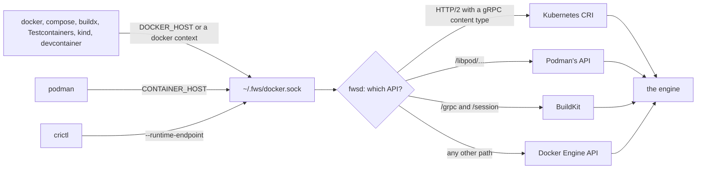
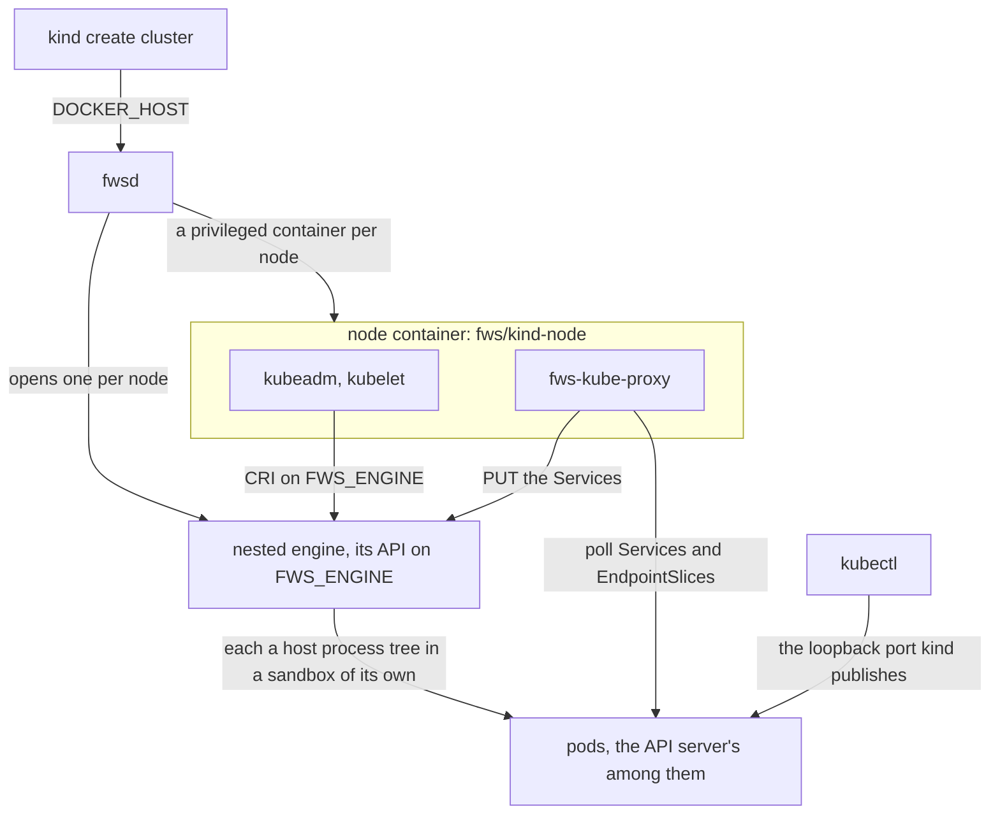

# Using fws

How to install and run the engine, how each client drives it, worked use
cases, and troubleshooting. The images are in [IMAGES](IMAGES.md), and
making images of your own in [IMAGE-AUTHORING](IMAGE-AUTHORING.md). The
engine refuses what it cannot honour rather than accept and ignore it;
[LIMITATIONS](../LIMITATIONS.md) lists each refusal and why.

The key words "MUST", "MUST NOT", "REQUIRED", "SHALL", "SHALL NOT", "SHOULD", "SHOULD NOT", "RECOMMENDED", "MAY", and "OPTIONAL" in this document are to be interpreted as described in [RFC 2119](https://www.rfc-editor.org/info/rfc2119).

The end-to-end suite (`tests/e2e`) runs what this guide describes on
macOS in CI; its tests are the fullest examples of each client.

- [Install](#install)
- [Run the engine](#run-the-engine)
- [Get images](#get-images)
- [The fws command](#the-fws-command)
- [The Docker CLI](#the-docker-cli)
- [Docker Compose](#docker-compose)
- [Podman](#podman)
- [Testcontainers](#testcontainers)
- [Dev Containers](#dev-containers)
- [Language toolchains](#language-toolchains)
- [Playwright](#playwright)
- [Graphical applications](#graphical-applications)
- [Kubernetes](#kubernetes)
- [Continuous integration](#continuous-integration)
- [Use cases](#use-cases)
  - [Start the engine and run a first container](#start-the-engine-and-run-a-first-container)
  - [A web app with Postgres and Redis on Compose](#a-web-app-with-postgres-and-redis-on-compose)
  - [Build images FROM the catalog and publish them](#build-images-from-the-catalog-and-publish-them)
  - [Integration tests with Testcontainers](#integration-tests-with-testcontainers)
  - [A dev container for a Node.js project](#a-dev-container-for-a-nodejs-project)
  - [A dev container for a Rust project, with a feature of its own](#a-dev-container-for-a-rust-project-with-a-feature-of-its-own)
  - [End-to-end tests with Playwright](#end-to-end-tests-with-playwright)
  - [Docker in Docker and Docker outside of Docker](#docker-in-docker-and-docker-outside-of-docker)
  - [A local Kubernetes cluster with kind](#a-local-kubernetes-cluster-with-kind)
  - [A k3s cluster from Testcontainers](#a-k3s-cluster-from-testcontainers)
  - [Podman: the remote client, pods and kube play](#podman-the-remote-client-pods-and-kube-play)
  - [Networks, published ports and egress](#networks-published-ports-and-egress)
  - [Hold containers to resource limits](#hold-containers-to-resource-limits)
  - [Volumes, bind mounts, docker cp and backups](#volumes-bind-mounts-docker-cp-and-backups)
  - [Health checks, restarts and docker wait](#health-checks-restarts-and-docker-wait)
  - [A sandboxed graphical application](#a-sandboxed-graphical-application)
  - [AWS Lambda functions locally](#aws-lambda-functions-locally)
  - [CI on GitHub Actions' macOS runners](#ci-on-github-actions-macos-runners)
  - [A troubleshooting walk-through](#a-troubleshooting-walk-through)
- [Troubleshooting](#troubleshooting)

## Install

The engine needs:

- **macOS on Apple silicon.** `fwsd` is built for `darwin/arm64` alone.
- **Go**, at the version `go.mod` names (1.26 or newer), to install it.
- **The Xcode Command Line Tools** (`xcode-select --install`). As it starts,
  `fwsd` builds the container library and the spawn helper with their
  clang.

```bash
go install github.com/e6qu/fun-with-sandboxes/cmd/...@latest
```

This installs every command into `$(go env GOPATH)/bin` (`~/go/bin` unless
`GOBIN` says otherwise). Neither Go's installer nor Homebrew puts that
directory on `PATH`, so a shell answers `command not found: fwsd` until it
is added, in the current shell and in the shell's profile:

```bash
export PATH="$(go env GOPATH)/bin:$PATH"
```

```bash
echo 'export PATH="$(go env GOPATH)/bin:$PATH"' >> ~/.zshrc
```

The commands it installs:

| Command | What it is |
|---|---|
| `fwsd` | the engine: it serves the Docker, Podman (libpod) and Kubernetes CRI APIs on one Unix socket |
| `fws-shim` | each container's supervisor, the `--init` process and each stack's egress proxy. `fwsd` starts it, and it MUST sit in the same directory as `fwsd` |
| `fws` | the engine's command-line companion: `fws catalog` lists the image catalog |
| `fws-kube-proxy` | a node's kube-proxy for Kubernetes on the engine; `fws/kubelet` and `fws/kind-node` carry their own |
| `fws-mkimage` | builds an image archive from a Nix closure; `scripts/build-images.sh` runs it to build the catalog |

Only `fwsd` and `fws-shim` are needed to run containers:

```bash
go install github.com/e6qu/fun-with-sandboxes/cmd/fwsd@latest github.com/e6qu/fun-with-sandboxes/cmd/fws-shim@latest
```

From a checkout, build both into one directory and run `fwsd` from there:

```bash
go build -o bin/ ./cmd/fwsd ./cmd/fws-shim
```

### Clients

The engine works with the stock clients; install the ones you use. With
Homebrew:

```bash
brew install docker docker-compose docker-buildx
```

Homebrew puts the Compose and buildx plugins where the Docker CLI does not
look by default; tell it where they are (this is what CI does):

```bash
mkdir -p ~/.docker && echo "{\"cliPluginsExtraDirs\": [\"$(brew --prefix)/lib/docker/cli-plugins\"]}" > ~/.docker/config.json
```

The other clients this guide uses:

```bash
brew install podman podman-compose cri-tools kind kubectl
```

The Dev Containers CLI is an npm package, so it needs Node.js on the Mac
(`brew install node`):

```bash
npm install -g @devcontainers/cli
```

## Run the engine

```bash
fwsd
```

`fwsd` runs in the foreground and logs to standard error. It refuses to
run as root, and refuses to start while another engine serves its socket.
It prints the socket once it serves, after the date and time Go's log
puts first:

```
2026/11/26 09:41:07 serving the Docker API on unix:///Users/you/.fws/docker.sock (state in /Users/you/.fws)
```

To keep it running in the background, with its log in a file:

```bash
nohup fwsd > ~/fwsd.log 2>&1 &
```

The engine is not a `launchd` service and installs none
([PLAN](../PLAN.md#non-goals)).

### Flags

| Flag | Default | Meaning |
|---|---|---|
| `-root DIR` | `~/.fws` | the engine's state directory |
| `-socket PATH` | `<root>/docker.sock` | the Unix socket the Docker, libpod and CRI APIs are served on, mode 0600 |
| `-port-base N` | `20000` | the first host port handed to stacks |
| `-port-limit N` | `30000` | the end of the host port range handed to stacks, exclusive |
| `-block-size N` | `100` | the host ports each stack holds; the range holds (limit − base) / size stacks |
| `-egress` | `true` | give each stack an HTTP and SOCKS5 proxy to the internet that refuses destinations on this Mac; `-egress=false` leaves containers without internet access |
| `-buildkit` | `true` | serve BuildKit for `docker build`, buildx and `docker compose build`; `-buildkit=false` leaves the classic builder alone |
| `-live-restore` | `false` | keep containers running while the engine stops, and take them back when it starts |
| `-image-archives DIR` | none | load an image from the archives (`*.tar`, as `docker save` and `scripts/build-images.sh` write them) in `DIR` the first time it is asked for |
| `-machine-guard` | `true` | while macOS reports critical memory pressure, or the disk holding the state has under 2 GiB free, pause the container using the most of it, one at a time, and resume them once it is normal |
| `-qos-clamp` | `utility` | the highest quality of service any container process runs at, so containers yield the CPU and disk to your own work: `utility`, `background`, `maintenance` or `none` |
| `-debug` | `false` | log each API request with its status and the time it took, and the steps of each container's create and start |

Boolean flags take `-flag=false`, as Go's flags do.

### Point the clients at it

The Docker CLI, Compose, buildx, Testcontainers, kind and the Dev
Containers CLI read `DOCKER_HOST`:

```bash
export DOCKER_HOST=unix://$HOME/.fws/docker.sock
```

A Docker context does the same for the Docker CLI and for programs that
run it, such as VS Code's Dev Containers extension started from the Dock,
which does not see your shell's variables:

```bash
docker context create fws --docker "host=unix://$HOME/.fws/docker.sock"
```

```bash
docker context use fws
```

Testcontainers libraries read `DOCKER_HOST`, not the Docker CLI's context,
so set the variable for them.

Podman's remote client reads `CONTAINER_HOST`, and `crictl` takes the same
socket as its runtime and image endpoint:

```bash
export CONTAINER_HOST=unix://$HOME/.fws/docker.sock
```

```bash
crictl --runtime-endpoint unix://$HOME/.fws/docker.sock --image-endpoint unix://$HOME/.fws/docker.sock version
```

Every client reaches the one socket, and `fwsd` tells the APIs apart by
each request (`internal/api/server.go`):



`docker version` reports the server's OS as `darwin`, and the engine
serves Docker's API version 1.52, down to 1.24.

### Stop and restart

`Ctrl-C`, or `SIGTERM`, stops the engine. Without `-live-restore` it stops
every container as it goes, and an engine that starts after one that died
ends the containers it left running. Either way, containers with the
restart policy `always` or `unless-stopped` start again when the engine
starts, unless they were stopped by hand, as dockerd does.

With `-live-restore`, the containers keep running, their published ports
keep answering, and the next engine on the same `-root` takes them back:
their state, health, logs and `docker update` all work again.

```bash
fwsd -live-restore
```

### Several engines

Each engine needs a state directory, a socket and a host port range of its
own. The end-to-end suite runs one beside your own engine like this:

```bash
fwsd -root ~/.fws-test -socket ~/.fws-test.sock -port-base 30000 -port-limit 31000 -block-size 50
```

Keep the state directory's path short: Unix socket paths are capped at
104 bytes, and services such as Postgres put sockets under a container's
root ([LIMITATIONS](../LIMITATIONS.md#networking)).

### Where state lives

Everything the engine keeps is under `-root`, `~/.fws` by default:
images in `images/`, containers' roots, logs and Seatbelt profiles under
`stacks/<stack>/c/<id>/`, volumes in `volumes/<name>/_data`, BuildKit's
cache in `buildkit/`, and the compiled container library in `lib/`.
[DESIGN](DESIGN.md#layout) lays out every file. Removing the directory,
with the engine stopped, removes every image, container and volume.

### Logs and debugging the engine

The engine logs to standard error. `-debug` adds a line for each API
request (`GET /v1.52/containers/json 200 3ms`) and the steps of each
create and start, as dockerd's `--debug` does:

```bash
fwsd -debug 2> ~/fwsd.log
```

Without `-debug`, the engine logs where a slow operation spent its time:
an image that takes a second or more to unpack (`image <id> unpacked:
blobs …, N of M layers unpacked …, merged …, usage …`), and a BuildKit
build whose commit of the image's layers is slow, with the number of
layers and their compressed size.

A container's own output is `docker logs`. What the sandbox refused a
container, and what the container library did with a path, are in
[Troubleshooting](#troubleshooting).

## Get images

Containers run macOS programs, so images are `darwin/arm64`. Linux images,
Docker Hub's among them, do not run: pulling a multi-platform image such
as `alpine` fails with `image platforms (linux/amd64, linux/arm64/v8, …)
do not include the engine platform (darwin/arm64)`, and pulling a
single-platform one with `image platform (linux/amd64) does not match the
engine platform (darwin/arm64)`. fws comes with a catalog of darwin images, named
`fws/<name>:<tag>`, which CI publishes as `ghcr.io/e6qu/fws-<name>:<tag>`.
[IMAGES](IMAGES.md) describes each one and how it is configured.

Compose files, tests and this guide name images `fws/<name>:<tag>`. The
engine never substitutes one name for another, and `fws/postgres:16` is
not on Docker Hub, so get the catalog's images under those names in one of
two ways.

**Pull and tag** each image you use:

```bash
docker pull ghcr.io/e6qu/fws-postgres:16 && docker tag ghcr.io/e6qu/fws-postgres:16 fws/postgres:16
```

`fws catalog -published` prints both names of each tag, so a kind of image
comes down at once:

```bash
fws catalog -published database | while read -r name ref; do docker pull "$ref" && docker tag "$ref" "$name"; done
```

A shell function does both for the tags it is given, by their names
without `fws/`; the [Use cases](#use-cases) use it:

```bash
fws_get() { for i in "$@"; do docker pull "ghcr.io/e6qu/fws-$i" && docker tag "ghcr.io/e6qu/fws-$i" "fws/$i" || return; done; }
```

```bash
fws_get postgres:16 redis:8 lambda/python:3.14
```

You can also name the published image itself, as in
`image: ghcr.io/e6qu/fws-postgres:16`.

**Build the archives** from a checkout with Nix, and let the engine load
each the first time it is asked for, or load them all:

```bash
scripts/build-images.sh images-out
```

```bash
fwsd -image-archives images-out
```

```bash
for f in images-out/*.tar; do docker load -i "$f"; done
```

A first build compiles what no Nix cache holds for darwin and takes hours;
[CONTRIBUTING](../CONTRIBUTING.md#test) says more.

Images of your own build `FROM` the catalog's: `fws/base:1` stands in for
Alpine or Debian. [IMAGE-AUTHORING](IMAGE-AUTHORING.md) is the guide to
writing them and to adding or changing a catalog image.

## The fws command

```
fws catalog [-json] [-published] [KIND|NAME...]
```

`fws catalog` lists the catalog's images, a line each: its name, tags,
kind and what it holds. Arguments keep the images of those kinds or names
(with or without `fws/`); the kinds are `base`, `language`, `lambda`,
`tool`, `database`, `storage`, `messaging`, `service` and `kubernetes`.

| Flag | Prints |
|---|---|
| none | `IMAGE TAGS KIND SUMMARY`, a row per image |
| `-published` | each tag's `fws/` name and where it is published, separated by a tab |
| `-json` | the selected images as JSON: `name`, `tags`, `kind`, `summary` |

```bash
fws catalog language
```

```bash
fws catalog -published postgres redis
```

`fws` exits with status 2 and its usage on any other command or an unknown
flag, and with status 2 and `no image of kind or name …` when no image
matches the arguments.

## The Docker CLI

The Docker CLI drives the engine as it drives dockerd. What follows is
what differs, or what is worth knowing; anything the engine cannot honour
fails with an error that says why ([LIMITATIONS](../LIMITATIONS.md)).

### Containers

`run`, `create`, `start`, `stop`, `restart`, `kill`, `rm`, `rename`,
`wait`, `pause`, `unpause`, `ps` (with Docker's filters and `-s`),
`inspect`, `logs` (follow, tail, since, until, timestamps), `attach` (with
detach keys), `exec` (attached, detached, with a TTY, as another user),
`top`, `stats`, `diff`, `export`, `commit` and `cp` work as in Docker:

```bash
docker run --rm fws/python:3.14 python3 -c 'print("hello from a container")'
```

```bash
docker run -it --rm fws/base:1
```

```bash
docker run -d --name web -p 127.0.0.1:8000:8000 fws/python:3.14 python3 -m http.server 8000
```

```bash
docker exec web python3 -c 'import socket; print(socket.gethostname())'
```

```bash
docker cp ./site/. web:/srv/
```

Each container is a process tree on the Mac, confined by a Seatbelt
profile and rooted in an APFS clone of its image, so it starts in
milliseconds. It lists only its own processes, with its main process as
pid 1; `docker exec web sh -c 'kill -TERM 1'` reaches it (`fws/python`
has no `kill` program, so the shell's own does it). `--init` runs the
engine's init as pid 1. A container's user, groups, hostname, domain name
and working directory are presented by the container library, so `--user`,
`exec -u`, `--group-add`, `--hostname`, `--domainname` and `-w` behave as
in Docker, while every process runs as you
([LIMITATIONS](../LIMITATIONS.md#isolation)).

A container reads and writes its own root and its mounts, and reads the
macOS system tree; it cannot read the rest of your files
([LIMITATIONS](../LIMITATIONS.md#isolation)).

### Ports

Each Compose project, a *stack*, holds a block of host ports (`-port-base`
on, 100 at a time); a container that is not in a project is a stack of its
own. A container's exposed ports listen on `127.0.0.1` at host ports of
its stack's block, where its stack's members reach them.

Publishing works as in Docker. `-p 8080` publishes on a free host port,
which `docker port` reports; `-p 8080:80` on host port 8080 of every
address; `-p 127.0.0.1:8080:80` on loopback alone; a range binds its first
free port; `/udp` publishes UDP. A taken port fails with Docker's `port is
already allocated`.

```bash
docker run -d --name echo -p 127.0.0.1::8000 fws/python:3.14 python3 -m http.server 8000
```

```bash
docker port echo 8000
```

The label `fws.ingress.allow` holds a container's published ports to the
addresses and CIDR prefixes it names; Docker has no such setting:

```bash
docker run -d -p 8000 --label fws.ingress.allow=127.0.0.1 fws/python:3.14 python3 -m http.server 8000
```

A container cannot connect to a server on the Mac itself: a connection to
any loopback port that is not a member's is refused, as in a network
namespace, and the egress proxy refuses the Mac's own addresses. Run the
server in a container instead. `--add-host name:host-gateway` writes
`127.0.0.1` for the name, which reaches nothing of the host's.

### Networks

Containers of a stack resolve and reach one another by container name,
service name, hostname and alias. User-defined bridge networks, with or
without subnets, IPv4, IPv6-only and dual-stack, `--network-alias`,
`--ip`, legacy `--link`, `network connect` and `disconnect`, `--internal`
networks, `--network none` and `--network container:<name>` work, and
networks join stacks:

```bash
docker network create --subnet 172.30.0.0/24 app-net
```

```bash
docker run -d --name cache --network app-net fws/redis:8
```

```bash
docker run --rm --network app-net fws/python:3.14 python3 -c 'import socket; s = socket.create_connection(("cache", 6379)); s.sendall(b"PING\r\n"); print(s.recv(16))'
```

`--network host` is refused, except inside a privileged container's
nested engine. Only the `bridge` driver and the default IPAM driver are
served. Containers' addresses are presented, not routed; servers see
clients connect from `127.0.0.1` ([LIMITATIONS](../LIMITATIONS.md#networking)).

Containers reach the internet through their stack's egress proxy, whose
`HTTP_PROXY`, `HTTPS_PROXY`, `ALL_PROXY` (SOCKS5) and `NO_PROXY` the
engine sets in each container: `curl`, `pip`, `bun install`, `cargo` and
Node.js's `fetch` use them. UDP does not leave the Mac. Two allow lists
narrow what the proxy lets through, a container's `fws.egress.allow`
label and a network's option of that name; a destination is reached only
when it is on every list that applies:

```bash
docker run --rm --label fws.egress.allow=github.com:443 fws/base:1 curl -fsSI https://github.com/
```

```bash
docker network create --opt fws.egress.allow='*.github.com,github.com' gh-only
```

Of the bridge driver's options, `com.docker.network.bridge.enable_ip_masquerade=false`
gives a network no internet access, `enable_icc=false` keeps its members
apart, and `host_binding_ipv4` sets its members' default published
address.

DNS: the container library resolves `/etc/hosts`, the stack's names and
the host's resolver; a program that sends DNS itself reaches the
container's router. `--dns` names a DNS server outside the Mac, or one a
member of the stack runs; `--dns-search` and `--dns-option` (`ndots`,
`timeout`, `attempts`) take effect.

### Volumes and mounts

Bind mounts (`-v /host/path:/path`, `--mount type=bind`), named and
anonymous volumes, `--volumes-from`, image mounts (`--mount
type=image`), `volume-subpath`, `volume-nocopy`, read-only mounts and
`--read-only` roots work. Named volumes live under `<root>/volumes`. A
local volume can bind a host directory, as Compose's `driver_opts`
`{type: none, o: bind, device: …}` asks:

```bash
docker volume create --opt type=none --opt o=bind --opt device="$PWD/data" data
```

`--tmpfs` and tmpfs volumes are directories emptied at each start, not
memory: `mode`, `uid`, `gid`, `ro` and `noexec` hold, and `size` is
refused. A bind source is any directory you can read; the container sees
nothing else of your files.

### Resource limits and docker update

The container's supervisor holds it to its limits without cgroups:

```bash
docker run -d --name worker --memory 256m --cpus 1.5 --pids-limit 100 --ulimit nofile=4096:4096 fws/python:3.14 python3 -m http.server 8000
```

```bash
docker stats --no-stream worker
```

| Option | Effect |
|---|---|
| `--memory` | each process's footprint, and their sum; past it the largest process is killed and the container reports `OOMKilled`. `--memory-swap` MUST equal it or be -1 |
| `--cpus`, `--cpu-quota`, `--cpu-period` | processes over quota stop with `SIGSTOP` until the next period |
| `--cpu-shares` | the processes' nice value |
| `--cpuset-cpus` | as many CPUs' time; a set of efficiency cores alone runs on them. fws numbers performance cores first |
| `--pids-limit` | processes, not threads: `fork` fails with `EAGAIN` at the limit |
| `--blkio-weight` | the disk I/O tier |
| `--ulimit` | `nofile`, `fsize`, `cpu`, `core`, `stack`, and `memlock` unlimited |
| `--storage-opt size=1G` | the root on a disk image of its own, so writes past it fail with `ENOSPC` |
| `--shm-size` | POSIX shared memory, 64 MiB by default |
| labels `kubernetes.io/egress-bandwidth`, `kubernetes.io/ingress-bandwidth` | bits a second through the container's router and egress proxy |

`docker update` changes the restart policy and the limits of a running
container. A running container's memory limit can be lowered, not raised,
and its cpuset cannot change: stop it, update it and start it again.

```bash
docker update --cpus 1 --pids-limit 50 --memory 128m --restart on-failure:3 worker
```

[LIMITATIONS](../LIMITATIONS.md#resources) says how each is enforced and
what is refused.

### Health checks and restart policies

Images' health checks, `--health-cmd`, `--health-interval`,
`--health-start-period`, `--health-start-interval`, `--no-healthcheck`,
`docker wait`, and the restart policies `no`, `on-failure[:N]`, `always`
and `unless-stopped` behave as in Docker, with Docker's back-off and
events. The catalog's services carry health checks, so `docker compose up
--wait` and Compose's `condition: service_healthy` wait for them to be
ready.

### Build

`docker build`, `docker buildx build` and `docker compose build` build on
an embedded BuildKit with a darwin worker, `FROM` darwin images. `RUN`
steps run under Seatbelt with internet access through a build-only egress
proxy. Multi-stage builds, build arguments, `COPY --from`, `RUN
--mount=type=cache`, `--ssh`, cache reuse,
`--output type=local`, Git build contexts and `# syntax=docker/dockerfile:<version>`
work:

```bash
docker build -t myapp:1 .
```

```bash
docker buildx build --load -t myapp:1 --build-arg GREETING=hi .
```

```bash
docker buildx build --ssh default="$SSH_AUTH_SOCK" --load -t private-deps:1 .
```

```bash
docker buildx build --output type=local,dest=out .
```

Use the default builder (the `docker` driver), which is the engine's own
BuildKit: a `docker-container` builder runs BuildKit's Linux image. A
`--platform` other than `darwin/arm64`, multi-platform builds and
`# syntax=` frontends other than Docker's own are refused. A `RUN` step
runs the programs the image holds, so `apt-get`, `apk` and `yum` fail
([LIMITATIONS](../LIMITATIONS.md#images-and-builds)).

`DOCKER_BUILDKIT=0`, or `fwsd -buildkit=false`, uses the classic builder,
which refuses `RUN --mount`, `--network` and `--security` as dockerd's does.

### Images and registries

`pull`, `push`, `login`, `logout`, `tag`, `rmi`, `images` (with filters and
digests), `image inspect`, `history`, `save`, `load`, `import`, `search`,
`image prune` and `system df` work with any registry that speaks the
distribution protocol. Manifests and digests survive a pull, save, load
and push byte for byte.

```bash
docker login ghcr.io
```

```bash
docker tag myapp:1 ghcr.io/you/myapp:1 && docker push ghcr.io/you/myapp:1
```

A multi-platform index pulls its `darwin/arm64` image alone. Disk figures
count more than the disk gives up, as a root shares blocks with its image
([LIMITATIONS](../LIMITATIONS.md#images-and-builds)).

### Docker in Docker

`--privileged` gives a container an engine of its own, nothing more: no
devices, capabilities or host mounts. `fws/dind:29` runs it as Docker's
`docker:dind` image does, with the Docker CLI, buildx and Compose:

```bash
docker run -d --privileged --name dind -e DOCKER_TLS_CERTDIR= fws/dind:29
```

Wait for its `dockerd` to listen, then give it an image and run it:

```bash
until docker logs dind 2>&1 | grep -q 'API listen on'; do sleep 1; done
```

```bash
docker save fws/python:3.14 | docker exec -i dind docker load
```

```bash
docker exec dind docker run --rm fws/python:3.14 python3 -c 'print("nested")'
```

The nested engine's containers, networks and published ports are its own,
and the outer engine does not list them. Without `-e DOCKER_TLS_CERTDIR=`
its `dockerd` serves TLS on 2376 with the certificates it makes in
`/certs`, as Docker's image does. Linux's `docker:dind` and
`kindest/node` do not run here.

### The user's session: seatbelt=gui

`--security-opt seatbelt=gui` grants a container your login session: the
window server, pasteboard, Launch Services, fonts, input methods,
preferences, audio and the GPU. Graphical applications need it, and so
does Playwright's Firefox. The container then reads the host's files but
your data and other stacks' state; the keychain stays denied.

Such a container MUST run as your user, because the session's services
learn the caller from the kernel and refuse one that calls itself root:

```bash
docker run --rm --security-opt seatbelt=gui --user "$(id -u):$(id -g)" -v "$PWD:/app" fws/base:1 /app/MyApp.app/Contents/MacOS/MyApp
```

`seatbelt=gui` is the only Seatbelt grant; any other value is refused.

### The engine's own labels

| Label or option | On | Meaning |
|---|---|---|
| `fws.egress.allow` | container label, network option | hosts, `*.domains`, addresses and prefixes, each with or without `:port`, the egress proxy lets the container reach |
| `fws.ingress.allow` | container label | addresses and prefixes its published ports take connections and datagrams from |
| `kubernetes.io/egress-bandwidth`, `kubernetes.io/ingress-bandwidth` | container label | the container's bandwidth, in bits a second |

## Docker Compose

Compose drives the engine as it drives dockerd. Each project is a stack:
its own block of host ports, its own directory tree, its own egress proxy.
Two projects never clash, and never see each other unless they share an
external network.

```bash
docker compose up -d --wait
```

`build`, `depends_on` with conditions, health checks, `ports`, networks
(with `external`, aliases and subnets), volumes, `configs` and `secrets`
(from files, inline content and the environment), `include`, `extends`,
`profiles`, `init`, `group_add`, `domainname`, `shm_size`, `post_start`
hooks, `exec`, `logs`, `down -v` and `watch` work.

`docker compose watch` syncs files into a running service and restarts or
rebuilds it as its `develop` section says:

```yaml
services:
  app:
    build: .
    develop:
      watch:
        - action: sync
          path: ./src
          target: /app
        - action: sync+restart
          path: ./conf
          target: /conf
```

```bash
docker compose up -d --build --wait && docker compose watch --no-up
```

Testcontainers' Compose module, which runs Compose's library in process,
works too (`TestTestcontainersCompose`).

## Podman

The engine serves Podman's API, libpod, on the same socket, so Podman's
remote client and `podman-compose` drive it:

```bash
export CONTAINER_HOST=unix://$HOME/.fws/docker.sock
```

```bash
podman --remote run --rm fws/python:3.14 python3 -c 'print("from podman")'
```

Containers, networks, volumes, `logs`, `exec`, `inspect` and `wait
--condition healthy` work. A pod made by `podman pod create` has an infra
container running `fws/pause`, whose network, IPC and, where shared, PID
namespace its members join, so they reach one another on `localhost`; the
pod starts, stops and is removed as one:

```bash
podman --remote pod create --name web
```

```bash
podman --remote run -d --pod web fws/python:3.14 python3 -m http.server 8000
```

`--infra=false --share=`, as `podman-compose` creates pods, makes a pod
that shares nothing. `podman-compose` brings a project up in a pod of its
own:

```bash
podman-compose -p demo -f compose.yaml up -d
```

`podman kube play` runs Pods and one-replica Deployments from Kubernetes
YAML, with their ConfigMaps' values, PersistentVolumeClaims' volumes,
init containers, host ports and limits; `kube generate` writes a pod back
and `kube down` removes what a file made:

```bash
podman --remote kube play pod.yaml
```

```bash
podman --remote kube down pod.yaml
```

Checkpoints and quadlets are not served ([LIMITATIONS](../LIMITATIONS.md#api-surface)).

## Testcontainers

Testcontainers drives the engine through `DOCKER_HOST` like any Docker
daemon. Containers' ports are on loopback, so the default host,
`localhost`, reaches them. Each library needs:

1. **`DOCKER_HOST`** set to the engine's socket. The reaper mounts the
   socket it names, unless `TESTCONTAINERS_DOCKER_SOCKET_OVERRIDE` names
   another.

   ```bash
   export DOCKER_HOST=unix://$HOME/.fws/docker.sock
   ```

2. **Its reaper's image.** Ryuk ships as a Linux image; the catalog's
   `fws/ryuk:0.14.0` is a darwin build of the same release. Tag it as the
   version each library runs:

   ```bash
   docker tag fws/ryuk:0.14.0 testcontainers/ryuk:0.14.0
   ```

   ```bash
   docker tag fws/ryuk:0.14.0 testcontainers/ryuk:0.8.1
   ```

3. **Catalog images by name.** Pass `fws/postgres:16` where a module
   defaults to `postgres`; the engine runs no Linux image.

| Library | Release tested | Ryuk it runs | Further settings |
|---|---|---|---|
| Testcontainers for Go | 0.45 | `testcontainers/ryuk:0.14.0` | none |
| Testcontainers for Java | 2.0.5 | `testcontainers/ryuk:0.14.0` | `TESTCONTAINERS_CHECKS_DISABLE=true`; `asCompatibleSubstituteFor` |
| Testcontainers for Node.js, under Node or Bun | 12.2.2 | `testcontainers/ryuk:0.14.0` | none |
| Testcontainers for Python | 4.15.0 | `testcontainers/ryuk:0.8.1` | `driver=None` for Postgres with psycopg 3 |
| testcontainers-rs | 0.27 | none: containers go when dropped | none |

Each library's wait strategies (logs, ports, HTTP, health checks, exec,
files, SQL), networks with aliases, file copies, exec, logs, stop and
start, and reuse work. Testcontainers for Go's modules for Postgres,
MySQL, MariaDB, Redis, Valkey, RabbitMQ, Kafka, MongoDB, k3s, DinD and the
rest run the catalog's images (`tests/e2e/testcontainers*_test.go`,
`services_test.go`).

Testcontainers for Java refuses an engine whose `OSType` is not `linux`,
so the engine answers it with a blank one, which it accepts; its startup
checks run `alpine`, a Linux image, so they MUST be turned off
(`TESTCONTAINERS_CHECKS_DISABLE=true`).

[Integration tests with Testcontainers](#integration-tests-with-testcontainers)
has a complete project for each library: its files, its run command and
the reaper's tag.

## Dev Containers

The Dev Containers CLI (`devcontainer up`, `exec`, `features publish`) and
VS Code's Dev Containers extension drive the engine as they drive Docker,
through the Docker CLI.

```bash
devcontainer up --workspace-folder .
```

```bash
devcontainer exec --workspace-folder . sh -c 'pwd; ls'
```

What works in a `devcontainer.json`:

- `image` on a darwin image, `build.dockerfile` (the CLI builds through
  buildx), or `dockerComposeFile` with `service` and `runServices`;
- `features`, local or published to a registry as OCI artifacts, whose
  `install.sh` installs darwin programs;
- every lifecycle command, from `initializeCommand` on the host through
  `onCreateCommand`, `updateContentCommand`, `postCreateCommand`,
  `postStartCommand` to `postAttachCommand`, in their string, array and
  parallel object forms;
- `containerUser`, `remoteUser`, `containerEnv`, `remoteEnv` with
  `${localEnv:…}` and `${containerEnv:…}`, `mounts` (bind and volume),
  `workspaceMount`, `workspaceFolder`, `overrideCommand`, `appPort`, and
  reopening (`devcontainer up` again) and rebuilding
  (`--remove-existing-container`).

The image MUST hold the commands the tools run in it (`sh`, `sleep`,
`cat`, `mkdir`, `tar`), as `fws/base`, `fws/node`, `fws/rust` and
`fws/bun` do; `fws/playwright` holds enough for `up` and `exec`
(`TestDevcontainerPlaywright`). `fws/python` holds `python3` and `/bin/sh` alone, so it
serves a dev container's neighbouring service, not the dev container
itself. Features from the
containers.dev collection (`common-utils`, `node`, `docker-in-docker`…)
install Linux packages and fail; use an image that already holds the tool,
or a feature of your own that installs darwin programs
([LIMITATIONS](../LIMITATIONS.md#images-and-builds)). Every process runs as you, so
the workspace stays yours on the host whatever `remoteUser` is.

```json
{
  "name": "app",
  "image": "fws/node:24",
  "containerEnv": {"NODE_ENV": "development"},
  "postCreateCommand": "npm install",
  "forwardPorts": [3000],
  "appPort": ["127.0.0.1:3000:3000"]
}
```

`appPort` publishes a port for the CLI; `forwardPorts` is VS Code's, which
forwards a container port nothing publishes to the same port on the host.

### VS Code

VS Code's Dev Containers extension runs the Docker CLI, so it MUST see the
engine: start VS Code from a shell where `DOCKER_HOST` is set (`code .`),
or make the `fws` context current (`docker context use fws`). Reopen in
Container then creates the container, installs VS Code's macOS server in
it (the engine's `/etc/os-release` says `ID=darwin`) with the extensions
and settings of `customizations.vscode`, forwards `forwardPorts`, runs
`postAttachCommand`, lends the container your Git configuration,
credential helper and SSH agent, and stops the container when VS Code
quits. An extension published for Linux alone does not run in the
container.

### Docker outside of Docker

Mount the engine's socket and use a darwin Docker CLI, from `fws/dind`:

```dockerfile
FROM fws/dind:29
```

```json
{
  "build": {"dockerfile": "Dockerfile"},
  "mounts": ["type=bind,source=${localEnv:HOME}/.fws/docker.sock,target=/var/run/docker.sock"],
  "remoteEnv": {"LOCAL_WORKSPACE_FOLDER": "${localWorkspaceFolder}"}
}
```

The CLI overrides the image's command, so no daemon of its own starts. A
sibling container that mounts the workspace names it by its host path,
`$LOCAL_WORKSPACE_FOLDER`.

### A graphical dev container

A dev container that opens windows asks for the user's session in
`runArgs`, as your own user (put the numbers `id -u` and `id -g` print
in place of `501:20`):

```json
{
  "image": "fws/base:1",
  "runArgs": ["--security-opt", "seatbelt=gui", "--user", "501:20"]
}
```

A Compose service asks with `security_opt: ["seatbelt=gui"]` and `user:`.

## Language toolchains

The catalog's language images build and run projects mounted into them,
and fetch packages through the egress proxy:

```bash
docker run --rm -v "$PWD:/app" -w /app fws/python:3.14 sh -c 'python3 -m ensurepip && python3 -m pip install -r requirements.txt && python3 -m pytest'
```

```bash
docker run --rm -v "$PWD:/app" -w /app fws/node:24 sh -c 'npm install && npm test'
```

```bash
docker run --rm -v "$PWD:/app" -w /app fws/bun:1 sh -c 'bun install && bun test'
```

```bash
docker run --rm -v "$PWD:/app" -w /app fws/rust:1.100 sh -c 'cargo fmt --check && cargo clippy -- -D warnings && cargo test'
```

- **Python** 3.11 to 3.15, with pip through `python3 -m ensurepip`.
- **Node.js** 22, 24 and 26 with `npm` and `npx`; 22 and 24 add corepack
  (pnpm) and Yarn 1. node-gyp builds native addons with the image's
  clang, macOS SDK, `make` and `python3`; there is no Xcode, `xcrun` or
  Swift.
- **Bun** with `bunx`, and `bun` standing in for `node` in package
  scripts.
- **Rust** with `cargo`, `rustfmt`, `clippy` and clang for the `cc` crate,
  for `aarch64-apple-darwin` alone. There is no rustup, so
  `rust-toolchain.toml` goes unread.
- **AWS Lambda** runtimes, `fws/lambda/python`, `fws/lambda/nodejs` and
  `fws/lambda/java`, run a handler under the Runtime Interface Emulator:

  ```bash
  docker run -d --name fn -p 127.0.0.1:9000:8080 -v "$PWD:/var/task:ro" fws/lambda/python:3.14 app.handler
  ```

  ```bash
  curl -s -d '{"name": "lambda"}' http://127.0.0.1:9000/2015-03-31/functions/function/invocations
  ```

A binary built in `fws/rust` or `fws/node` is a macOS binary, which a
multi-stage build copies into `fws/base` ([Build images FROM the catalog and publish them](#build-images-from-the-catalog-and-publish-them)).

## Playwright

`fws/playwright:1.65` holds Node.js 24, `playwright` and `@playwright/test`
1.65.1, Chromium's headless shell, Firefox and ffmpeg. A project with its
specs in `tests/` and this `playwright.config.ts`:

```ts
import { defineConfig, devices } from "@playwright/test";

export default defineConfig({
  use: { video: "on" },
  projects: [
    { name: "chromium", use: { ...devices["Desktop Chrome"] } },
    { name: "firefox", use: { ...devices["Desktop Firefox"] } },
  ],
});
```

Chromium runs in a container like any other:

```bash
docker run --rm -v "$PWD:/app" fws/playwright:1.65 npx playwright test --project chromium --output test-results/chromium
```

Firefox MUST run in a container granted the user's session, as your user,
because macOS Firefox starts AppKit even headless:

```bash
docker run --rm --security-opt seatbelt=gui --user "$(id -u):$(id -g)" -e HOME=/tmp -v "$PWD:/app" fws/playwright:1.65 npx playwright test --project firefox --output test-results/firefox
```

`npx` runs the image's own runner. A project's own `@playwright/test`
1.65.1 finds the image's browsers (`PLAYWRIGHT_BROWSERS_PATH`). There is
no WebKit and no headed or full Chromium, so `channel: 'chromium'` is
absent ([IMAGES](IMAGES.md#fwsplaywright)). Screenshots and videos land
in `test-results/` in the project. To test a service of a Compose
project, run the tests on its network (`--network <project>_default`) and
point them at the service by name.

## Graphical applications

With `--security-opt seatbelt=gui` and your user, a macOS application
runs in a container, opens its windows on your desktop and uses the
pasteboard. Chromium-based applications, Electron's and VS Code among
them, MUST run with `--no-sandbox`: macOS refuses a second Seatbelt
profile to a sandboxed process, so their helpers cannot enter their own,
and the container's profile confines them instead.

An Electron application, as Electron ships it for macOS, gets your
desktop and pasteboard, and nothing of your files but its mount:

```bash
curl -fsSLO https://github.com/electron/electron/releases/download/v38.2.0/electron-v38.2.0-darwin-arm64.zip && mkdir -p ~/electron && ditto -xk electron-v38.2.0-darwin-arm64.zip ~/electron
```

```js
// ~/electron/main.js
const { app, BrowserWindow } = require("electron");
app.whenReady().then(() => {
  const win = new BrowserWindow({ width: 400, height: 300 });
  win.loadURL("data:text/html,<h1>drawn in a container</h1>");
});
```

```bash
docker run --rm --security-opt seatbelt=gui --user "$(id -u):$(id -g)" -v ~/electron:/app fws/base:1 /app/Electron.app/Contents/MacOS/Electron --no-sandbox /app/main.js
```

VS Code itself, its macOS build for Apple silicon unzipped into
`~/vscode`, with a workspace mounted and a user data directory inside the
container:

```bash
docker run --rm --security-opt seatbelt=gui --user "$(id -u):$(id -g)" -e SHELL=/bin/bash -e HOME=/tmp/home -v ~/vscode:/vscode -v "$PWD:/work" fws/base:1 "/vscode/Visual Studio Code.app/Contents/MacOS/Code" --no-sandbox --use-mock-keychain --user-data-dir=/tmp/vscode-data --extensions-dir=/tmp/vscode-extensions /work
```

The keychain stays denied, hence `--use-mock-keychain`. The application
reads the host's files but your data and other stacks' state, and writes
only its root and mounts. Where an application misbehaves,
[Seatbelt's log](#seatbelt-denials) says what it was refused.

## Kubernetes

### kind

[kind](https://kind.sigs.k8s.io)'s docker provider drives the engine, with
`fws/kind-node:1.37` (Kubernetes 1.37.2) as its node image:

```bash
kind create cluster --image fws/kind-node:1.37
```

```bash
kubectl get nodes
```

Multi-node clusters, IPv6 and dual-stack clusters, the API server on the
loopback port kind publishes, `extraPortMappings`, `kind load
docker-image`, `kind load image-archive`, `kind export logs` and `kind
delete cluster` work as with kindest/node. Pods run on the engine nested
in each node, which pulls nothing from Docker Hub, so load the images
they run:

```bash
kind load docker-image fws/nginx:1
```

How a kind cluster sits on the engine (`images/kind-node/entry`,
`internal/engine/nested.go`, `cmd/fws-kube-proxy`):



`kubectl` works as usual: Deployments, Services (cluster IPs, DNS names,
NodePorts), ConfigMaps, Secrets, Jobs, PersistentVolumeClaims on the
`standard` storage class, `exec`, `logs`, `cp` and `port-forward`. A pod's
memory and CPU limits hold. [LIMITATIONS](../LIMITATIONS.md#kubernetes)
lists what differs: no kube-proxy or CoreDNS (`fws-kube-proxy` and the
container library stand in), and of `containerdConfigPatches` only
registry mirrors and a hosts directory. The node's `ctr`, `containerd` and
`journalctl` stand in for those kind runs, and its `crictl` is upstream's,
so `docker exec <node> crictl images` lists what a node holds.

### k3s

`fws/k3s:1.37` stands in for k3s's image, a single-node kubeadm cluster
from `fws/kind-node`'s parts, as Testcontainers' k3s module runs it:

```go
k, err := k3s.Run(ctx, "fws/k3s:1.37")
kubeconfig, err := k.GetKubeConfig(ctx)
err = k.LoadImages(ctx, "fws/nginx:1")
```

`k3s kubectl`, `k3s ctr` and `k3s crictl` run in it. Its node MUST have an address
outside loopback: the default bridge, as the module uses, or a network
with a subnet. `k3s agent`, Traefik, ServiceLB, the metrics server and the
Helm controller are absent; `--disable` of them is accepted, and a `k3s
server` flag fws/k3s cannot honour fails the start
([IMAGES](IMAGES.md#fwsk3s)).

### The Container Runtime Interface

The socket serves Kubernetes' CRI over gRPC, so `crictl` and the kubelet
use the engine as they use containerd:

```bash
alias crictl='crictl --runtime-endpoint unix://$HOME/.fws/docker.sock --image-endpoint unix://$HOME/.fws/docker.sock'
```

A pod needs `fws/pause:3.10.2` (`fws_get pause:3.10.2 python:3.14`, from
[Get images](#get-images)). `pod.json`, whose `log_directory` is where the
engine writes its containers' logs:

```json
{
  "metadata": {"name": "web", "namespace": "default", "uid": "web-1"},
  "log_directory": "/tmp/crictl-web"
}
```

`container.json`:

```json
{
  "metadata": {"name": "server"},
  "image": {"image": "fws/python:3.14"},
  "command": ["python3", "-m", "http.server", "8000"],
  "log_path": "server.log"
}
```

```bash
POD_ID=$(crictl runp pod.json)
```

```bash
CONTAINER_ID=$(crictl create "$POD_ID" container.json pod.json) && crictl start "$CONTAINER_ID"
```

```bash
crictl pods && crictl ps && crictl logs "$CONTAINER_ID"
```

```bash
crictl stopp "$POD_ID" && crictl rmp "$POD_ID"
```

A pod sandbox is an `fws/pause:3.10.2` container holding the pod's network
and published ports, which the pod's containers join, as cri-dockerd maps
CRI onto Docker's. Pods join the engine's pod network, `fws-pods`, on the
node's pod CIDR (IPv4, IPv6 or dual-stack), and reach the pods of other
nodes sharing a network with theirs; a `hostNetwork` pod, as kubeadm's
static pods are, shares its node container's network. The engine writes
container output to the log files the client names, in CRI's format.
`exec`, `attach`, `port-forward`, `stats`, `statsp`, `metricsp`, `events`,
`update`, `pull`, `images` and `inspecti` work; checkpoints are refused.

`fws-kube-proxy`, in `fws/kubelet`'s image, is a node's kube-proxy: it
keeps the engine's Services on the pod network matching the cluster's,
reachable at their cluster IPs, by their DNS names and, for NodePort
Services, at the node's ports.

A kubelet runs in a privileged `fws/kubelet:1.37` container against the
engine nested in it, whose CRI socket `$FWS_ENGINE` names, with
`fws-kube-proxy` beside it:

```bash
kubelet --kubeconfig=/etc/kubernetes/pki/node.conf --container-runtime-endpoint=unix://$FWS_ENGINE --cgroups-per-qos=false --enforce-node-allocatable= --fail-swap-on=false
```

`TestKubernetesControlPlane` in `tests/e2e/kubernetes_test.go` brings up
etcd, the API server, the controller manager, the scheduler and two such
kubelets from the catalog's images, as a complete example.

## Continuous integration

The repository's own CI is a model for running fws on GitHub's macOS
runners (`.github/workflows/ci.yml`, job `e2e`): a `macos-15` runner, Go
from `go.mod`, the clients from Homebrew, the images, and an engine
started in the background. GitHub's macOS runners have the Xcode Command
Line Tools. The repository's CI restores its image archives from a cache
and passes them to the suite's engine with `-image-archives`, which loads
only what each shard uses ([CONTRIBUTING](../CONTRIBUTING.md#ci)).
[CI on GitHub Actions' macOS runners](#ci-on-github-actions-macos-runners)
is a complete workflow of your own.

## Use cases

Each use case is a complete walk-through: what it is for, what it needs,
every file in full, and every command in order, ending with how to clean
up. Each starts in a new, empty directory and assumes:

- Go's install directory is on `PATH` ([Install](#install)), the engine
  is running and `DOCKER_HOST` names its socket
  ([Run the engine](#run-the-engine));
- the Docker CLI and the plugins it uses are installed ([Clients](#clients));
- `fws_get`, from [Get images](#get-images), is defined in the shell. Each
  use case names the images it needs.

The end-to-end suite (`tests/e2e`) runs the same invocations; a use case
names the test that does where there is one.

- [Start the engine and run a first container](#start-the-engine-and-run-a-first-container)
- [A web app with Postgres and Redis on Compose](#a-web-app-with-postgres-and-redis-on-compose)
- [Build images FROM the catalog and publish them](#build-images-from-the-catalog-and-publish-them)
- [Integration tests with Testcontainers](#integration-tests-with-testcontainers)
- [A dev container for a Node.js project](#a-dev-container-for-a-nodejs-project)
- [A dev container for a Rust project, with a feature of its own](#a-dev-container-for-a-rust-project-with-a-feature-of-its-own)
- [End-to-end tests with Playwright](#end-to-end-tests-with-playwright)
- [Docker in Docker and Docker outside of Docker](#docker-in-docker-and-docker-outside-of-docker)
- [A local Kubernetes cluster with kind](#a-local-kubernetes-cluster-with-kind)
- [A k3s cluster from Testcontainers](#a-k3s-cluster-from-testcontainers)
- [Podman: the remote client, pods and kube play](#podman-the-remote-client-pods-and-kube-play)
- [Networks, published ports and egress](#networks-published-ports-and-egress)
- [Hold containers to resource limits](#hold-containers-to-resource-limits)
- [Volumes, bind mounts, docker cp and backups](#volumes-bind-mounts-docker-cp-and-backups)
- [Health checks, restarts and docker wait](#health-checks-restarts-and-docker-wait)
- [A sandboxed graphical application](#a-sandboxed-graphical-application)
- [AWS Lambda functions locally](#aws-lambda-functions-locally)
- [CI on GitHub Actions' macOS runners](#ci-on-github-actions-macos-runners)
- [A troubleshooting walk-through](#a-troubleshooting-walk-through)

### Start the engine and run a first container

From nothing to a container answering on a port: install the engine, start
it, get an image and run it the ways Docker runs one.

**Needs:** a Mac with Apple silicon, Go, the Xcode Command Line Tools and
the Docker CLI ([Install](#install)).

Install the commands, put Go's install directory on `PATH` (add the same
line to `~/.zshrc` to keep it, [Install](#install)), and start the engine
in the background:

```bash
go install github.com/e6qu/fun-with-sandboxes/cmd/...@latest
```

```bash
export PATH="$(go env GOPATH)/bin:$PATH"
```

```bash
nohup fwsd > ~/fwsd.log 2>&1 &
```

```bash
export DOCKER_HOST=unix://$HOME/.fws/docker.sock
```

Wait until it answers; `~/fwsd.log` says why if it never does:

```bash
until docker version > /dev/null 2>&1; do sleep 1; done
```

The server reports macOS:

```bash
docker version --format '{{.Server.Os}}'
```

```
darwin
```

List what the catalog holds, then get Python under its `fws/` name, and
define `fws_get` ([Get images](#get-images)) for the images that follow:

```bash
fws catalog language
```

```bash
docker pull ghcr.io/e6qu/fws-python:3.14 && docker tag ghcr.io/e6qu/fws-python:3.14 fws/python:3.14
```

```bash
fws_get() { for i in "$@"; do docker pull "ghcr.io/e6qu/fws-$i" && docker tag "ghcr.io/e6qu/fws-$i" "fws/$i" || return; done; }
```

Run a command and exit:

```bash
docker run --rm fws/python:3.14 python3 -c 'import platform; print("hello from", platform.system(), platform.machine())'
```

```
hello from Darwin arm64
```

Run a server in the background, publish its port on loopback, and talk to
it:

```bash
docker run -d --name web -p 127.0.0.1:8000:8000 fws/python:3.14 python3 -m http.server 8000
```

```bash
curl -sI http://127.0.0.1:8000/
```

```bash
docker ps --filter name=web
```

```bash
docker logs web
```

```bash
docker exec web python3 -c 'import socket; print(socket.gethostname())'
```

```bash
docker stats --no-stream web
```

An interactive shell, in the catalog's base image:

```bash
fws_get base:1
```

```bash
docker run -it --rm fws/base:1
```

Clean up, and stop the engine (`SIGTERM` stops every container first):

```bash
docker rm -f web
```

```bash
pkill -x fwsd
```

### A web app with Postgres and Redis on Compose

A Node.js service that counts visits in Postgres and hits in Redis, built
from a Dockerfile and run with its databases as a Compose project; then
edited live with `docker compose watch`, run twice side by side, and taken
down with and without its data. `TestComposeWatch` and
`TestTestcontainersCompose` run the same Compose features.

**Needs:** `fws_get node:24 postgres:16 redis:8`; Docker Compose.

Create the project, named `visits` after its directory:

```bash
mkdir visits && cd visits && mkdir src
```

`package.json`:

```json
{
  "name": "visits",
  "private": true,
  "type": "module",
  "scripts": {"start": "node src/server.js"},
  "dependencies": {"pg": "^8", "redis": "^5"}
}
```

`src/server.js`:

```js
import http from "node:http";
import pg from "pg";
import { createClient } from "redis";

// fws/postgres allows ten connections; keep the pool small.
const db = new pg.Pool({ connectionString: process.env.DATABASE_URL, max: 2 });
const cache = await createClient({ url: process.env.REDIS_URL }).connect();
await db.query("CREATE TABLE IF NOT EXISTS visits (at timestamptz NOT NULL DEFAULT now())");

http.createServer(async (req, res) => {
  if (req.url === "/healthz") {
    res.end("ok\n");
    return;
  }
  await db.query("INSERT INTO visits DEFAULT VALUES");
  const { rows } = await db.query("SELECT count(*)::int AS visits FROM visits");
  const hits = await cache.incr("hits");
  res.setHeader("content-type", "application/json");
  res.end(JSON.stringify({ greeting: "hello", visits: rows[0].visits, hits }) + "\n");
}).listen(3000, () => console.log("listening on 3000"));
```

`Dockerfile`; `npm install` reaches the npm registry through the build's
egress proxy:

```dockerfile
FROM fws/node:24
WORKDIR /app
COPY package.json ./
RUN npm install --no-audit --no-fund
COPY src ./src
EXPOSE 3000
CMD ["node", "src/server.js"]
```

`.dockerignore`:

```
node_modules
```

`compose.yaml`. The databases' images carry health checks, so `web` waits
for them; `develop.watch` says what `docker compose watch` does with each
change:

```yaml
services:
  web:
    build: .
    environment:
      DATABASE_URL: postgres://postgres:secret@db:5432/app
      REDIS_URL: redis://cache:6379
    ports:
      - "127.0.0.1:${WEB_PORT:-3000}:3000"
    healthcheck:
      test: ["CMD", "curl", "-fsS", "http://127.0.0.1:3000/healthz"]
      interval: 2s
    depends_on:
      db: {condition: service_healthy}
      cache: {condition: service_healthy}
    develop:
      watch:
        - action: sync+restart
          path: ./src
          target: /app/src
        - action: rebuild
          path: package.json
  db:
    image: fws/postgres:16
    environment:
      POSTGRES_PASSWORD: secret
      POSTGRES_DB: app
    volumes:
      - pgdata:/var/lib/postgresql/data
  cache:
    image: fws/redis:8
    volumes:
      - redisdata:/data
volumes:
  pgdata: {}
  redisdata: {}
```

Build and start the project, and wait for every service to be healthy:

```bash
docker compose up -d --build --wait
```

```bash
docker compose ps
```

```bash
curl -s http://127.0.0.1:3000/
```

```
{"greeting":"hello","visits":1,"hits":1}
```

The services' logs, and commands in them:

```bash
docker compose logs web
```

```bash
docker compose exec db psql -U postgres -d app -c 'SELECT count(*) FROM visits'
```

```bash
docker compose exec cache redis-cli get hits
```

Edit the code while it runs. Start watching, in a second terminal:

```bash
docker compose watch --no-up
```

Change the greeting; Compose copies `src` into the container and restarts
the service, and its log says `Syncing` and then that the service
restarted:

```bash
sed -i '' 's/greeting: "hello"/greeting: "hello again"/' src/server.js
```

```bash
curl -s http://127.0.0.1:3000/
```

```
{"greeting":"hello again","visits":2,"hits":2}
```

A change to `package.json` rebuilds the image and recreates the service.
`Ctrl-C` stops watching. `docker compose watch` without `--no-up` builds
and starts the project itself first.

A second copy of the project runs beside the first, under another project
name, with containers, network, volumes and a block of host ports of its
own:

```bash
WEB_PORT=3001 docker compose -p visits-2 up -d --build --wait
```

```bash
curl -s http://127.0.0.1:3001/
```

```
{"greeting":"hello again","visits":1,"hits":1}
```

Clean up. `down` keeps the named volumes, so data outlives the containers;
`down -v` removes them:

```bash
docker compose -p visits-2 down -v
```

```bash
docker compose down && docker volume ls --filter label=com.docker.compose.project=visits
```

```bash
docker compose down -v
```

### Build images FROM the catalog and publish them

Images of your own build `FROM` the catalog's darwin images: `fws/base`
where you would use Alpine or Debian, and a language image for a toolchain.
Builds run on the engine's BuildKit, `RUN` steps under Seatbelt, with the
internet through a build-only proxy. `TestShellImages`, `TestBuildKit`,
`TestRustToolchain` and `TestRegistryLoginAndImport` run the same steps.

**Needs:** `fws_get base:1 python:3.14 rust:1.100 toolbox:1`; buildx.

Each of the three images is a project of its own, in a directory of its
own.

#### A shell tool FROM fws/base

`fws/base` has `bash`, `curl`, `git`, `jq` and the everyday commands, and
no package manager ([IMAGES](IMAGES.md#fwsbase)).

```bash
mkdir stars && cd stars
```

`stars.sh`:

```bash
#!/bin/bash
set -euo pipefail
curl -fsS "https://api.github.com/repos/$1" | jq -r '"\(.full_name): \(.stargazers_count) stars"'
```

`Dockerfile`:

```dockerfile
FROM fws/base:1
COPY stars.sh /usr/local/bin/stars
RUN chmod 755 /usr/local/bin/stars
ENTRYPOINT ["stars"]
```

```bash
docker build -t stars:1 .
```

```bash
docker run --rm stars:1 golang/go
```

#### A Python service FROM fws/python

pip is installed with `python3 -m ensurepip`; packages come from PyPI
through the build's egress proxy. There is no compiler in `fws/python`, so
packages need macOS wheels or to be pure Python.

```bash
mkdir ../flask && cd ../flask
```

`requirements.txt`:

```
flask>=3.1
```

`app.py`:

```python
from flask import Flask

app = Flask(__name__)


@app.get("/")
def index():
    return {"message": "hello from flask"}


if __name__ == "__main__":
    app.run(host="0.0.0.0", port=8000)
```

`Dockerfile`:

```dockerfile
FROM fws/python:3.14
WORKDIR /app
COPY requirements.txt ./
RUN python3 -m ensurepip && python3 -m pip install --no-cache-dir -r requirements.txt
COPY app.py ./
EXPOSE 8000
CMD ["python3", "app.py"]
```

```bash
docker build -t hello-flask:1 .
```

```bash
docker run -d --name flask -p 127.0.0.1:8000:8000 hello-flask:1
```

```bash
curl -s http://127.0.0.1:8000/
```

```
{"message":"hello from flask"}
```

```bash
docker rm -f flask
```

#### A Rust binary in a multi-stage build

The binary is built in `fws/rust`, with the crate registry in a cache
mount that later builds reuse, and copied into `fws/base`. A third stage
holds the binary alone, for `--output` to write it to the host.

```bash
mkdir -p ../hello/src && cd ../hello
```

`Cargo.toml`:

```toml
[package]
name = "hello"
version = "0.1.0"
edition = "2024"
```

`src/main.rs`:

```rust
fn main() {
    println!("hello from {} {}", std::env::consts::OS, std::env::consts::ARCH);
}
```

`.dockerignore`:

```
target
```

`Dockerfile`:

```dockerfile
FROM fws/rust:1.100 AS build
WORKDIR /src
COPY . .
RUN --mount=type=cache,target=/usr/local/cargo/registry cargo build --release

FROM scratch AS bin
COPY --from=build /src/target/release/hello /hello

FROM fws/base:1
COPY --from=build /src/target/release/hello /usr/local/bin/hello
CMD ["hello"]
```

```bash
docker buildx build --load -t hello:1 .
```

```bash
docker run --rm hello:1
```

```
hello from macos aarch64
```

```bash
docker image inspect -f '{{.Os}}/{{.Architecture}}' hello:1
```

```
darwin/arm64
```

The binary is a macOS binary, so the one the `bin` stage holds runs on the
Mac itself:

```bash
docker buildx build --target bin --output type=local,dest=out .
```

```bash
./out/hello
```

#### Push to a local registry

`fws/toolbox` serves a registry that keeps what is pushed to it in memory,
as the end-to-end suite runs one for kind (`TestKindLocalRegistry`). The
engine speaks plain HTTP to a registry on `localhost`:

```bash
docker run -d --name registry -p 127.0.0.1:5000:5000 fws/toolbox:1 registry 0.0.0.0:5000
```

```bash
docker tag hello:1 localhost:5000/hello:1 && docker push localhost:5000/hello:1
```

```bash
docker rmi localhost:5000/hello:1 && docker pull localhost:5000/hello:1
```

#### Push to GitHub's registry

Log in with a token that may write packages, then tag and push. The image
is `darwin/arm64`; it runs on fws engines alone.

```bash
echo "$GHCR_TOKEN" | docker login ghcr.io -u your-user --password-stdin
```

```bash
docker tag hello:1 ghcr.io/your-user/hello:1 && docker push ghcr.io/your-user/hello:1
```

`docker save hello:1 -o hello.tar` and `docker load -i hello.tar` carry an
image to another Mac without a registry.

Clean up:

```bash
docker rm -f registry && docker rmi stars:1 hello-flask:1 hello:1 localhost:5000/hello:1
```

A service in an image MUST follow the container contract, finding its paths
and ports through the container library;
[IMAGE-AUTHORING](IMAGE-AUTHORING.md) explains it, what an image can and
cannot hold, and how to add an image to the catalog.

### Integration tests with Testcontainers

A test that starts Postgres and Redis for itself, in each language
Testcontainers serves, as `TestTestcontainersPython`,
`TestTestcontainersJava`, `TestTestcontainersNode` and
`TestTestcontainersRust` run them, and as `services_test.go` runs Go's
modules. [Testcontainers](#testcontainers) lists the settings each library
needs.

**Needs:** `fws_get postgres:16 redis:8 ryuk:0.14.0`, the language's
toolchain on the Mac, and `DOCKER_HOST` exported in the shell that runs the
tests. Each language's project is a directory of its own. Tag the reaper
as the version your library runs:

```bash
docker tag fws/ryuk:0.14.0 testcontainers/ryuk:0.14.0
```

Containers start in well under a second, so each test can start its own
rather than share one.

#### Testcontainers for Go

```bash
go mod init example.com/store
```

`store_test.go`:

```go
package store_test

import (
	"context"
	"testing"

	"github.com/jackc/pgx/v5"
	goredis "github.com/redis/go-redis/v9"
	"github.com/testcontainers/testcontainers-go"
	"github.com/testcontainers/testcontainers-go/modules/postgres"
	"github.com/testcontainers/testcontainers-go/modules/redis"
)

func TestStore(t *testing.T) {
	ctx := context.Background()

	pg, err := postgres.Run(ctx, "fws/postgres:16",
		postgres.WithDatabase("app"), postgres.WithPassword("secret"), postgres.BasicWaitStrategies())
	testcontainers.CleanupContainer(t, pg)
	if err != nil {
		t.Fatal(err)
	}
	dsn, err := pg.ConnectionString(ctx, "sslmode=disable")
	if err != nil {
		t.Fatal(err)
	}
	conn, err := pgx.Connect(ctx, dsn)
	if err != nil {
		t.Fatal(err)
	}
	defer conn.Close(ctx)
	var two int
	if err := conn.QueryRow(ctx, "SELECT 1 + 1").Scan(&two); err != nil || two != 2 {
		t.Fatalf("SELECT 1 + 1: %d, %v", two, err)
	}

	rd, err := redis.Run(ctx, "fws/redis:8")
	testcontainers.CleanupContainer(t, rd)
	if err != nil {
		t.Fatal(err)
	}
	uri, err := rd.ConnectionString(ctx)
	if err != nil {
		t.Fatal(err)
	}
	opts, err := goredis.ParseURL(uri)
	if err != nil {
		t.Fatal(err)
	}
	client := goredis.NewClient(opts)
	defer client.Close()
	if err := client.Set(ctx, "greeting", "hello", 0).Err(); err != nil {
		t.Fatal(err)
	}
	if got, _ := client.Get(ctx, "greeting").Result(); got != "hello" {
		t.Fatalf("GET greeting: %q", got)
	}
}
```

```bash
go get github.com/testcontainers/testcontainers-go@v0.45.0 github.com/testcontainers/testcontainers-go/modules/postgres@v0.45.0 github.com/testcontainers/testcontainers-go/modules/redis@v0.45.0 github.com/jackc/pgx/v5 github.com/redis/go-redis/v9
```

```bash
go test -v ./...
```

The reaper removes the containers if the test process dies.
`testcontainers.Run` with `network.WithNetwork`, for containers that reach
one another by alias, works the same way (`TestTestcontainersNetwork`).

#### Testcontainers for Python

Testcontainers for Python 4.15.0 runs Ryuk 0.8.1; tag the catalog's reaper
under that name too:

```bash
docker tag fws/ryuk:0.14.0 testcontainers/ryuk:0.8.1
```

`test_store.py`:

```python
import psycopg
from testcontainers.community.postgres import PostgresContainer
from testcontainers.community.redis import RedisContainer
from testcontainers.core.container import DockerContainer
from testcontainers.core.network import Network


def test_postgres():
    # driver=None makes the URL psycopg 3 takes.
    with PostgresContainer("fws/postgres:16", driver=None) as pg:
        with psycopg.connect(pg.get_connection_url()) as conn:
            assert conn.execute("SELECT 1 + 1").fetchone()[0] == 2


def test_redis_on_a_network():
    with Network() as net:
        with RedisContainer("fws/redis:8").with_network(net).with_network_aliases("cache") as redis:
            client = redis.get_client()
            client.set("greeting", "hello")
            assert client.get("greeting") == b"hello"
            # Another container on the network reaches it by its alias.
            probe = DockerContainer("fws/redis:8").with_network(net).with_command(["redis-cli", "-h", "cache", "ping"])
            with probe:
                assert probe.wait() == 0
```

```bash
python3 -m venv venv && . venv/bin/activate
```

```bash
pip install testcontainers==4.15.0 redis 'psycopg[binary]' pytest
```

```bash
pytest -q
```

```
2 passed
```

#### Testcontainers for Java

Testcontainers for Java refuses an engine whose `OSType` is not `linux`,
so the engine answers it with a blank one, which it accepts. Its startup
checks run `alpine`, a Linux image, so they MUST be turned off, with
`TESTCONTAINERS_CHECKS_DISABLE=true` or `checks.disable=true` in
`~/.testcontainers.properties`. It checks that a substitute image is
compatible, so a test names what `fws/postgres` stands for with
`asCompatibleSubstituteFor`.

`pom.xml`:

```xml
<?xml version="1.0" encoding="UTF-8"?>
<project xmlns="http://maven.apache.org/POM/4.0.0">
  <modelVersion>4.0.0</modelVersion>
  <groupId>example</groupId>
  <artifactId>store</artifactId>
  <version>1</version>
  <properties>
    <maven.compiler.release>17</maven.compiler.release>
    <project.build.sourceEncoding>UTF-8</project.build.sourceEncoding>
  </properties>
  <dependencyManagement>
    <dependencies>
      <dependency>
        <groupId>org.testcontainers</groupId>
        <artifactId>testcontainers-bom</artifactId>
        <version>2.0.5</version>
        <type>pom</type>
        <scope>import</scope>
      </dependency>
      <dependency>
        <groupId>org.junit</groupId>
        <artifactId>junit-bom</artifactId>
        <version>5.14.4</version>
        <type>pom</type>
        <scope>import</scope>
      </dependency>
    </dependencies>
  </dependencyManagement>
  <dependencies>
    <dependency>
      <groupId>org.testcontainers</groupId>
      <artifactId>testcontainers-postgresql</artifactId>
      <scope>test</scope>
    </dependency>
    <dependency>
      <groupId>org.junit.jupiter</groupId>
      <artifactId>junit-jupiter</artifactId>
      <scope>test</scope>
    </dependency>
    <dependency>
      <groupId>org.postgresql</groupId>
      <artifactId>postgresql</artifactId>
      <version>42.7.15</version>
      <scope>test</scope>
    </dependency>
    <dependency>
      <groupId>org.slf4j</groupId>
      <artifactId>slf4j-simple</artifactId>
      <version>2.0.20</version>
      <scope>test</scope>
    </dependency>
  </dependencies>
  <build>
    <plugins>
      <plugin>
        <groupId>org.apache.maven.plugins</groupId>
        <artifactId>maven-compiler-plugin</artifactId>
        <version>3.16.0</version>
      </plugin>
      <plugin>
        <groupId>org.apache.maven.plugins</groupId>
        <artifactId>maven-surefire-plugin</artifactId>
        <version>3.6.1</version>
      </plugin>
    </plugins>
  </build>
</project>
```

```bash
mkdir -p src/test/java/example
```

`src/test/java/example/StoreTest.java`:

```java
package example;

import static org.junit.jupiter.api.Assertions.assertEquals;

import java.io.BufferedReader;
import java.io.InputStreamReader;
import java.net.Socket;
import java.nio.charset.StandardCharsets;
import java.sql.Connection;
import java.sql.DriverManager;
import java.sql.ResultSet;
import org.junit.jupiter.api.Test;
import org.testcontainers.containers.GenericContainer;
import org.testcontainers.containers.wait.strategy.Wait;
import org.testcontainers.postgresql.PostgreSQLContainer;
import org.testcontainers.utility.DockerImageName;

class StoreTest {
    static final DockerImageName POSTGRES =
        DockerImageName.parse("fws/postgres:16").asCompatibleSubstituteFor("postgres");

    @Test
    void postgres() throws Exception {
        try (PostgreSQLContainer pg = new PostgreSQLContainer(POSTGRES)) {
            pg.start();
            try (Connection c = DriverManager.getConnection(pg.getJdbcUrl(), pg.getUsername(), pg.getPassword());
                 ResultSet rs = c.createStatement().executeQuery("SELECT 1 + 1")) {
                rs.next();
                assertEquals(2, rs.getInt(1));
            }
        }
    }

    @Test
    void redis() throws Exception {
        try (GenericContainer<?> redis = new GenericContainer<>(DockerImageName.parse("fws/redis:8"))
                 .withExposedPorts(6379)
                 .waitingFor(Wait.forLogMessage(".*Ready to accept connections.*\\n", 1))) {
            redis.start();
            try (Socket s = new Socket(redis.getHost(), redis.getMappedPort(6379))) {
                s.getOutputStream().write("PING\r\n".getBytes(StandardCharsets.US_ASCII));
                var in = new BufferedReader(new InputStreamReader(s.getInputStream(), StandardCharsets.US_ASCII));
                assertEquals("+PONG", in.readLine());
            }
        }
    }
}
```

```bash
TESTCONTAINERS_CHECKS_DISABLE=true mvn -q test
```

It runs Ryuk privileged, which here gives the reaper an engine of its own
that it does not use; `TESTCONTAINERS_RYUK_CONTAINER_PRIVILEGED=false`
saves starting it.

#### Testcontainers for Node.js and Bun

The same project runs under Node.js and under Bun.

`package.json`:

```json
{
  "name": "store",
  "private": true,
  "type": "module",
  "dependencies": {
    "@testcontainers/postgresql": "12.2.2",
    "@testcontainers/redis": "12.2.2",
    "pg": "8.23.1",
    "testcontainers": "12.2.2"
  }
}
```

`check.mjs`:

```js
import assert from "node:assert/strict";
import net from "node:net";
import pg from "pg";
import { PostgreSqlContainer } from "@testcontainers/postgresql";
import { RedisContainer } from "@testcontainers/redis";

const postgres = await new PostgreSqlContainer("fws/postgres:16").start();
try {
  const client = new pg.Client({ connectionString: postgres.getConnectionUri() });
  await client.connect();
  const { rows } = await client.query("SELECT 1 + 1 AS two");
  assert.equal(rows[0].two, 2);
  await client.end();
} finally {
  await postgres.stop();
}

const redis = await new RedisContainer("fws/redis:8").start();
try {
  const pong = await new Promise((resolve, reject) => {
    const s = net.connect(redis.getMappedPort(6379), redis.getHost());
    s.on("data", (b) => { s.end(); resolve(b.toString().trim()); });
    s.on("error", reject);
    s.write("PING\r\n");
  });
  assert.equal(pong, "+PONG");
} finally {
  await redis.stop();
}
console.log("passed");
```

```bash
npm install && node check.mjs
```

```bash
bun install && bun check.mjs
```

#### testcontainers-rs

testcontainers-rs runs no reaper: a container goes when its handle is
dropped.

`Cargo.toml`:

```toml
[package]
name = "store"
version = "0.1.0"
edition = "2021"
publish = false

[dev-dependencies]
testcontainers = { version = "0.27", features = ["blocking"] }
testcontainers-modules = { version = "0.15", features = ["postgres", "redis", "blocking"] }
postgres = "0.19"
```

```bash
mkdir -p src tests && touch src/lib.rs
```

`tests/store.rs`:

```rust
use std::io::{BufRead, BufReader, Write};
use std::net::TcpStream;

use testcontainers::runners::SyncRunner;
use testcontainers::ImageExt;
use testcontainers_modules::{postgres::Postgres, redis::Redis};

#[test]
fn postgres() {
    let node = Postgres::default().with_name("fws/postgres").with_tag("16").start().unwrap();
    let url = format!(
        "host={} port={} user=postgres password=postgres dbname=postgres",
        node.get_host().unwrap(),
        node.get_host_port_ipv4(5432).unwrap()
    );
    let mut client = postgres::Client::connect(&url, postgres::NoTls).unwrap();
    let two: i32 = client.query_one("SELECT 1 + 1", &[]).unwrap().get(0);
    assert_eq!(two, 2);
}

#[test]
fn redis() {
    let cache = Redis::default().with_name("fws/redis").with_tag("8").start().unwrap();
    let addr = (cache.get_host().unwrap().to_string(), cache.get_host_port_ipv4(6379).unwrap());
    let mut s = TcpStream::connect(addr).unwrap();
    s.write_all(b"PING\r\n").unwrap();
    let mut line = String::new();
    BufReader::new(&s).read_line(&mut line).unwrap();
    assert_eq!(line.trim_end(), "+PONG");
}
```

```bash
cargo test -- --test-threads=1
```

Clean up: each library removes what it started. The reaper's own
container goes by itself a few seconds after the test process ends.

### A dev container for a Node.js project

A Node.js project developed inside `fws/node`, with the Dev Containers CLI
and with VS Code: the workspace mounted, dependencies installed after
creation, the server's port on the Mac. `TestDevcontainerUp`,
`TestDevcontainerAppPort`, `TestDevcontainerLifecycle` and
`TestVSCodeDevContainersCustomizations` run the same settings.

**Needs:** `fws_get node:24`; the Dev Containers CLI
(`npm install -g @devcontainers/cli`); for the second half, VS Code with
the Dev Containers extension.

`package.json`:

```json
{
  "name": "hello",
  "private": true,
  "type": "module",
  "scripts": {"start": "node src/server.js", "test": "node --test"}
}
```

`src/server.js`:

```js
import http from "node:http";

export const greet = (name) => `hello, ${name}`;

if (process.argv[1] === new URL(import.meta.url).pathname) {
  http.createServer((req, res) => res.end(greet("dev container") + "\n")).listen(3000);
}
```

`test/greet.test.js`:

```js
import test from "node:test";
import assert from "node:assert/strict";
import { greet } from "../src/server.js";

test("greets", () => assert.equal(greet("you"), "hello, you"));
```

`.devcontainer/devcontainer.json`. `appPort` publishes the container's
port 3000 on the Mac's loopback; the lifecycle commands run in the
container:

```json
{
  "name": "hello",
  "image": "fws/node:24",
  "containerEnv": {"NODE_ENV": "development"},
  "postCreateCommand": "npm install",
  "postStartCommand": "node --version",
  "postAttachCommand": "echo attached",
  "appPort": ["127.0.0.1:3000:3000"],
  "customizations": {
    "vscode": {
      "extensions": ["dbaeumer.vscode-eslint"],
      "settings": {"editor.formatOnSave": true}
    }
  }
}
```

With the CLI, create the container and run the tests in it:

```bash
devcontainer up --workspace-folder .
```

```bash
devcontainer exec --workspace-folder . npm test
```

Start the server in the background; the process outlives the `exec`:

```bash
devcontainer exec --workspace-folder . sh -c 'nohup npm start > /tmp/server.log 2>&1 &'
```

```bash
curl -s http://127.0.0.1:3000/
```

```
hello, dev container
```

`devcontainer up` again reopens the same container;
`--remove-existing-container` rebuilds it from scratch:

```bash
devcontainer up --workspace-folder . --remove-existing-container
```

In VS Code, start it where it sees the engine (`code .` from a shell with
`DOCKER_HOST` set, or after `docker context use fws`), and run **Dev
Containers: Reopen in Container**. VS Code installs its macOS server and
the extensions `customizations.vscode` names, applies the settings, runs
`postAttachCommand`, and lends the container your Git configuration and
SSH agent. A port listed in `forwardPorts` instead of `appPort` is
forwarded by VS Code rather than published by the engine.

Clean up: the CLI labels the container with the workspace's path:

```bash
docker rm -f $(docker ps -aq --filter label=devcontainer.local_folder="$PWD")
```

### A dev container for a Rust project, with a feature of its own

A Rust project in `fws/rust`, with a named volume that keeps downloaded
crates across rebuilds, and a dev container feature of the workspace's own
that adds a `check` command. Features from the containers.dev collection
install Linux packages and fail; a feature whose `install.sh` installs
darwin programs, or scripts, works (`TestDevcontainerDockerfileAndFeature`,
`TestDevcontainerRegistryFeature`).

**Needs:** `fws_get rust:1.100`; the Dev Containers CLI.

Make the crate first, with the image's own cargo:

```bash
docker run --rm -v "$PWD:/app" -w /app fws/rust:1.100 cargo init --vcs none --name hello .
```

`.devcontainer/check/devcontainer-feature.json`:

```json
{
  "id": "check",
  "version": "1.0.0",
  "name": "check",
  "options": {"clippy": {"type": "string", "default": "-D warnings"}},
  "containerEnv": {"CHECK_INSTALLED": "1"}
}
```

`.devcontainer/check/install.sh`; a feature's options reach it as
upper-case variables:

```bash
#!/bin/sh
set -e
cat > /usr/local/bin/check <<EOF
#!/bin/sh
set -e
cargo fmt --check
cargo clippy --all-targets -- $CLIPPY
cargo test
EOF
chmod 755 /usr/local/bin/check
```

`.devcontainer/devcontainer.json`:

```json
{
  "name": "rust",
  "image": "fws/rust:1.100",
  "features": {"./check": {"clippy": "-D warnings"}},
  "mounts": ["source=cargo-registry,target=/usr/local/cargo/registry,type=volume"],
  "postCreateCommand": "cargo fetch"
}
```

The CLI builds an image with the feature through buildx, then starts it:

```bash
devcontainer up --workspace-folder .
```

```bash
devcontainer exec --workspace-folder . check
```

```bash
devcontainer exec --workspace-folder . cargo run
```

Rebuilding keeps the crates in the `cargo-registry` volume:

```bash
devcontainer up --workspace-folder . --remove-existing-container
```

Clean up:

```bash
docker rm -f $(docker ps -aq --filter label=devcontainer.local_folder="$PWD") && docker volume rm cargo-registry
```

### End-to-end tests with Playwright

Playwright's test runner over a project's specs, with Chromium in a plain
container and Firefox in one granted the user's session, as
`TestPlaywrightTest` runs them; then against a service of a Compose
project.

**Needs:** `fws_get playwright:1.65`. No Node.js on the Mac: the image's
own `@playwright/test` runs the specs.

`playwright.config.ts`:

```ts
import { defineConfig, devices } from "@playwright/test";

export default defineConfig({
  reporter: "list",
  use: { baseURL: process.env.BASE_URL, video: "on", screenshot: "on" },
  projects: [
    { name: "chromium", use: { ...devices["Desktop Chrome"] } },
    { name: "firefox", use: { ...devices["Desktop Firefox"] } },
  ],
});
```

`tests/page.spec.ts`:

```ts
import { test, expect } from "@playwright/test";

test("renders a page", async ({ page, browserName }) => {
  await page.setContent(`<title>rendered in fws</title><p id=p>painted by ${browserName}</p>`);
  await expect(page).toHaveTitle("rendered in fws");
  await expect(page.locator("#p")).toHaveText(`painted by ${browserName}`);
});
```

Chromium runs in a container like any other:

```bash
docker run --rm -v "$PWD:/app" fws/playwright:1.65 npx playwright test --project chromium --output test-results/chromium
```

It ends with `1 passed`.

macOS Firefox starts AppKit even headless, so it MUST run in a container
granted the user's session, as your user:

```bash
docker run --rm --security-opt seatbelt=gui --user "$(id -u):$(id -g)" -e HOME=/tmp -v "$PWD:/app" fws/playwright:1.65 npx playwright test --project firefox --output test-results/firefox
```

Screenshots and videos land in `test-results/` in the project.

To test the Compose project of
[A web app with Postgres and Redis on Compose](#a-web-app-with-postgres-and-redis-on-compose),
with that project up, add a spec that visits the service, and run the
tests on the project's network, `visits_default`, with the service's name
in `BASE_URL`:

`tests/visits.spec.ts`:

```ts
import { test, expect } from "@playwright/test";

test("counts visits", async ({ page }) => {
  test.skip(!process.env.BASE_URL, "BASE_URL names the app");
  await page.goto("/");
  await expect(page.locator("body")).toContainText('"hits"');
});
```

```bash
docker run --rm --network visits_default -e BASE_URL=http://web:3000 -v "$PWD:/app" fws/playwright:1.65 npx playwright test --project chromium
```

There is no WebKit and no headed or full Chromium
([IMAGES](IMAGES.md#fwsplaywright)). The same image serves a dev
container, `{"image": "fws/playwright:1.65"}`, where
`devcontainer exec --workspace-folder . npx playwright test --project chromium`
runs the specs (`TestDevcontainerPlaywright`).

Clean up:

```bash
rm -rf test-results
```

### Docker in Docker and Docker outside of Docker

Two ways to run Docker from a container. Docker in Docker gives a
container an engine of its own, for a CI job that builds and runs
containers in isolation; Docker outside of Docker hands a container the
engine's own socket, so what it starts are its siblings. `TestDockerInDocker`,
`TestDockerInDockerTLS` and `TestDevcontainerDockerOutsideOfDocker` run
both.

**Needs:** `fws_get dind:29 python:3.14`.

#### An engine of its own

`--privileged` gives the container an engine of its own, nothing more.
`-e DOCKER_TLS_CERTDIR=` serves the nested engine without TLS:

```bash
docker run -d --privileged --name dind -e DOCKER_TLS_CERTDIR= fws/dind:29
```

Its `dockerd` logs `API listen on` once it serves; wait for it:

```bash
until docker logs dind 2>&1 | grep 'API listen on'; do sleep 1; done
```

```bash
docker exec dind docker version --format '{{.Server.Os}}'
```

```
darwin
```

The nested engine pulls on its own; give it an image from the outer one:

```bash
docker save fws/python:3.14 | docker exec -i dind docker load
```

```bash
docker exec dind docker run --rm fws/python:3.14 python3 -c 'print("nested")'
```

Compose runs in it too. Copy a project in and bring it up:

`compose.yaml`:

```yaml
services:
  web:
    image: fws/python:3.14
    command: ["python3", "-m", "http.server", "8000"]
    ports: ["8000:8000"]
```

```bash
docker exec dind mkdir -p /work && docker cp compose.yaml dind:/work/compose.yaml
```

```bash
docker exec dind docker compose -f /work/compose.yaml -p inner up -d
```

```bash
docker exec dind docker ps --format '{{.Names}}'
```

The outer engine does not list the nested engine's containers:

```bash
docker ps --format '{{.Names}}'
```

Removing the container removes its engine and everything in it:

```bash
docker rm -f dind
```

With TLS, as Docker's image serves by default, the daemon makes its
certificates in `/certs`; publish 2376 and use the client certificate:

```bash
docker run -d --privileged --name dind-tls -p 127.0.0.1::2376 fws/dind:29
```

```bash
until docker logs dind-tls 2>&1 | grep -q 'API listen on .*:2376'; do sleep 1; done
```

```bash
mkdir -p certs && docker cp dind-tls:/certs/client/. certs
```

The certificates name `localhost`:

```bash
docker --tlsverify --tlscacert certs/ca.pem --tlscert certs/cert.pem --tlskey certs/key.pem -H "tcp://localhost:$(docker port dind-tls 2376 | cut -d: -f2)" version --format '{{.Server.Os}}'
```

```bash
docker rm -f dind-tls && rm -rf certs
```

Testcontainers for Go's DinD module runs
`fws/dind:29` the same way (`TestTestcontainersDinD`).

#### The engine's own socket

Mount the engine's socket at `/var/run/docker.sock`; `fws/dind`'s Docker
CLI, given a command, talks to it and starts no daemon:

```bash
docker run --rm -v "$HOME/.fws/docker.sock:/var/run/docker.sock" fws/dind:29 docker ps --format '{{.Names}}'
```

A sibling that mounts a workspace names it by its path on the Mac, which
the container does not see; pass it in:

```bash
docker run --rm -v "$HOME/.fws/docker.sock:/var/run/docker.sock" -e HOST_PWD="$PWD" fws/dind:29 sh -c 'docker run --rm -v "$HOST_PWD:/w" fws/python:3.14 python3 -c "import os; print(os.listdir(\"/w\"))"'
```

In a dev container, the same is two settings
([Docker outside of Docker](#docker-outside-of-docker)).

### A local Kubernetes cluster with kind

A two-node cluster with kind, an image of your own loaded into it,
deployed with `kubectl apply`, and reached through a NodePort and through
`kubectl port-forward`. `TestKindCluster` runs the same steps.

**Needs:** `fws_get kind-node:1.37 nginx:1`; kind and kubectl
(`brew install kind kubectl`).

An image to deploy, built `FROM fws/nginx:1`.

`index.html`:

```html
<!doctype html>
<title>site</title>
<p>served by kind on fws</p>
```

`Dockerfile`:

```dockerfile
FROM fws/nginx:1
COPY index.html /usr/share/nginx/html/index.html
```

```bash
docker build -t site:1 .
```

`kind.yaml`: a control plane and a worker, the worker's port 30080 on the
Mac's loopback:

```yaml
kind: Cluster
apiVersion: kind.x-k8s.io/v1alpha4
nodes:
  - role: control-plane
  - role: worker
    extraPortMappings:
      - containerPort: 30080
        hostPort: 30080
        listenAddress: 127.0.0.1
```

```bash
kind create cluster --name dev --image fws/kind-node:1.37 --config kind.yaml
```

```bash
kubectl get nodes -o wide
```

The nodes pull nothing from Docker Hub; load the image into them:

```bash
kind load docker-image --name dev site:1
```

`site.yaml`:

```yaml
apiVersion: apps/v1
kind: Deployment
metadata:
  name: site
spec:
  replicas: 2
  selector:
    matchLabels: {app: site}
  template:
    metadata:
      labels: {app: site}
    spec:
      containers:
        - name: nginx
          image: site:1
          imagePullPolicy: IfNotPresent
          ports:
            - containerPort: 80
          resources:
            limits: {memory: 128Mi, cpu: 500m}
---
apiVersion: v1
kind: Service
metadata:
  name: site
spec:
  type: NodePort
  selector: {app: site}
  ports:
    - port: 80
      targetPort: 80
      nodePort: 30080
```

```bash
kubectl apply -f site.yaml
```

```bash
kubectl rollout status deployment/site
```

Through the NodePort kind publishes:

```bash
curl -s http://127.0.0.1:30080/
```

Through `kubectl port-forward`, in a second terminal:

```bash
kubectl port-forward service/site 8080:80
```

```bash
curl -s http://127.0.0.1:8080/
```

Logs, a shell, and what a node holds:

```bash
kubectl logs -l app=site
```

The image has a shell but no `cat`; the shell reads the file:

```bash
kubectl exec deployment/site -- sh -c 'while IFS= read -r l; do echo "$l"; done < /usr/share/nginx/html/index.html'
```

```bash
docker exec dev-worker crictl images
```

Clean up:

```bash
kind delete cluster --name dev && docker rmi site:1
```

[kind](#kind) lists what else works, and
[LIMITATIONS](../LIMITATIONS.md#kubernetes) what differs.

### A k3s cluster from Testcontainers

A single-node cluster for a Go test, from Testcontainers' k3s module, as
`TestK3sModule` runs it: the module starts `fws/k3s`, hands back a
kubeconfig, and loads images into the node.

**Needs:** `fws_get k3s:1.37 nginx:1 ryuk:0.14.0`,
`docker tag fws/ryuk:0.14.0 testcontainers/ryuk:0.14.0`, Go.

```bash
go mod init example.com/cluster
```

`cluster_test.go`:

```go
package cluster_test

import (
	"context"
	"io"
	"os"
	"path/filepath"
	"testing"

	"github.com/testcontainers/testcontainers-go"
	tcexec "github.com/testcontainers/testcontainers-go/exec"
	"github.com/testcontainers/testcontainers-go/modules/k3s"
)

func TestCluster(t *testing.T) {
	ctx := context.Background()
	c, err := k3s.Run(ctx, "fws/k3s:1.37")
	testcontainers.CleanupContainer(t, c)
	if err != nil {
		t.Fatal(err)
	}

	// A kubeconfig for clients on the Mac, client-go's or kubectl's.
	kubeconfig, err := c.GetKubeConfig(ctx)
	if err != nil {
		t.Fatal(err)
	}
	path := filepath.Join(t.TempDir(), "kubeconfig")
	if err := os.WriteFile(path, kubeconfig, 0o600); err != nil {
		t.Fatal(err)
	}

	if err := c.LoadImages(ctx, "fws/nginx:1"); err != nil {
		t.Fatal(err)
	}
	kubectl := func(args ...string) string {
		t.Helper()
		code, r, err := c.Exec(ctx, append([]string{"k3s", "kubectl"}, args...), tcexec.Multiplexed())
		if err != nil {
			t.Fatalf("kubectl %v: %v", args, err)
		}
		b, _ := io.ReadAll(r)
		if code != 0 {
			t.Fatalf("kubectl %v: exit status %d\n%s", args, code, b)
		}
		return string(b)
	}
	kubectl("run", "web", "--image=fws/nginx:1", "--image-pull-policy=Never")
	kubectl("wait", "--for=condition=Ready", "--timeout=3m", "pod/web")
	t.Log(kubectl("get", "pods", "-o", "wide"))
}
```

```bash
go get github.com/testcontainers/testcontainers-go@v0.45.0 github.com/testcontainers/testcontainers-go/modules/k3s@v0.45.0
```

```bash
go test -v -timeout 10m ./...
```

The node MUST have an address outside loopback, which the default bridge
the module uses gives it. Traefik, ServiceLB, the metrics server and the
Helm controller are absent ([IMAGES](IMAGES.md#fwsk3s)).

### Podman: the remote client, pods and kube play

Podman's remote client, a pod whose members share a network, Kubernetes
YAML run with `podman kube play`, and a Compose file with
`podman-compose`. `TestPodmanRemote`, `TestPodmanInfraPod`,
`TestPodmanKubePlay` and `TestPodmanCompose` run the same steps.

**Needs:** `fws_get python:3.14 pause:3.10.2`; `brew install podman
podman-compose`. No Podman machine: the engine serves Podman's API.

```bash
export CONTAINER_HOST=unix://$HOME/.fws/docker.sock
```

```bash
podman --remote version
```

```bash
podman --remote run --rm fws/python:3.14 python3 -c 'print("from podman")'
```

A pod: its infra container runs `fws/pause`, and its members reach one
another on `localhost`:

```bash
podman --remote pod create --name web
```

```bash
podman --remote run -d --name web-server --pod web fws/python:3.14 python3 -m http.server 8000
```

```bash
podman --remote run --rm --pod web fws/python:3.14 python3 -c 'import time, urllib.request
for _ in range(50):
    try:
        print(urllib.request.urlopen("http://127.0.0.1:8000/").status); break
    except OSError:
        time.sleep(0.1)'
```

```
200
```

```bash
podman --remote pod ps
```

The pod stops, starts and is removed as one:

```bash
podman --remote pod stop web && podman --remote pod start web
```

```bash
podman --remote pod rm -f web
```

#### Kubernetes YAML with kube play

`pod.yaml`: a ConfigMap's value in a variable, a claim's volume an init
container fills, and a server on host port 8000:

```yaml
apiVersion: v1
kind: ConfigMap
metadata:
  name: site-settings
data:
  greeting: hello from a ConfigMap
---
apiVersion: v1
kind: PersistentVolumeClaim
metadata:
  name: site-data
---
apiVersion: v1
kind: Pod
metadata:
  name: site
spec:
  volumes:
    - name: data
      persistentVolumeClaim:
        claimName: site-data
  initContainers:
    - name: prepare
      image: fws/python:3.14
      command: ["python3", "-c", "import os; open('/data/index.html', 'w').write(os.environ['GREETING'] + '\\n')"]
      env:
        - name: GREETING
          valueFrom:
            configMapKeyRef: {name: site-settings, key: greeting}
      volumeMounts:
        - {name: data, mountPath: /data}
  containers:
    - name: server
      image: fws/python:3.14
      command: ["python3", "-m", "http.server", "8000", "--directory", "/data"]
      ports:
        - containerPort: 8000
          hostPort: 8000
      volumeMounts:
        - {name: data, mountPath: /data}
      resources:
        limits: {memory: 128Mi}
```

```bash
podman --remote kube play pod.yaml
```

The init container runs first; the server answers once it has:

```bash
until curl -fs http://127.0.0.1:8000/; do sleep 1; done
```

```
hello from a ConfigMap
```

The pod's containers are named `<pod>-<container>`:

```bash
podman --remote logs site-server
```

```bash
podman --remote kube generate site
```

```bash
podman --remote kube down pod.yaml && podman --remote volume rm site-data
```

#### podman-compose

`compose.yaml`:

```yaml
services:
  web:
    image: fws/python:3.14
    command: ["python3", "-m", "http.server", "8000"]
    healthcheck:
      test: ["CMD", "python3", "-c", "import urllib.request; urllib.request.urlopen('http://localhost:8000')"]
      interval: 1s
  client:
    image: fws/python:3.14
    command: ["python3", "-c", "import time; time.sleep(600)"]
```

```bash
podman-compose -p demo -f compose.yaml up -d
```

```bash
podman --remote wait --condition healthy demo_web_1
```

```bash
podman-compose -p demo -f compose.yaml exec client python3 -c "import urllib.request; print(urllib.request.urlopen('http://web:8000').status)"
```

```bash
podman-compose -p demo -f compose.yaml down
```

### Networks, published ports and egress

User-defined networks with subnets and aliases, published ports and who
may reach them, what containers may reach on the internet, and how fast.
`TestNetworkSubnets`, `TestSharedNetworks`, `TestIngressAllowList`,
`TestEgressAllowLists`, `TestNetworkDriverOptions` and `TestBandwidthLabels`
run the same settings.

**Needs:** `fws_get redis:8 python:3.14 base:1`.

#### A network with a subnet and aliases

```bash
docker network create --subnet 172.30.0.0/24 app-net
```

```bash
docker run -d --name cache-1 --network app-net --network-alias cache --ip 172.30.0.10 fws/redis:8
```

Another member reaches it by its alias, its name or its address:

```bash
docker run --rm --network app-net fws/redis:8 redis-cli -h cache ping
```

```
PONG
```

```bash
docker run --rm --network app-net fws/redis:8 redis-cli -h 172.30.0.10 ping
```

```bash
docker network inspect app-net -f '{{range .Containers}}{{.Name}} {{.IPv4Address}}{{println}}{{end}}'
```

A running container joins and leaves networks:

```bash
docker run -d --name client fws/python:3.14 python3 -c 'import time; time.sleep(600)'
```

```bash
docker network connect app-net client && docker exec client python3 -c 'import socket; print(socket.gethostbyname("cache"))'
```

```bash
docker network disconnect app-net client
```

An `--internal` network has no internet access; one created with
`--opt com.docker.network.bridge.enable_icc=false` keeps its members from
reaching one another.

#### Published ports and who may reach them

`-p 127.0.0.1::8000` publishes on a free loopback port, which `docker port`
reports:

```bash
docker run -d --name echo -p 127.0.0.1::8000 fws/python:3.14 python3 -m http.server 8000
```

```bash
curl -sI "http://$(docker port echo 8000)/"
```

The label `fws.ingress.allow` holds published ports to the addresses and
prefixes it names; a connection from anywhere else is refused:

```bash
docker run -d --name lan-only -p 8001:8000 --label fws.ingress.allow=192.168.0.0/16 fws/python:3.14 python3 -m http.server 8000
```

```bash
curl -sS --max-time 3 http://127.0.0.1:8001/ || echo refused
```

#### What containers may reach on the internet

Containers reach the internet through their stack's egress proxy. The label
`fws.egress.allow` narrows what a container reaches:

```bash
docker run --rm --label fws.egress.allow=github.com:443 fws/base:1 curl -fsSI https://github.com/
```

```bash
docker run --rm --label fws.egress.allow=github.com:443 fws/base:1 curl -fsSI https://example.com/
```

```
curl: (56) CONNECT tunnel failed, response 403
```

A network's option of the same name narrows it for every member; a
destination is reached only when it is on every list that applies:

```bash
docker network create --opt fws.egress.allow='*.github.com,github.com' gh-only
```

```bash
docker run --rm --network gh-only fws/base:1 curl -fsSI https://api.github.com/
```

#### Bandwidth

The labels `kubernetes.io/ingress-bandwidth` and
`kubernetes.io/egress-bandwidth` set a container's rate in bits a second.
A server that sends 4 MB, and a client held to 8 Mbit/s, about 1 MB a
second:

```bash
docker run -d --name blob --network app-net fws/python:3.14 python3 -c 'import http.server
class H(http.server.BaseHTTPRequestHandler):
    def do_GET(self):
        self.send_response(200); self.send_header("Content-Length", "4000000"); self.end_headers(); self.wfile.write(b"x" * 4000000)
http.server.HTTPServer(("0.0.0.0", 8000), H).serve_forever()'
```

```bash
docker run --rm --network app-net --label kubernetes.io/ingress-bandwidth=8M fws/python:3.14 python3 -c 'import os, time, urllib.request
os.environ.pop("http_proxy", None); os.environ.pop("HTTP_PROXY", None)
t = time.time(); n = len(urllib.request.urlopen("http://blob:8000").read()); print(n, "bytes in", round(time.time() - t, 1), "s")'
```

```
4000000 bytes in 4.0 s
```

Clean up:

```bash
docker rm -f cache-1 client echo lan-only blob && docker network rm app-net gh-only
```

### Hold containers to resource limits

Memory, CPU, process and disk limits, held by the container's supervisor
without cgroups, and changed on a running container with `docker update`.
`TestMemoryLimit`, `TestCPUQuota`, `TestPidsLimit`, `TestUlimits`,
`TestStorageQuota` and `TestPauseUnpauseUpdate` run the same limits.

**Needs:** `fws_get python:3.14 base:1`.

A process past `--memory` is killed and the container reports it:

```bash
docker run --name hog --memory 64m fws/python:3.14 python3 -c 'b = b"x" * (512 << 20); print("allocated")'; echo "exit $?"
```

```
exit 137
```

```bash
docker inspect -f '{{.State.ExitCode}} {{.State.OOMKilled}}' hog
```

```
137 true
```

`--cpus` holds a busy loop to its share:

```bash
docker run -d --name busy --cpus 0.5 fws/python:3.14 python3 -c 'while True: pass'
```

```bash
docker stats --no-stream --format '{{.Name}} {{.CPUPerc}} {{.MemUsage}} {{.PIDs}}' busy
```

`--pids-limit` counts processes; `fork` fails with `EAGAIN` at the limit:

```bash
docker run --rm --pids-limit 5 fws/python:3.14 python3 -c 'import os, time
n = 0
try:
    while n < 20:
        if os.fork() == 0:
            time.sleep(5); os._exit(0)
        n += 1
except OSError as e:
    print("fork", n + 1, "failed:", e.strerror)'
```

```
fork 5 failed: Resource temporarily unavailable
```

A health check's command is a process too, and counts against the limit.

`--ulimit nofile` and a disk quota on the container's root:

```bash
docker run --rm --ulimit nofile=256:256 fws/python:3.14 python3 -c 'import resource; print(resource.getrlimit(resource.RLIMIT_NOFILE))'
```

```bash
docker run --rm --storage-opt size=100M fws/base:1 dd if=/dev/zero of=/big bs=1M count=200
```

```
dd: error writing '/big': No space left on device
```

Change a running container's limits and restart policy:

```bash
docker run -d --name worker --memory 256m --cpus 2 --pids-limit 100 fws/python:3.14 python3 -m http.server 8000
```

```bash
docker update --memory 128m --cpus 1 --pids-limit 50 --restart on-failure:3 worker
```

```bash
docker inspect -f '{{.HostConfig.Memory}} {{.HostConfig.NanoCpus}} {{.HostConfig.PidsLimit}} {{.HostConfig.RestartPolicy.Name}}' worker
```

```
134217728 1000000000 50 on-failure
```

A running container's memory limit can be lowered, not raised; raising it,
or changing `--cpuset-cpus`, needs a stop first:

```bash
docker stop worker && docker update --memory 512m worker && docker start worker
```

`docker pause` stops every process with `SIGSTOP`; connections wait until
`docker unpause`.

Clean up:

```bash
docker rm -f hog busy worker
```

### Volumes, bind mounts, docker cp and backups

Data kept apart from a container: named volumes, host directories, files
copied in and out, and a volume's backup and restore.
`TestBindVolume`, `TestTmpfsVolume`, `TestVolumeSubpathAndNoCopy` and
`TestDockerCp` run the same mounts.

**Needs:** `fws_get postgres:16 base:1`.

A named volume outlives its containers:

```bash
docker volume create pgdata
```

```bash
docker run -d --name db -e POSTGRES_PASSWORD=secret -v pgdata:/var/lib/postgresql/data fws/postgres:16
```

```bash
until [ "$(docker inspect -f '{{.State.Health.Status}}' db)" = healthy ]; do sleep 1; done
```

```bash
docker exec db psql -U postgres -c 'CREATE TABLE notes (body text)' -c "INSERT INTO notes VALUES ('kept')"
```

```bash
docker rm -f db && docker run -d --name db -e POSTGRES_PASSWORD=secret -v pgdata:/var/lib/postgresql/data fws/postgres:16
```

```bash
until [ "$(docker inspect -f '{{.State.Health.Status}}' db)" = healthy ]; do sleep 1; done; docker exec db psql -U postgres -tAc 'SELECT body FROM notes'
```

```
kept
```

Back the volume up to a tarball on the Mac, with the server stopped, and
restore it into a new volume:

```bash
docker stop db
```

```bash
docker run --rm -v pgdata:/data:ro -v "$PWD:/backup" fws/base:1 tar -czf /backup/pgdata.tgz -C /data .
```

```bash
docker volume create pgdata-restored && docker run --rm -v pgdata-restored:/data -v "$PWD:/backup:ro" fws/base:1 tar -xzf /backup/pgdata.tgz -C /data
```

```bash
docker run -d --name db2 -e POSTGRES_PASSWORD=secret -v pgdata-restored:/var/lib/postgresql/data fws/postgres:16
```

A bind mount shares a directory of the Mac; `:ro` makes it read-only:

```bash
mkdir -p site && echo 'from the Mac' > site/index.html
```

```bash
docker run --rm -v "$PWD/site:/srv:ro" fws/base:1 cat /srv/index.html
```

A volume can stand for a host directory, as Compose's `driver_opts` asks:

```bash
docker volume create --opt type=none --opt o=bind --opt device="$PWD/site" site
```

```bash
docker run --rm -v site:/data fws/base:1 sh -c 'echo "written in a container" > /data/note' && cat site/note
```

`docker cp` copies into and out of a container, running or stopped:

```bash
docker run -d --name box fws/base:1 sleep 600
```

```bash
docker cp site/index.html box:/tmp/ && docker exec box cat /tmp/index.html
```

```bash
docker cp box:/tmp/index.html ./copied.html
```

`--tmpfs /scratch` gives a directory emptied at each start, and
`--read-only` makes the root read-only; `--mount type=image` mounts another
image's files.

Clean up:

```bash
docker rm -f db db2 box && docker volume rm pgdata pgdata-restored site && rm -rf site pgdata.tgz copied.html
```

### Health checks, restarts and docker wait

A container's health, what waits on it, and what the engine does when a
container exits. Health checks behave as in Docker, with Docker's events.

**Needs:** `fws_get python:3.14 base:1`.

A health check from the command line, probing the server on loopback:

```bash
docker run -d --name web --health-cmd 'python3 -c "import urllib.request; urllib.request.urlopen(\"http://localhost:8000\")"' --health-interval 5s --health-start-period 30s --health-start-interval 200ms fws/python:3.14 python3 -m http.server 8000
```

```bash
until [ "$(docker inspect -f '{{.State.Health.Status}}' web)" = healthy ]; do sleep 1; done; echo healthy
```

`docker events --filter event=health_status` streams each change of
health as it happens.

```bash
docker inspect -f '{{.State.Health.Status}} {{(index .State.Health.Log 0).ExitCode}}' web
```

The catalog's services carry health checks of their own, so
`docker compose up --wait` and `condition: service_healthy` wait for them;
`--no-healthcheck` turns an image's off.

A restart policy restarts a container that exits, with Docker's back-off.
`on-failure:3` tries three times:

```bash
docker run -d --name flaky --restart on-failure:3 fws/base:1 sh -c 'echo started; exit 1'
```

```bash
sleep 5; docker inspect -f '{{.RestartCount}} {{.State.Status}} {{.State.ExitCode}}' flaky
```

```
3 exited 1
```

```bash
docker logs flaky
```

`unless-stopped` and `always` restart a container whenever it exits, and
start it again when the engine starts, unless it was stopped by hand:

```bash
docker run -d --name keeper --restart unless-stopped fws/python:3.14 python3 -m http.server 8000
```

`docker wait` blocks until a container exits and prints its status:

```bash
docker run -d --name job fws/base:1 sh -c 'sleep 2; exit 7' && docker wait job
```

```
7
```

Clean up:

```bash
docker rm -f web flaky keeper job
```

### A sandboxed graphical application

A macOS application in a container: it opens its windows on your desktop
and uses the pasteboard, and reads none of your files but its mount.
`TestElectronInAContainer` runs this one.

**Needs:** `fws_get base:1`. The container MUST be granted the user's
session (`--security-opt seatbelt=gui`) and run as your user; a
Chromium-based application MUST run with `--no-sandbox`
([LIMITATIONS](../LIMITATIONS.md#isolation)).

Electron, as its project ships it for macOS:

```bash
curl -fsSLO https://github.com/electron/electron/releases/download/v38.2.0/electron-v38.2.0-darwin-arm64.zip
```

```bash
mkdir -p ~/electron && ditto -xk electron-v38.2.0-darwin-arm64.zip ~/electron
```

`~/electron/main.js`:

```js
const { app, BrowserWindow, clipboard } = require("electron");

app.whenReady().then(async () => {
  const win = new BrowserWindow({ width: 400, height: 300 });
  await win.loadURL("data:text/html,<title>drawn in fws</title><h1>drawn in a container</h1>");
  console.log("title", win.getTitle());
  clipboard.writeText("copied in a container");
});
app.on("window-all-closed", () => app.quit());
```

```bash
docker run --rm --security-opt seatbelt=gui --user "$(id -u):$(id -g)" -v ~/electron:/app fws/base:1 /app/Electron.app/Contents/MacOS/Electron --no-sandbox /app/main.js
```

A window opens. In another terminal, the pasteboard holds what the
container wrote:

```bash
pbpaste
```

```
copied in a container
```

Closing the window ends the container. The keychain stays denied, so an
application that keeps secrets there needs a fallback, such as VS Code's
`--use-mock-keychain` ([Graphical applications](#graphical-applications)).
When an application misbehaves, [Seatbelt's log](#seatbelt-denials) says
what it was refused.

Clean up:

```bash
rm -rf ~/electron electron-v38.2.0-darwin-arm64.zip
```

### AWS Lambda functions locally

A function's handler run under AWS's Runtime Interface Emulator, invoked
over HTTP as the Lambda base images take invocations. `TestLambdaPython`,
`TestLambdaNode` and `TestLambdaJava` run the same functions.

**Needs:** `fws_get lambda/python:3.14 lambda/nodejs:24 lambda/java:17`.

The emulator takes invocations on the container's port 8080 at
`/2015-03-31/functions/function/invocations`, and the image's one argument
is the handler.

#### Python

`app.py`:

```python
import os


def handler(event, context):
    if event.get("fail"):
        raise ValueError("asked to fail")
    return {"greeting": "hello " + event["name"], "runtime": os.environ["AWS_EXECUTION_ENV"]}
```

```bash
docker run -d --name fn-py -p 127.0.0.1:9000:8080 -v "$PWD:/var/task:ro" fws/lambda/python:3.14 app.handler
```

```bash
curl -s -d '{"name": "lambda"}' http://127.0.0.1:9000/2015-03-31/functions/function/invocations
```

```
{"greeting": "hello lambda", "runtime": "AWS_Lambda_python3.14"}
```

A handler's exception comes back as Lambda reports it:

```bash
curl -s -d '{"fail": true}' http://127.0.0.1:9000/2015-03-31/functions/function/invocations
```

```bash
docker logs fn-py
```

#### Node.js

`index.mjs`:

```js
export const handler = async (event, context) => ({
  greeting: "hello " + event.name,
  requestId: context.awsRequestId,
  runtime: process.env.AWS_EXECUTION_ENV,
});
```

```bash
docker run -d --name fn-node -p 127.0.0.1:9001:8080 -v "$PWD:/var/task:ro" fws/lambda/nodejs:24 index.handler
```

```bash
curl -s -d '{"name": "lambda"}' http://127.0.0.1:9001/2015-03-31/functions/function/invocations
```

#### Java, built into an image

`fws/lambda/java` carries a JDK, so a build compiles the handler against
the runtime's libraries.

`App.java`:

```java
package example;

import com.amazonaws.services.lambda.runtime.Context;
import com.amazonaws.services.lambda.runtime.RequestHandler;

public class App implements RequestHandler<App.Request, App.Response> {
    public static class Request { public String name; }
    public static class Response { public String greeting; public String requestId; }

    public Response handleRequest(Request in, Context ctx) {
        Response r = new Response();
        r.greeting = "hello " + in.name;
        r.requestId = ctx.getAwsRequestId();
        return r;
    }
}
```

`Dockerfile`:

```dockerfile
FROM fws/lambda/java:17
COPY App.java ./
RUN ["javac", "-cp", "../runtime/lib/*", "-d", ".", "App.java"]
CMD ["example.App::handleRequest"]
```

```bash
docker buildx build --load -t fn-java:1 .
```

```bash
docker run -d --name fn-java -p 127.0.0.1:9002:8080 fn-java:1
```

```bash
curl -s -d '{"name": "lambda"}' http://127.0.0.1:9002/2015-03-31/functions/function/invocations
```

Clean up:

```bash
docker rm -f fn-py fn-node fn-java && docker rmi fn-java:1
```

### CI on GitHub Actions' macOS runners

A workflow that starts the engine on a GitHub-hosted Apple silicon runner,
gets the images a project's tests use, and runs them: Compose and
Testcontainers alike. The repository's own `e2e` job
(`.github/workflows/ci.yml`) does the same at scale.

**Needs:** a repository whose tests reach the engine through `DOCKER_HOST`.

`.github/workflows/test.yml`:

```yaml
name: test
on:
  push:
  pull_request:
jobs:
  test:
    runs-on: macos-15
    timeout-minutes: 30
    steps:
      - uses: actions/checkout@v5
      - uses: actions/setup-go@v6
        with:
          go-version: stable
      - name: install the Docker CLI, Compose and buildx
        run: |
          brew install docker docker-compose docker-buildx
          mkdir -p ~/.docker
          echo "{\"cliPluginsExtraDirs\": [\"$(brew --prefix)/lib/docker/cli-plugins\"]}" > ~/.docker/config.json
      - name: start fws
        run: |
          go install github.com/e6qu/fun-with-sandboxes/cmd/...@latest
          nohup "$(go env GOPATH)/bin/fwsd" > "$RUNNER_TEMP/fwsd.log" 2>&1 &
          echo "DOCKER_HOST=unix://$HOME/.fws/docker.sock" >> "$GITHUB_ENV"
          for _ in $(seq 60); do
            DOCKER_HOST=unix://$HOME/.fws/docker.sock docker version > /dev/null 2>&1 && exit 0
            sleep 1
          done
          cat "$RUNNER_TEMP/fwsd.log"
          exit 1
      - name: get the images
        run: |
          "$(go env GOPATH)/bin/fws" catalog -published postgres redis ryuk |
            while read -r name ref; do docker pull "$ref" && docker tag "$ref" "$name"; done
          docker tag fws/ryuk:0.14.0 testcontainers/ryuk:0.14.0
          # The web app's Dockerfile builds FROM fws/node:24.
          docker pull ghcr.io/e6qu/fws-node:24 && docker tag ghcr.io/e6qu/fws-node:24 fws/node:24
      - name: test
        run: go test ./...
      # A project with a compose.yaml, such as the web app above.
      - name: integration test with Compose
        run: |
          docker compose up -d --build --wait
          curl -fsS http://127.0.0.1:3000/
          docker compose down -v
      - name: the engine's log and Seatbelt's denials
        if: failure()
        run: |
          cat "$RUNNER_TEMP/fwsd.log"
          log show --last 20m --style compact --predicate 'sender == "Sandbox"' |
            sed -n 's/.*Sandbox: \([^(]*\)([0-9]*) \(deny.*\)/\1 \2/p' | sort | uniq -c | sort -rn
```

GitHub's macOS runners have the Xcode Command Line Tools, which `fwsd`
builds its container library with as it starts. The runners also carry
Python, Java with Maven, Node.js and rustup, so Testcontainers for those
languages needs only the reaper's tag of the version each runs
([Integration tests with Testcontainers](#integration-tests-with-testcontainers)).
To save the pulls on each run, `docker save` the images into an
`actions/cache` directory and start the engine with `-image-archives` on
it, which loads each the first time a test asks for it, as the
repository's CI does ([CONTRIBUTING](../CONTRIBUTING.md#ci)).

### A troubleshooting walk-through

How to find out why a container failed: what the engine refused, what the
sandbox denied, and where a program lost its way among paths.

**Needs:** `fws_get python:3.14 base:1`.

**An option the engine cannot honour** fails at create, with the reason;
nothing is silently ignored (`TestSettingsTheEngineRefuses`):

```bash
docker run --rm --oom-score-adj 500 fws/base:1 true
```

```
docker: Error response from daemon: OOM score adjustments are not supported …
```

[LIMITATIONS](../LIMITATIONS.md) lists every refusal and why. A Linux image
fails at pull, a multi-platform one with `image platforms (linux/amd64, …)
do not include the engine platform (darwin/arm64)` and a single-platform one with `image platform
(linux/amd64) does not match the engine platform (darwin/arm64)`: use the
catalog's, or build `FROM` it.

**The engine's view.** Restart the engine with `-debug` to log every API
request and the steps of each container's create and start:

```bash
pkill -x fwsd; while pgrep -x fwsd > /dev/null; do sleep 1; done; nohup fwsd -debug > ~/fwsd.log 2>&1 &
```

```bash
until docker version > /dev/null 2>&1; do sleep 1; done
```

```bash
docker run --rm fws/base:1 true && tail -n 20 ~/fwsd.log
```

**What the sandbox denied.** A container that fails with `Operation not
permitted`, or a program that gives up quietly, was most likely denied
something by Seatbelt. Watch the denials while it runs, in a second
terminal:

```bash
log stream --style compact --predicate 'sender == "Sandbox"'
```

```bash
docker run --rm fws/base:1 cat /Users/Shared/anything
```

The stream shows a line such as `Sandbox: cat(12345) deny(1)
file-read-data /Users/Shared/anything`: the process, the operation and
what it named. A container reads its root, its mounts and the macOS system
tree, not the rest of your files, so the fix is a mount (`-v`). Afterwards,
each distinct denial once:

```bash
log show --last 10m --style compact --predicate 'sender == "Sandbox"' | sed -n 's/.*Sandbox: \([^(]*\)([0-9]*) \(deny.*\)/\1 \2/p' | sort | uniq -c | sort -rn
```

The container's own profile is in its state directory
([SEATBELT](SEATBELT.md#reading-a-containers-profile)):

```bash
docker run -d --name probe fws/base:1 sleep 600
```

```bash
cat ~/.fws/stacks/*/c/$(docker inspect -f '{{.Id}}' probe | cut -c1-12)/profile.sb | head -n 40
```

**Where a program looked for a file.** `FWS_TRACE=1` has the container
library print each call that asks about a file's place, what the path
mapped to and what came back ([Tracing paths](#tracing-paths)):

```bash
docker run --rm -e FWS_TRACE=1 fws/python:3.14 python3 -c 'import os; os.stat("/etc/hosts")' 2>&1 | grep '^fws: ' | tail -n 5
```

The last calls before a failure show where the program lost its way.

**A container that cannot reach something.** From inside a container, a
server on the Mac is refused (`ECONNREFUSED`): run the server in a
container on the same network instead. A `403` from the proxy means the
destination is off an `fws.egress.allow` list or is the Mac itself:

```bash
docker run --rm fws/base:1 sh -c 'env | grep -i _proxy'
```

Clean up:

```bash
docker rm -f probe
```

[Common errors](#common-errors) maps the other messages to their causes.

## Troubleshooting

### Seatbelt denials

Seatbelt logs every denial to the unified log. While a container runs:

```bash
log stream --style compact --predicate 'sender == "Sandbox"'
```

[SEATBELT](SEATBELT.md#finding-what-a-container-was-denied) shows how to
summarise the log afterwards and how to read a container's profile.

### Tracing paths

`FWS_TRACE=1` in a container's environment has the container library
write to standard error, as lines starting `fws: `, each call that asks
about a file's place (`stat`, `getattrlist`, `statfs`, `realpath`), what
the path mapped to and what came back:

```bash
docker run --rm -e FWS_TRACE=1 fws/python:3.14 python3 -c 'import os; os.stat("/etc/hosts")' 2>&1 | grep '^fws: '
```

The last calls before a failure show where a program lost its way.

### Common errors

| Error | Meaning |
|---|---|
| `command not found: fwsd` | `go install`'s directory, `$(go env GOPATH)/bin`, is not on `PATH`: `export PATH="$(go env GOPATH)/bin:$PATH"` ([Install](#install)) |
| `fws-shim must be installed beside fwsd, at …` | `fws-shim` is missing from `fwsd`'s directory: install both with `go install` into one directory |
| `fwsd must not run as root` | run it as yourself; containers run with your rights |
| `another engine is already serving …` | an engine serves the socket already: stop it, or give this one `-root` and `-socket` of its own |
| `Cannot connect to the Docker daemon at unix:///var/run/docker.sock` | the client does not know the engine: set `DOCKER_HOST` or use the `fws` context |
| `docker: unknown command: docker compose`, or from older CLIs `docker: 'compose' is not a docker command` | the CLI cannot find the plugins: set `cliPluginsExtraDirs` ([Clients](#clients)) |
| `image platforms (linux/amd64, …) do not include the engine platform (darwin/arm64)`, or `image platform (linux/amd64) does not match the engine platform (darwin/arm64)` | a Linux image: use the catalog's, or build `FROM` it |
| `Unable to find image 'fws/…' locally`, then a failed pull from Docker Hub (`UNAUTHORIZED`, `pull access denied`) | the image is not present under its `fws/` name: pull and tag it ([Get images](#get-images)) |
| `requested platform … does not match the engine platform` | `--platform` or `FROM --platform` other than `darwin/arm64` |
| `apt-get: not found` (or `apk`, `yum`) in a build | Linux package managers do not exist here: `COPY` darwin programs, or start from a catalog image that holds them |
| `port is already allocated` | the host port is taken, by another container or a host process |
| `… is not supported: …` | an option the engine cannot honour without root or a VM; the message says why ([LIMITATIONS](../LIMITATIONS.md)) |
| `raising the memory limit of a running container is not supported` | stop the container, update it and start it again |
| `ECONNREFUSED` reaching a host service from a container | containers cannot reach the Mac's own servers: run the server in a container |
| `403 Forbidden` from the proxy, or SOCKS5's "connection not allowed by ruleset" | the destination is off an `fws.egress.allow` list, or is on this Mac |
| a Chromium-based application crashes as it starts | add `--no-sandbox` |
| an application in a `seatbelt=gui` container cannot reach the window server | run it as your user: `--user "$(id -u):$(id -g)"` |
| Playwright's Firefox aborts | it needs `--security-opt seatbelt=gui`, as your user |
| Testcontainers for Java finds no Docker environment, or pulls `alpine` | set `TESTCONTAINERS_CHECKS_DISABLE=true` and `DOCKER_HOST` |
| Testcontainers cannot pull `testcontainers/ryuk` | tag `fws/ryuk:0.14.0` as the version it runs ([Testcontainers](#testcontainers)) |
| a service's socket path is too long | Unix socket paths are capped at 104 bytes: keep `-root` short |
